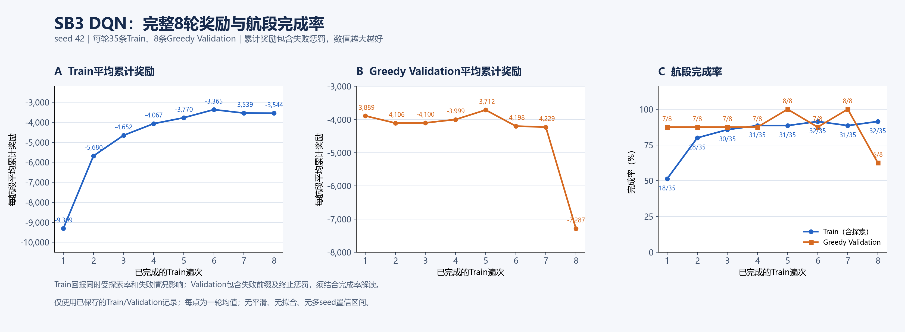

# SB3 DQN：8遍训练结果与奖励曲线

运行：`sb3_dqn_1s_seed42_run01`；分支：`feat/v6-sb3-baseline`。

实际使用官方Stable-Baselines3 2.9.0及项目`MaskedDQN`扩展，CPU、PyTorch单线程；
每秒决策，13档实际FC增量，普通DQN、单步TD、均匀Replay。
固定35条Train航段各遍历8次，共3,128,257次正式Adam更新，另有50,000步无Adam预填充。
累计有效运行83,933秒（约23.31小时，不含关机暂停）。本次提交不重新训练或评估。

## 奖励曲线

- [8轮奖励曲线数据CSV](analysis/reward_progress_round_01_08.csv)。
- [此前第1–7轮四面板图](raw/analysis/reward_progress_round_01_07.png)、[对应数据](raw/analysis/reward_progress_round_01_07.csv)。
- [逐轮选模比较CSV](raw/analysis/final_validation_selection.csv)、[冻结选模记录](raw/analysis/model_selection.json)。

纵轴为环境综合奖励的每航段累计回报均值，包含真实失败终止惩罚，不是单步奖励或Q值。
Train每个点汇总35条航段，且含逐渐降低的随机探索；Greedy Validation每个点汇总固定8条航段。
失败会缩短执行长度，因此奖励必须与完成率、覆盖率一起阅读。
图中没有新轨迹、平滑拟合或多随机种子置信区间；8遍等于280个正式Train航段episode。

## 完整结果与模型选择

| 遍次 | Train完成 | Greedy Validation完成 | Val平均累计回报 | 平均单次非零FC增量 | 全8航段经济评价成本（元） |
|---|---:|---:|---:|---:|---:|
| 1 | 18/35 | 7/8 | -3889.19 | 14.36 kW | 未全部完成 |
| 2 | 28/35 | 7/8 | -4106.25 | 25.84 kW | 未全部完成 |
| 3 | 30/35 | 7/8 | -4099.69 | 15.15 kW | 未全部完成 |
| 4 | 31/35 | 7/8 | -3999.49 | 19.84 kW | 未全部完成 |
| **5** | **31/35** | **8/8** | **-3712.04** | **20.48 kW** | **1,579,024.05** |
| 6 | 32/35 | 7/8 | -4197.56 | 21.12 kW | 未全部完成 |
| 7 | 31/35 | 8/8 | -4229.45 | 21.64 kW | 3,040,016.77 |
| 8 | 32/35 | 5/8 | -7287.09 | 33.89 kW | 未全部完成 |

按训练前确定的Validation完成数、覆盖率、全部完成后的经济成本排序，冻结选择**第5轮**。
第5、7轮均完整执行相同8条航段，可直接比较；第5轮成本较低，差异主要来自当前FC退化评价项。
第5轮并非每一种功率平稳性指标都优于第7轮，不能仅凭变载次数判断效果。
第8轮在`parent_002_seg01`、`parent_016_seg01`和`parent_044_seg01`发生SOC下限失败。
训练回报早期改善，但Greedy表现未稳定，末轮明显回退，不能宣称稳定收敛。

## 给网页版GPT的阅读路径

1. 先看本页图和[完整report.json](raw/report.json)、[训练记录CSV](raw/training_records.csv)。
2. [q_probes](raw/q_probes)：44个固定物理状态、全部13Q、合法动作排名及各checkpoint变化；CSV可以直接在GitHub浏览。
3. `raw/round_NN_validation/`：每条航段的PNG、逐秒CSV.gz及`sample_metrics.csv`。第5轮见[该目录](raw/round_05_validation)。
4. `raw/round_NN_replay_td_fit.json/.csv.gz`：普通非终止、正常终止、失败终止、失败前缀的TD拟合。
5. `raw/round_NN_train_failure_values*`和`raw/round_NN_train_failure_prefixes*`：真实Train失败与价值传播记录。
6. `raw/round_NN_failure_details.json/.csv`：失败时刻F的物理范围与13档候选，区别最后执行的F-1。
7. [实际代码](../../../src/v6_sb3)、[官方源码差异说明](../../v6_sb3_source_audit.md)、[配置与终端命令](../../v6_sb3_pycharm.md)。

TD目标不是最优Q值。不得用Loss、更新计数或某一个状态的Q值代替实际控制评估。
不得将执行前缀的低成本与完整航段成本直接比较。
最大FC增量±60 kW/s是仿真假设，不是已标定的实船爬坡能力。

## 模型和运行记录

- [第5轮选定模型](raw/models/round_05/model.zip)、[第8轮最终模型](raw/models/round_08/model.zip)。
- 第5、8轮保留完整`model.zip`、`replay.pkl`、`training_state.pt`及完成标记；
  其他轮次保留模型和训练状态，未重复归档各轮大型Replay，也不保留完整断点标记。
- [原训练入口环境记录](raw/runtime.json)、各次resume环境记录、[实际训练时源码快照](raw/source_snapshot)。
- [已有第5轮Test输出](raw/test_round_05)：仅归档用户终端已有结果，本次提交没有重新运行Test，也未据Test重选模型。

完整运行结果复制到本目录，原本地输出保留；没有删除结果、提交虚拟环境或重新处理原始数据。
