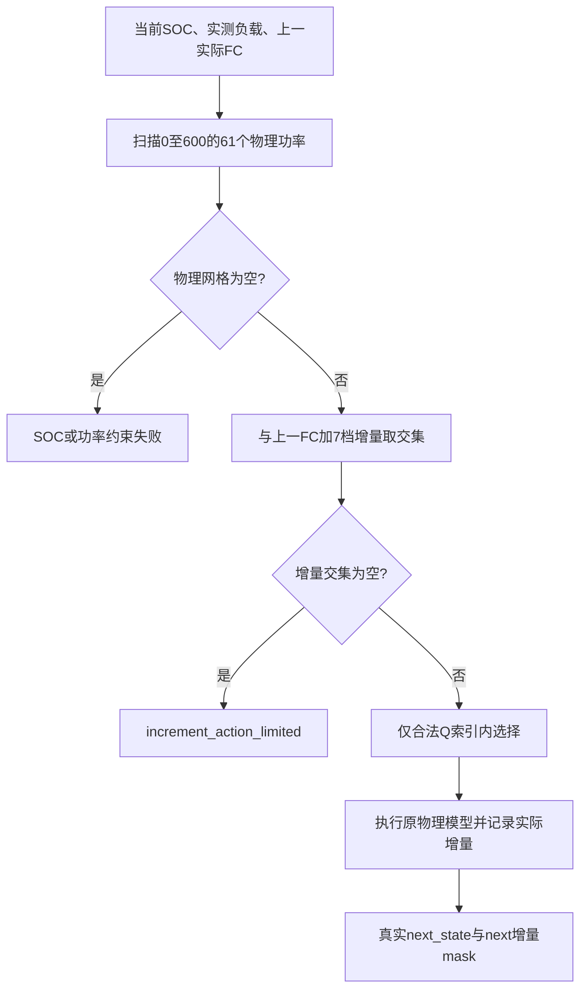

# 增量动作与物理可行性掩码只读审计

日期：2026-10-19。未修改正式代码、动作、状态、奖励、物理参数或标签；未启动训练、策略重放、测试套件或优化器；不读取Test载荷，不提交Git。

## 1. 本地身份和范围

- 当前工作树：`C:/Users/20883/OneDrive/Desktop/lstm-dqn-mpc/lstm-dqn-mpc/.worktrees/v4-increment7-zhou`。
- 当前分支 `feat/v4-increment7-zhou-td1`；HEAD `dc3c1947bc4dc400710896dfe3acca2e9ae3f54d`。既有5个tracked修改和4个untracked文件保持原状，含交错更新/replay16接口准备。
- 已完成100轮实验源码提交 `82e21cc46fef163b8680550e35252e2f7c8fa0db`，源码指纹 `3edf333281cbe23024ba2c6f2bfdd18cb3c564e2bf557ef9dca20923ca0dc812`。该实验实际为航段末集中更新；未把未训练的交错接口当成已有结果。
- 当前实时读取 `actions.py/control.py/dqn.py`，确认与实验的7档配置一致；历史报告仅用作辅助见证，未用其替代现有代码。
- 数据为 `operating_dataset_independent_v2/splits_v2_exclude046_seg01`，正式加载器只打开Train35/Validation8，验证其canonical payload SHA；五项manifest身份与运行metadata/checkpoint一致。Test仅存在分割metadata，载荷读取0。
- 第100轮78条实际档案：探索Train35、Greedy Train35、Validation8，共**30174个已执行决策状态+16个无动作的失败观测状态**。失败点没有虚构动作。
- 最终真实续训checkpoint保留的**300000条Train Replay**来自R75–100；另恢复其中210条失败终止transition的真实下一观测状态。它们不是100轮全部失败，也不与R100档案相加当独立事件。
- 所有R100状态及所有失败点调用正式 `feasible_fc_actions()`。Replay大批量采用与正式SOC函数相同运算顺序的向量化功率/SOC条件，在全部R100执行点逐一与正式标量函数核对；无近似动态模型、无MPC求解。

## 2. 当前动作、映射和调用顺序

`src/v4/actions.py:11` 的真实列表为 `(-60,-30,-10,0,10,30,60)`，绝对网格为0,10,…,600 kW。

|Q输出索引|增量kW|执行功率|
|---|---|---|
|0|-60|previous_fc_kw + (-60)|
|1|-30|previous_fc_kw + (-30)|
|2|-10|previous_fc_kw + (-10)|
|3|0|previous_fc_kw + (0)|
|4|10|previous_fc_kw + (10)|
|5|30|previous_fc_kw + (30)|
|6|60|previous_fc_kw + (60)|

映射是 `P_exec=P_prev+ΔP[index]`，**没有裁剪**。超出0–600的候选被排除，空集合保持为空；不自动切回61档。

- `actions.py:20–27` 将状态归一化引起的微小舍入恢复至10kW网格（abs_tol=1e-4）；这不是把越界动作截断到0或600。
- `actions.py:30–48` 取物理绝对可行网格与增量集合的交集。
- `dqn.py:168–200` 做功率↔Q索引双向映射；解码越界直接报错，不clip。`:202–219` 贪心和探索均只用合法索引。
- `control.py:440–460` 先构造真实当前状态，再算物理网格，再算增量交集，最后调用策略并核验实际输出。
- `control.py:577–600` 用执行后真实状态、下一已观测负载和下一段真实dt计算下一动作mask，保存实际action_index和delta；下一状态在Replay里对应下一决策时刻，不是把未来负载放进当前策略状态。
- `dqn.py:238–264`、`:357–366` 检查Replay映射；`:490–500` 用下一增量索引mask构造Masked Double-DQN目标。非终止空mask报错，不会bootstrap到非法动作。



### 边界映射实例

|上一FC|7个原始映射结果，按Q索引顺序|处理|
|---|---|---|
|0|−60,−30,−10,0,10,30,60|前三个排除，不合并成三个0|
|20|−40,−10,10,20,30,50,80|前两个排除；没有到0的−20档|
|560|500,530,550,560,570,590,620|620排除；没有到600的+40档|
|600|540,570,590,600,610,630,660|后三个排除，不合并成600|

完整28行边界映射见 `action_mapping.csv`；全部61种上一功率×7索引共427对也已枚举，无同一状态内重复映射。

## 3. 物理掩码和连续可行域

真实约束：FC0–600 kW，电池624kWh，母线充电下限−624kW、放电上限1248kW，SOC[.2,.8]，充放电效率均.95。来自 `src/v2/config.py:83–90`、`src/v2/models/battery_energy.py:81–140`、`src/v4/control.py:294–314`。

`P_bat=P_load−P_FC`；放电SOC减少 `P_bat*dt_h/(.95*624)`，充电SOC增加 `−.95*P_bat*dt_h/624`。最后不足30s的区间使用原真实dt，并未强行按30s。

从上述正式分段线性方程精确反解（不是近似电池模型）：

```
B_min = max(-624, -(0.8-SOC)*624/(0.95*dt_h))
B_max = min(1248, (SOC-0.2)*624*0.95/dt_h)
FC_min = max(0, P_load-B_max)
FC_max = min(600, P_load-B_min)
```

`FC_min>FC_max`则当前连续物理系统无解，否则为闭可行区间；与10kW绝对网格及增量网格分别相交。本次所有观察中，未发现“连续有解但61档绝对网格无解”的实例。

正式mask不含额外FC启停门控，也不含单独物理爬坡率约束；±60是**当前动作设计的单步可达范围**，不应被自动说成设备已标定的物理爬坡上限。当前不对它作任何修改。

## 4. 第100轮空掩码：完整16点

|上下文|航段|失败行(0基)|相对分钟|SOC|负载kW|上一FC kW|精确原因|最近可行增量kW|
|---|---|---|---|---|---|---|---|---|
|exploratory|parent_008_seg01|80|40.0|0.20272446|929.3426|510|当前SOC约束无解|无|
|exploratory|parent_047_seg01|116|58.0|0.20000490|722.2475|600|当前SOC约束无解|无|
|exploratory|parent_036_seg01|107|53.5|0.20537320|990.5499|570|当前SOC约束无解|无|
|exploratory|parent_021_seg01|209|104.5|0.79998418|42.2097|150|需要超过±60|-110|
|exploratory|parent_035_seg01|261|130.5|0.20018058|672.5025|600|当前SOC约束无解|无|
|exploratory|parent_029_seg01|132|66.0|0.79952421|134.7819|350|需要超过±60|-180|
|exploratory|parent_012_seg01|280|140.0|0.20137276|771.2889|590|当前SOC约束无解|无|
|exploratory|parent_010_seg02|187|93.5|0.20097660|699.4621|600|当前SOC约束无解|无|
|exploratory|parent_017_seg01|234|117.0|0.20018690|614.9788|600|当前SOC约束无解|无|
|exploratory|parent_015_seg01|163|81.5|0.20291172|1092.0353|540|当前SOC约束无解|无|
|train|parent_010_seg02|243|121.5|0.20048536|678.2365|590|当前SOC约束无解|无|
|train|parent_015_seg01|155|77.5|0.20195795|1093.0518|600|当前SOC约束无解|无|
|train|parent_017_seg01|210|105.0|0.20024355|652.2364|600|当前SOC约束无解|无|
|train|parent_036_seg01|123|61.5|0.20141996|1020.0921|580|当前SOC约束无解|无|
|validation|parent_016_seg01|254|127.0|0.20026524|786.5814|570|当前SOC约束无解|无|
|validation|parent_044_seg01|196|98.0|0.20272756|790.3425|560|±60内稀疏档位缺口|40|

分类：13点为当前SOC下的连续物理无解，2点为需要超过±60的可达性失败，1点为±60范围内的稀疏动作档位缺口。结构性功率容量无解0点，连续/绝对10kW网格冲突0点。

**“当前SOC无解”不等于“整条航段无法完成”。** 它说明策略已把系统带到该负载下无法继续供电的状态；较早储备SOC或不同FC轨迹仍可能避免进入该状态。现有015/044完整7档合法动作见证已经在此前独立审计重建，不能被这次局部无解推翻。

### 4.1 可行但不可达的明确实例

1. **Validation parent_044_seg01**，2024-07-03 10:00:22+08:00，原航段5880s，第196行（0基）。SOC=.2027275601，负载790.3425，上一FC560kW。连续可行FC区间 **[596.3147838,600] kW**，61档唯一可行动作为600，所需增量**+40**。原7档中+30只能到590（SOC不够），+60到620（越界）。13档±60网格能补回这一点，**不需要扩大最大变载**。
2. **探索Train parent_021_seg01**，2024-05-11 10:07:46+08:00，6270s。SOC=.7999841799，负载42.20972，上一FC150。连续区间[0,43.4566764]，最近可行绝对网格功率40，需**−110**。13档±60仍无解；25档±120可选−110或−120。
3. **探索Train parent_029_seg01**，2024-05-27 09:18:51+08:00，3960s。SOC=.7995242149，负载134.7819，上一FC350。连续区间[0,172.2837848]，最近可行网格170，需**−180**。13档±60和25档±120均不能直接救回当前状态。

后两点体现高SOC、FC尚高而负载下降时的局部死端。它们不证明必须扩大动作上限；提前保留充电空间、及时下调FC也可能避开，但本次未执行新策略，不虚构修复后完成率或成本。

## 5. 最终Train Replay的210个失败观测

|精确原因|状态数|占210点比例|
|---|---|---|
|当前SOC约束无解|165|78.57%|
|需要超过±60|43|20.48%|
|±60内稀疏档位缺口|2|0.95%|

45个增量不可达点中，43个需要超过±60，2个是稀疏网格缺口：

- R87 Train `parent_012_seg01`：SOC=.2024441732，负载773.8616，上一FC580，缺少**+20到600**。
- R93 Train `parent_037_seg01`：SOC=.7999391659，负载0，上一FC20，缺少**−20到0**。

全部210点的时间戳、SOC、负载、上一FC、连续可行区间、全部缺失可行增量及候选覆盖情况见 `replay_empty_mask_states.csv`，按航段和原因的计数见 `failure_reason_by_sample.csv`。它们来自保留池R75–100，不代表全部历史；与R100探索部分会重叠。

## 6. 候选集合只做离线覆盖

- 原7档：`[-60,-30,-10,0,10,30,60]`。
- 13档：`[-60,-50,...,50,60]`，最大变载仍60。
- 25档：`[-120,-110,...,110,120]`，最大变载120，仅用于区分缺档与范围不足。
- 原61档绝对功率：没有增量范围限制，最坏相邻步可变600，**不是建议自动回退方案**。

|候选|动作数|最大变载kW/步|R100失败16点恢复|Replay失败210点恢复|Replay执行状态平均合法动作数|
|---|---|---|---|---|---|
|increment7|7|60|0|0|6.4503|
|dense13_max60|13|60|1|2|11.8613|
|dense25_max120|25|120|2|20|21.3550|
|absolute61|61|600|3|45|60.4914|

以上“恢复”仅表示**同一个已访问状态恢复至少一个合法动作**，不是恢复完整航段，也不是新策略成功率。R100的30174个已执行点，以及Replay的300000个已执行点，原7档均非空——因为它们本来就是成功执行过的动作；不能把这个100%当作空掩码问题已经解决。

- R100失败点：13档仅补回1/16（6.25%），25档2/16（12.50%），绝对网格3/16（18.75%）。相对于3个“有物理解”点分别为1/3、2/3、3/3。
- Replay失败点：13档补回2/210（.95%），25档20/210（9.52%），绝对网格45/210（21.43%）。相对于45个有物理解点，分别4.44%、44.44%、100%。
- 13档可以消除当前10kW功率网格上**±60范围内所有缺档**，但不能消除超出±60的死端；不能把“改13档”承诺成解决大部分失败。
- 候选平均合法动作由6.45增至11.86或21.35，未来探索/Replay动作覆盖也需重新评价；本次未修改网络输出或重新训练。增大范围可能加剧变载，不能因覆盖率更高就直接选择±120。

## 7. 失败归类与确定性错误

### 7.1 没有发现的错误

- R100全部30174条已执行动作：实际功率等于上一实际功率加所选增量，动作索引与delta一致，边界无clip，无索引别名。
- R100物理mask、增量mask及非终止next_mask与归档分别**0处不一致**。
- Replay300000条的索引映射、执行后FC状态、非终止下一状态增量mask核对通过；本轮12517条探索经验与实际归档的动作索引、FC和delta逐条一致。
- 所有16个R100空mask点和210个Replay失败点，细分 `failure_cause`/terminal_reason 与本次按正式物理网格复算一致；没有将增量失败的细分cause错误记成SOC。
- 失败仍是任务未完成，done=True、停止bootstrap和一次失败训练罚项符合当前任务约定；局部可达性失败不是UNKNOWN，不应为美化完成率当成功/数据截断。

### 7.2 确认存在的统计命名风险

`src/v4/experiment_schedule.py:81–98` 把所有 `failure_kind=='no_feasible_action'` 汇总为 `physical_failures`，包括 `increment_action_limited`。因此**physical_failures不等于连续物理系统无解数量**。

100轮现有日志累计（仅复用report原因数，未重读旧轮全部精确状态）：

|上下文|SOC受限|增量不可达|结构功率无解|总未完成|
|---|---|---|---|---|
|exploratory_train|530|646|0|1176|
|greedy_train|506|669|0|1175|
|greedy_validation|166|152|0|318|

这些历史细分原因是代码原标签，不能借本次210个状态的比例外推全部历史缺档/超范围比例；但可以确定，若将汇总 `physical_failures` 全部解读为SOC/电池/FC容量不足，就会误读其中增量失败。

这属于**统计字段语义过宽**，不是已证实的动作索引或物理mask运算bug。按当前固定动作任务它们仍应全部算未完成；应在报告/统计中单列连续物理无解与动作可达性失败，同时保留总任务失败资格，不应删除失败记录。

## 8. 最小修复建议（未实施）

1. **先修统计表达**：在 `experiment_schedule.annotate_evaluation()` 与 `monitored_training` 摘要增加明确的 `plant_infeasible` / `action_reachability_failure` 分项，保留原总失败/完整资格及细分原因。不要用改名掩盖任务失败；这一步不需动DDQN、奖励、动作或模型。
2. **若批准动作设计变更，先验证13档±60的单变量方案**：只填补10kW增量缺档，保留最大变载60和原物理mask；同步改输出维度、动作身份/Replay验证/checkpoint恢复，必须新模型初始化，不能把7输出权重当13输出续训。它能直接修044当前+40缺口及保留池中±20缺口；不能保证控制质量或完整完成。
3. **对43个超±60死端优先区分进入原因**：低SOC/高负载时供能过晚，高SOC/负载下降时充电空间不足。保留已有015/044全程可行见证，审查较早真实动作的Q排序与能量储备；不能仅因某个局部状态需要−180或+220就断定必须扩大上限，亦不能强制FC补救或自动回退61档。
4. ±120目前仅是离线覆盖诊断；13档和范围扩展不要同时改，避免无法判断收益来自填档还是最大变载变化。本次没有冻结任何新动作集合。

**总结：有真实的离散可达性缺口，但不是主要失败的唯一来源；当前没有发现边界裁剪、动作索引或Replay映射的确定性代码错误。13档能修局部缺档，不能解决多数SOC受限和超过±60的死端，更不能据此宣称Q拟合或反向振荡已解决。**

## 9. 产物与保护

- `action_mapping.csv`：边界映射表。
- `r100_visited_state_masks.csv`：30190个真实执行/失败观测点、每套候选合法数量。
- `r100_empty_mask_states.csv`：16个失败点完整明细。
- `replay_empty_mask_states.csv`：最终Replay210个失败点完整明细。
- `candidate_coverage.csv`：候选数量、最大变载、覆盖分母及平均合法动作数。
- `all_round_logged_failure_reasons.csv`：100轮已有细分日志。
- `failure_reason_by_sample.csv`：按样本统计。
- `verification.json`、`protected_hashes_before.json`：实际身份、复核方法、0不一致及SHA保护记录。

本次保护33个源码/配置/checkpoint/档案文件，SHA前后一致，Test载荷0，训练/策略执行/优化器调用0。已有交错更新准备、数据、模型和历史产物均保留。
