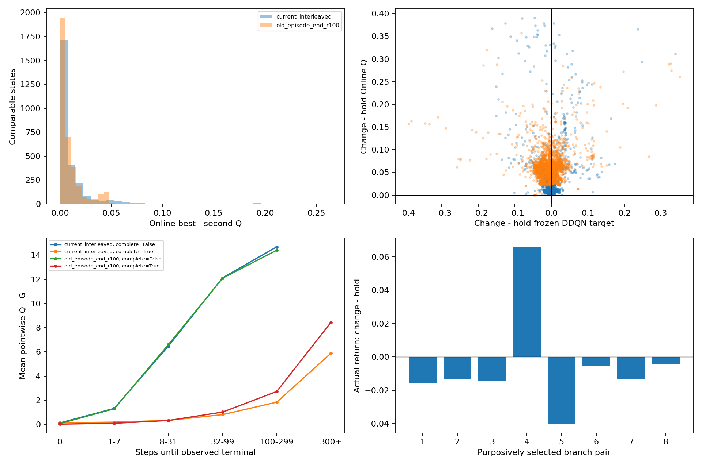
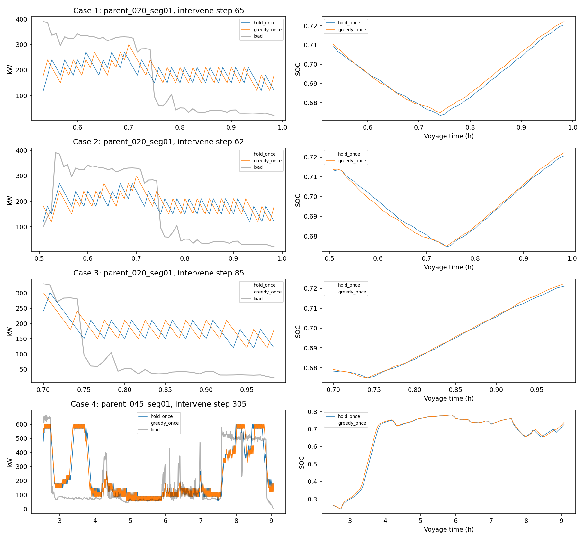

# 燃料电池频繁变载：逐状态Bellman分解与单步干预诊断

日期：2026-10-20。本次只读诊断，无正式算法修改、反向传播、训练、Test载荷读取或Git提交。既有后台基线未被中断或改动。

## 1. 结论

**频繁变载主要表现为网络形成了对变载动作的系统性相对偏好，同时存在冻结Bellman目标不一致和部分虚假的bootstrap收益。不能用“即时奖励本来鼓励振荡”或“只是两个动作几乎相等”概括。**

这是对已访问状态和固定策略的证据结论；不能据此确定唯一训练根因是学习率、PER、Target滞后、更新预算或状态不足。

- 旧R100全部Validation中，保持合法的3,647次变载，**即时奖励全部比保持差**。其中1,266次（34.71%）当前一步目标仍认为变载较好；2,381次（65.29%）连当前一步目标都更偏好保持，Online Q仍选变载。
- 固定的新交错更新R81快照，相应比例是1,086/2,639（41.15%）与1,553/2,639（58.85%）。这只是该轮诊断，不是交错更新100轮结论，不能用不同完成集合的成本证明改进。
- 8组定向单步反事实中，7组变载回报更差、1组变载确有后续收益。**8组是按现象选取的案例，不是随机总体估计；不能说全Validation有87.5%的动作错误。**
- 原020窗口三个单步保持干预均改善完整训练回报和完整经济成本。既有“150 kW整窗口”结果未冒充本次单步干预。
- 旧R100有87.91%的可比较状态把hold排在第6或7；大多数“best与second很接近”是**两个变载动作**在竞争，hold并不接近。这比单纯浮点噪声/随机排序的解释更符合证据。

## 2. 本地身份、快照与保护范围

- 当前分支：`feat/v4-increment7-zhou-td1`。
- 当前HEAD：`dc3c1947bc4dc400710896dfe3acca2e9ae3f54d`。工作区存在本轮之前的交错更新未提交改动；完整列表和逐源码SHA保存在`identity.json`，未将HEAD等同于实际源码身份。
- 旧参考：`V4-INDEP35-M3-DELTA7-ZHOU-TD1-PER-S42`，精确R100诊断权重，训练提交`82e21cc46fef163b8680550e35252e2f7c8fa0db`；checkpoint SHA `1d2b3ee1a93445dc9074ba967ae4c37ece3659fae1a1f94717c65fc02184edf7`。
- 当前参考：`V4-INDEP35-M3-DELTA7-ZHOU-TD1-PER-INTERLEAVED-S42-20261020`。读取时最后完整续训checkpoint为**R81**，只将Online/Target及身份复制到本目录的独立只读权重文件；随后不跟随后台训练更新。快照SHA `002cc04b264827e37f619041cb363406b09e016f9d4229d749f2cfe8cb72a87b`。不是用R100旧网络冒充交错更新模型。
- 两者同一数据manifest；原数据只调用`load_validation()`，8条Validation，无Train载荷重放、无Test载荷读取。所有模型CPU、eval、inference_mode，诊断进程单线程，未改变训练线程配置。
- 状态minimal3、3–128–128–7、增量[-60,-30,-10,0,10,30,60]、gamma=1、n=1、reward_scale=.001、Zhou联合奖励beta_soc=200、PER不变。差别是旧航段末更新与新交错更新，且快照轮次不同，不当作已完成的公平对照。

工作区原有变更：
```
M src/v4/control.py
 M src/v4/dqn.py
 M src/v4/feedback_study.py
 M src/v4/monitored_training.py
 M tests/test_v4_increment_entry.py
?? docs/v4_increment7_interleaved_study_2026-10-19.md
?? docs/v4_increment7_replay16_study_2026-10-18.md
?? src/v4/interleaved_replay.py
?? tests/test_v4_interleaved_updates.py
```

`readonly_verification.json`确认正式v3/v4源码、旧R100权重和本次固定新权重均未变。后台训练的`training_state_latest.pt`允许被其自身正常发布更新；诊断从未写入该文件。

## 3. 真实转移、奖励、失败和DDQN目标

实际使用路径：`control.py:build_state/feasible_fc_actions/replay_episode`、`actions.py:candidate_fc_actions`、`v3.control:EconomicMPC.interval`、`independent_economics.py:soc_equivalent_hydrogen_cost_cny`、`failure_replay.py:prepare_failure_replay`。`EconomicMPC`这里只调用正式物理经济**interval**，没有调用MPC优化器。

每一步从航段起点SOC0.6/FC0/零退化出发，按归档实际执行功率恢复完整`AccountState(SOC, previous_fc_kw, fc_loss_uv, battery_weighted_ah)`。实际与保持各调用一次正式interval，生成各自不同的SOC、FC/电池寿命和next_state；下一时刻负载仅用于离线后继转移核算，不进入当前策略状态。

正常奖励未缩放值：

`r_raw=-(C_H2_actual+C_SOC_equivalent+C_FC_degradation+C_Bat_degradation+200*(SOC_next-.6)^2+(.11025/60)*(FC-previous_FC)^2)`。

四项经济/等效成本与两个辅助惩罚分别保留；辅助惩罚不是实际人民币费用。一次失败惩罚10132.660087898294原始奖励单位，由正式失败处理函数只附加到最后真实执行动作上；缩放后10.132660087898294。正常末步done=True；若动作后下一观测无合法增量，先按正式失败语义结算为失败终止，再计算目标，禁止继续bootstrap。没有虚构失败时动作或终端充电。

`r=.001*r_raw`只缩放一次；`Y=r+(1-d)*Q_target(s',argmax_legal Q_online(s'))`。本次gamma=1，无n-step恢复、岸电/终端SOC重复加价。

统计`delta_r`是**训练语义完整的即时奖励差**（包含该步需要归属的真实失败惩罚）；`delta_r_normal`另列正常动作差。后继掩码不合法导致的正常/失败分支差异因此不会藏在bootstrap里。原020窗口没有此特殊差异。

两套快照共7,080步：Greedy动作、动作索引、mask均逐步完全复现；SOC、账本和缩放奖励最大绝对差均为0。单步边界裁剪次数0；没有伪造动作与功率映射。

## 4. 全Validation动作对比较

统计总体是“实际变载且保持在当前时刻合法”的状态，不包括已经保持或保持被真实物理约束排除的状态。各项属于不同证据维度，Online/Target冲突和小间隔不能与前两类简单相加。

|模型|全部访问步|可比较步|即时变载更差|bootstrap补偿：delta_Y>0|Q与目标相反：delta_Q>0,delta_Y<0|Online/Target最优不同|
|---|---|---|---|---|---|---|
|旧航段末更新 R100|3726|3647|3647|1266 / 34.71%|2381 / 65.29%|3029 / 83.05%|
|当前交错更新 R81|3354|2639|2639|1086 / 41.15%|1553 / 58.85%|1817 / 68.85%|

### 按航段

|模型|Validation航段|比较步|Y更偏变载|Q/Y矛盾|反向步|best-second中位数|变载-hold Q中位数|
|---|---|---|---|---|---|---|---|
|旧R100|parent_002_seg01|397|152|245|227|0.005305|0.061315|
|旧R100|parent_011_seg01|755|266|489|545|0.003718|0.050073|
|旧R100|parent_016_seg01|243|106|137|133|0.006462|0.072393|
|旧R100|parent_020_seg01|113|44|69|62|0.007465|0.055794|
|旧R100|parent_033_seg01|358|133|225|216|0.005285|0.060448|
|旧R100|parent_040_seg01|515|174|341|324|0.005115|0.061034|
|旧R100|parent_044_seg01|193|76|117|108|0.003599|0.065223|
|旧R100|parent_045_seg01|1073|315|758|761|0.004819|0.051411|
|新R81|parent_002_seg01|52|36|16|31|0.063966|0.172849|
|新R81|parent_011_seg01|603|292|311|289|0.003765|0.013425|
|新R81|parent_016_seg01|128|61|67|95|0.039147|0.072262|
|新R81|parent_020_seg01|36|10|26|0|0.010992|0.033361|
|新R81|parent_033_seg01|270|79|191|126|0.002238|0.017593|
|新R81|parent_040_seg01|459|134|325|182|0.002285|0.015366|
|新R81|parent_044_seg01|82|39|43|51|0.024849|0.061983|
|新R81|parent_045_seg01|1009|435|574|492|0.003647|0.015195|

按SOC、负载变化量、增量动作、反向/非反向的汇总见`stratified_comparison.csv`。负载变化区间为(-∞,-60]、(-60,-10]、(-10,10]、(10,60]、(60,∞)kW；SOC区间在CSV中明确列出。这些是描述分组，不是控制阈值。

### 原020的64步窗口

- 64/64即时变载更差；24/64（37.5%）Frozen Y认为bootstrap足以补偿；40/64（62.5%）Q偏好与Frozen Y相反。
- Online/Target最优不同51/64（79.6875%）；反向40次。best-second间隔中位数0.005795、P95=0.013818、最小8.93e-6。
- **变载-hold差却为中位数0.050903、最小0.034524**。不能把两个变载动作的近似并列说成“hold与变载差不多”。
- 平均delta_r=-0.007669818，delta_bootstrap=+0.001385945，delta_Y=-0.006283873，delta_Q=+0.051836504。
- 实际第54–60步FC呈180→150→210→180→150→210→180→150的循环样式（每步同时存在真实负载/SOC变化）。同一冻结网络因当前状态变化而反复选不同档，并非权重在Validation中更新。没有严格证明数学极限环，也没有仅由FC单一输入引起的因果隔离。

旧R100全Validation：hold排名6/7为3,206/3,647（87.91%）；best-second<0.001有491步（13.46%），但变载-hold<0.001仅5步。新R81的hold排名6/7为61/2,639（2.31%），但仍有1,553步Q/Y矛盾。说明排序结构发生变化，不代表已学到经济合理策略。

旧R100全轨迹有1,346个“两步非零增量相抵”窗口、1,214个“三步全非零增量净和为0”窗口；窗口可重叠，不能当作独立事件相加。完整逐航段数据见`cycle_and_hold_rank_statistics.json`。

## 5. 单步反事实：从同一个完整环境状态分支

8组代表案例，选择规则事先写在`branch_selection.json`：原020的Q/目标矛盾最大、bootstrap补偿最大、best-second最小；连续同方向；失败前低SOC；负增量SOC下降；新快照最大Q/目标差与最小间隔反向。属于定向抽样，无总体频率外推。

**没有另建近似环境。** 每个分支调用正式`replay_episode()`，先严格执行同一归档前缀重建完整寿命账本，再仅首步hold或Greedy，之后恢复同一个冻结Greedy网络。两路分支前完整状态相等、前缀SHA相同。Greedy分支的全轨迹动作/SOC和终止/失败回报重新复现原归档。首步之外无150kW保持、SOC门控、人工平滑或其他干预。

以下所有差均为“变载分支−保持分支”。训练回报大者较好，成本小者较好。两路都失败的成本只记录执行前缀，不比较完整航程经济优劣。

|案例|模型|航段|干预步|delta_r|delta_Y|delta_Q|真实delta_G|结局|完整Zhou成本差/元|
|---|---|---|---|---|---|---|---|---|---|
|1|旧R100|parent_020_seg01|65|-0.013109|-0.052574|+0.098573|-0.015411|均完成|+6.3607|
|2|旧R100|parent_020_seg01|62|-0.013371|+0.026630|+0.034524|-0.013223|均完成|+6.9224|
|3|旧R100|parent_020_seg01|85|-0.013158|+0.000714|+0.052885|-0.014123|均完成|+6.8039|
|4|旧R100|parent_045_seg01|305|-0.012934|-0.081861|+0.356834|+0.065932|均完成|+0.2257|
|5|旧R100|parent_016_seg01|246|-0.005102|-0.076683|+0.196969|-0.040282|保持soc_limited；变载soc_limited|失败前缀，非完整成本比较|
|6|旧R100|parent_016_seg01|254|-0.005111|-0.005111|+0.128572|-0.005111|保持soc_limited；变载soc_limited|失败前缀，非完整成本比较|
|7|新R81|parent_002_seg01|100|-0.004832|-0.161685|+0.367259|-0.013012|保持soc_limited；变载soc_limited|失败前缀，非完整成本比较|
|8|新R81|parent_045_seg01|1061|-0.004943|-0.004533|+0.019383|-0.004193|均完成|+2.6070|

### 代表证据

1. **020第65步：动作相对拟合明显偏差。** Q差+0.098573，Frozen Y差-0.052574，真实G差-0.015411。保持一步使完整Zhou成本少6.3607元，并减少一个后续方向反转。Q最偏好变载的状态，其当前目标和实测同策略后续回报都偏好保持。
2. **020第62步：有预测的未来收益，但收益被高估。** 即时差-0.013371，bootstrap差+0.040000，使Y差+0.026630；真实后续收益差仅约+0.000148，不足抵消即时损失，真实G差-0.013223。这里不能只说“网络没按目标拟合”，因为当前目标本身也偏向错误的同策略动作优势。
3. **020第85步：best-second极小，但hold不接近。** best-second约8.93e-6，Q变载-hold差仍+0.052885；真实G差-0.014123、成本多6.8039元。说明只处理并列档选择，未必会让它选hold。
4. **045第305步：确有未来收益的反例。** 即时差-0.012934，但变载的真实G差+0.065932，后续收益确实补偿了即时损失。两路均完成；完整Zhou成本却多0.2257元，说明改善来源包括SOC/控制辅助目标，不能把训练回报改善等同于纯经济改善。Frozen Y差-0.081861在此还错估了相反方向，Target不是正确Q真值。
5. **失败前016及新002：保持一步能少损失，却不能解除既有失败。** 两路均SOC受限失败；真实G差为-0.040282或-0.013012。只是已到达风险状态的局部干预证据，不足以证明整个航段物理无解，也不能以失败前缀成本较少宣称更经济。

每路SOC/FC/成本/奖励序列保存在`branch_XX_...csv`；完整状态、完成/失败、后缀三成本及全航段账本在`counterfactual_details.json`。后缀等效氢耗仅使用分支起终SOC差；完整评价仍用初始0.6。失败惩罚只在训练回报中，未计入Zhou成本。

## 6. Q与真实回报校准

对每个已实际执行时刻计算`G_t=sum(r_t,...,r_terminal)`，使用同一缩放、gamma=1、失败惩罚和终止语义，再与同一时刻Q(s_t,a_t)配对。不是用整段回报与Q均值直接比较。

- 旧R100失败航段：距终止0步Q-G均值0.0640；8–31步6.5975；32–99步12.0936；100–299步14.4038。
- 新R81失败航段：对应0.1204、6.4700、12.1192、14.6867。
- 正常完成航段也有随距离增加的偏差；全量逐步、分位数和分组曲线均保存。

**这些G是固定Greedy策略在已知外生负载上的单条实现，不是最优Q真值。** 当前三维状态未显式提供未来负载和航段终止信息；不同航段阶段的结果不能当作同一Markov状态的唯一标签。单凭Q-G偏大不能判定最优长期价值错误。本次较强的排序证据来自同一完整状态、相同未来负载、仅首步不同的反事实优势。





## 7. 根因证据等级与最小建议

|待区分机制|证据等级与本次结论|最小建议，均未实施|
|---|---|---|
|网络预测变载未来收益|已证实：旧34.71%、新41.15%的可比较状态其当前目标满足dr<0但dY>0|不把这些状态直接叫拟合错误；同时检验预测未来差与反事实未来差|
|未来收益高估|较强支持，特定状态已证实：020第62步预测+0.040000、实测未来仅+0.000148|先在Train同类状态区分当前目标估计偏差与Q拟合残差；不要把Target当真值或直接加SOC权重|
|Online动作优势与当前目标不一致|已证实：旧65.29%、新58.85%；020第65步反事实进一步支持其动作优势错误|优先建立Train保持/变载相对优势校准指标，在独立Train副本中固定目标、同更新预算验证共同拟合；若需更改训练，只做一个因素的受控验证，不承诺单改replay频率/学习率必然解决|
|小间隔与排序敏感|已证实存在小间隔和相邻状态最优档反复切换；尚未证明微小噪声是根因|区分best-second与change-hold；先处理价值排序，不添加动作迟滞或人为覆盖Q排名|
|Online/Target排序冲突|已证实旧83.05%、新68.85%；不能仅凭单快照确定Target滞后为主因|后续若训练已完成，再在固定更新预算下单独检验Target时间尺度；本轮不改tau|
|真实未来收益存在|案例045已证实；其余总体比例未知|保留按真实经济/控制权衡主动变载的能力，不能一律禁止变载或规定FC基荷|
|奖励缺少频率/反向次数项|代码确认无显式频率或反向项；**未证实是根因**|目前不建议再添加一项。已有变载经济成本与平方惩罚在每次变化都收费，累计值已隐含频率代价；020保持的真实回报更好，不能把该现象归咎于惩罚不够|
|保持被mask/执行限制|可比较总体均排除该原因；旧另有18、新1个变载步hold不合法；裁剪/映射不一致均0|不改mask、不加人工门控。独立处理动作可达性失败，不将其与所有振荡混为一谈|
|PER不足、共享网络梯度干扰、三维状态混叠|本轮未直接因果验证|已有旧Replay中hold88,994/300,000，反驳“全局没有保持经验”；不能由此断定局部覆盖充分。状态/采样/网络各自单变量诊断，不能同时修改|

本次没有发现必须立刻修复的动作映射或物理执行代码错误。**可以确认需要改善的是动作相对价值的可信度；尚不能把具体实现或某个超参数宣判为唯一根因。** 不直接给出“提高惩罚/增加更新/增加状态量”这种未经验证的组合修复。

## 8. 最终回答与比例边界

**两种机制都存在。** 从当前冻结目标看，旧模型约34.7%属于“估计未来收益可抵消即时损失”，约65.3%属于“Online依然偏变载、但当前目标已偏保持”；新R81对应41.2%与58.8%。后者不是单纯没有长期传播通道，而是当前动作优势未与自身目标对齐。

这两个比例是完整可比较Validation状态的精确计数，**不是现实正确/错误动作的比例**。实际未来收益是否存在，本轮8个定向分支里1个存在、7个不存在；样本不足以给全Validation的真实因果占比。Online/Target冲突、小间隔、状态阶段不确定性可以同时出现，不能互斥归因。

最小下一步是待现有基线完成后，按同一固定Validation集合继续使用这些“动作优势—目标优势—反事实优势”指标检验学习质量；如需学习机制实验，先在Train副本控制单一因素验证动作优势共同拟合。**本轮不修改正式模型、奖励、状态、动作、损失、PER、学习率或Target参数，也不启动新的完整训练。**

## 9. 文件索引

- `identity.json`、`reproduction_verification.json`、`readonly_verification.json`：身份、全步复现、只读保护。
- `per_step_action_comparison.csv`：6,286行比较；各动作Q、actual/hold物理结果、全部奖励分项、r/Y/Q/bootstrap差、方向标记。
- `all_legal_action_q.csv`：每个可比较状态所有合法增量、实际FC、Online/Target Q和排名。
- `stratified_comparison.csv`、`gap_and_reward_difference_statistics.csv`：分航段/SOC/负载变化/动作及Q间隔分布。
- `all_validation_state_calibration.csv`：全部7,080步的同一时刻Q/G校准。
- `q_return_calibration_by_distance.csv`：按距终止步数与完成状态的均值、分位数。
- `counterfactual_summary.csv`、`counterfactual_future_value_decomposition.csv`、`counterfactual_details.json`：精确单步分支、未来差分及完整账本。
- `diagnose.py`、`write_report.py`：本目录诊断代码；不在正式src中。
