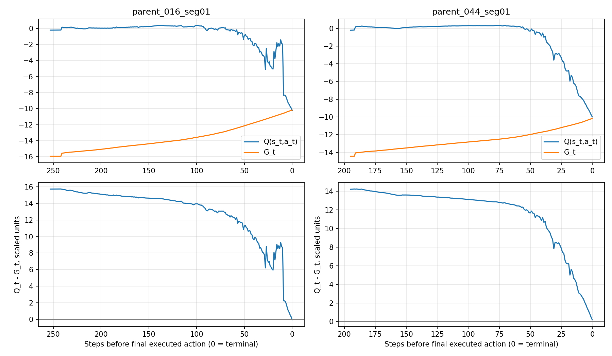

# 统计口径纠正、交错更新基线与缩放对照阶段记录

日期：2026-10-20。分支`feat/v4-increment7-zhou-td1`，HEAD`dc3c1947bc4dc400710896dfe3acca2e9ae3f54d`。本次未修改正式src、数据、算法或超参数，保留此前未提交的交错接口。

## 一、确定的统计口径问题与纠正

旧实验ID：`V4-INDEP35-M3-DELTA7-ZHOU-TD1-PER-S42`；输出`v4_independent35_m3_delta7_zhou_td1_per_seed42_100r`，训练源码提交`82e21cc46fef163b8680550e35252e2f7c8fa0db`。以下所有旧数值都来自该运行，但**范围不一样**。

|范围|真实执行动作步|Replay新增|Adam更新|Target软更新|
|---|---:|---:|---:|---:|
|bootstrap|14995|14995|468|468|
|正式探索Train R1–100|1098846|1098846|34339|34339|
|训练累计含bootstrap|1113841|1113841|34807|34807|
|全部Greedy评价累计|1445749|0|0|0|
|仅R100探索Train|12517|12517|391|391|
|仅R100 Greedy Train|13931|0|0|0|
|仅R100 Greedy Validation|3726|0|0|0|

30174=12517+13931+3726，是第100轮三种上下文的实际执行动作合计；**不是34807次更新的训练分母**。此前并列呈现这些数字容易误导，现统一运行ID和scope，不能用34807/30174计算UTD。

累计对账：`14995+1098846=1113841=34807*32+17`。故累计UTD为34807/1113841≈.0312495；末尾17条是未消费credit，Target初始复制另有1次不属于软更新。bootstrap末credit19，R100起credit12、末17，跨范围计数应考虑carry。bootstrap与正式训练分开后，不能要求每段都恰为整数1/32。

环境步在此定义为真实执行的30s或最后不足30s的有效动作区间；无合法动作的失败观测不虚构一步。Replay是n=1每个有效动作的入池条目；评价动作只计评价环境步，不入池、不更新。故“同一运行”不意味着不同计数范围可直接相除。

## 二、Validation失败逐点Q/G复核

用第100轮真实checkpoint，CPU/eval/inference_mode重新检查450个失败路径实际状态的Q，和既有NumPy值最大差1.91e-6。每个时间点严格配对：

`G_t=sum_(j=t)^(最后真实执行动作) r_scaled,j`，gamma=1、scale=.001，末步原失败罚一次、无虚构终端补能、终止后不bootstrap。

两个航段为Validation016（254个已执行动作）和044（196个）。逐点重新从原始档案反向累计G，与此前保存的逐点G误差为0。**此前“Q均值约+.15 vs回报约−14”实际也是同一批时间点的Q_t与G_t均值，但文字没有说清不是整航段单个总回报；本次改用每点差值及其分位数，不再用模糊的均值对照作为主要证据。**

距离定义：最后一个已执行动作的距离为0；下一无动作失败观测不另造动作。

|航段|距最后有效动作步数|点数|Q_t−G_t均值|绝对误差中位数|绝对P95|绝对P99|
|---|---|---|---|---|---|---|
|parent_016_seg01|0–7|8|0.97913|0.90165|2.01440|2.11329|
|parent_016_seg01|8–31|24|7.26990|7.90108|9.04537|9.22827|
|parent_016_seg01|32–99|68|12.03631|12.51822|13.79806|13.90589|
|parent_016_seg01|100–100000|154|14.88648|14.86245|15.73272|15.73965|
|parent_044_seg01|0–7|8|1.28624|1.28362|2.27500|2.37203|
|parent_044_seg01|8–31|24|5.92505|6.21586|8.49319|8.50246|
|parent_044_seg01|32–99|68|12.15091|12.59068|13.06873|13.10291|
|parent_044_seg01|100–100000|96|13.62948|13.57096|14.22203|14.24142|

这是**有证据的价值校准异常**：离失败远时对该Greedy实际路径明显乐观，近端误差较小。但G不是精确最优Q；当前状态不完全可观测、拟合不足、bootstrap偏差与更新时序均可能影响，不能据此认定某个未执行动作必能完成航段。044含动作可达性失败，不应与016的SOC耗尽混为单一原因。

## 三、210个Replay失败点的来源与重复

- 来源为最终保留的Train Replay R75–100，不是全部100轮，也不含Validation；每条为一次实际失败前的最后有效动作终止经验。
- 210个不同的`(round,sample,失败行)`事件；按原始双精度`(SOC,load,previous_FC)`精确比较，**210个唯一状态，精确重复0次**。
- 相同`(sample,失败行)`有164个位置，另46次为跨轮重复落到同一位置，但SOC/FC状态不同；位置重复不等于同一经验被重复入池。明细见两张multiplicity CSV。
- 每次抽样可以跨batch反复抽到同一条；历史每条抽取次数未完整保存，不能将210唯一状态称为210个独立同分布样本，也不能据此推断训练时未重复学习。
- 从26个旧探索轨迹压缩档案逐条定位并核对300000条Replay的原始奖励、动作来源；最大缩放reward误差1.11e-16，210条失败末步均done=True、nextmask空、失败罚一次。

精确原因：165个当前SOC下连续物理无解、43个有物理解但需要超过±60、2个±60内缺档；结构性功率容量无解0。

这三者不是三个互斥的全程因果结论：“当前物理无解/动作不可达”描述失败时刻；“前序控制导致储备低”描述形成过程，两者可同时成立。165点表明当时SOC不足，不能全归动作缺陷，也不能在无反事实时逐点断言全部可通过更早充电避免。已有015与044全航段合法见证支持这两个样本在名义模型下可完成，但没有逐点证明切换动作就能挽救既有失败路径。

细分cause没有错标；原`physical_failures`汇总却包含增量不可达，语义过宽。保持总任务未完成资格，不通过忽略增量失败改善完成率。

## 四、奖励份额的范围纠正

下列分项为缩放前值；SOC辅助/平方辅助/失败罚是训练等效量，非真实人民币支出。份额分母为该scope逐步各项**绝对值**总和；净SOC等效累计单独有符号保留。主导频率为每个scope全部步的比例，全0分项步不算任何项主导；并列项允许共同主导。

### R100 Greedy train / completed

|分项|步数|绝对中位数|绝对P95|有符号累计|绝对份额|主导频率|
|---|---|---|---|---|---|---|
|实际氢耗|13200|2.1936|5.9985|35120.39|15.34%|13.08%|
|SOC等效氢耗|13200|0.7629|4.3102|-1882.48|6.94%|3.22%|
|FC退化|13200|4.5788|7.8863|78353.41|34.22%|55.27%|
|电池退化|13200|0.1328|1.1097|3510.64|1.53%|0.00%|
|SOC辅助|13200|2.3293|21.2758|62224.74|27.18%|28.25%|
|平方变载辅助|13200|1.6538|6.6150|33865.49|14.79%|0.00%|
|失败罚|13200|0.0000|0.0000|0.00|0.00%|0.00%|
### R100 Greedy train / failed_prefix

|分项|步数|绝对中位数|绝对P95|有符号累计|绝对份额|主导频率|
|---|---|---|---|---|---|---|
|实际氢耗|731|4.3334|5.9985|2796.43|4.71%|13.68%|
|SOC等效氢耗|731|1.9808|7.2094|1145.42|3.38%|18.06%|
|FC退化|731|4.7750|8.0825|5001.46|8.43%|30.78%|
|电池退化|731|0.4966|2.2207|565.53|0.95%|0.00%|
|SOC辅助|731|3.4642|29.7697|6732.51|11.35%|36.66%|
|平方变载辅助|731|1.6538|6.6150|1685.91|2.84%|0.00%|
|失败罚|731|0.0000|0.0000|40530.64|68.33%|0.55%|
### R100 Greedy validation / completed

|分项|步数|绝对中位数|绝对P95|有符号累计|绝对份额|主导频率|
|---|---|---|---|---|---|---|
|实际氢耗|3276|2.4963|5.9985|9302.42|17.04%|16.79%|
|SOC等效氢耗|3276|0.8982|4.4939|-626.86|7.72%|3.08%|
|FC退化|3276|4.5788|7.8863|19016.38|34.84%|57.66%|
|电池退化|3276|0.1554|1.1751|911.93|1.67%|0.00%|
|SOC辅助|3276|2.4702|16.7262|12851.52|23.55%|22.31%|
|平方变载辅助|3276|1.6538|6.6150|8284.92|15.18%|0.00%|
|失败罚|3276|0.0000|0.0000|0.00|0.00%|0.00%|
### R100 Greedy validation / failed_prefix

|分项|步数|绝对中位数|绝对P95|有符号累计|绝对份额|主导频率|
|---|---|---|---|---|---|---|
|实际氢耗|450|3.6921|5.9985|1668.57|5.42%|5.78%|
|SOC等效氢耗|450|1.8967|4.8422|572.04|3.21%|8.00%|
|FC退化|450|4.5788|8.0825|2929.94|9.52%|49.33%|
|电池退化|450|0.4385|1.4163|257.72|0.84%|0.00%|
|SOC辅助|450|2.8677|27.0163|3612.80|11.74%|36.00%|
|平方变载辅助|450|1.6538|6.6150|1061.52|3.45%|0.00%|
|失败罚|450|0.0000|0.0000|20265.32|65.83%|0.44%|
### 最终保留Replay全部300000条 / 不按PER概率加权

|分项|绝对中位数|绝对P95|有符号累计|绝对份额|主导频率|
|---|---|---|---|---|---|
|实际氢耗|1.8971|5.8798|741292.77|10.31%|17.55%|
|SOC等效氢耗|0.6979|3.9307|62262.62|4.98%|6.83%|
|FC退化|2.3738|7.8863|1425324.93|19.82%|32.43%|
|电池退化|0.1416|1.1717|92617.77|1.29%|0.00%|
|SOC辅助|2.6961|24.1591|2002968.47|27.85%|42.96%|
|平方变载辅助|0.1837|6.6150|443420.17|6.17%|0.03%|
|失败罚|0.0000|0.0000|2127858.62|29.59%|0.07%|

Greedy Train与Validation分别按完整/失败前缀报告，不能把失败前缀较短累计称为经济更优。Replay是R75–100保留条目的分布，不是完整航段经济评价，不与31个完整Greedy Train总额直接比较。该Replay中普通/失败标签的分组明细保存在CSV。

所有300000条均由原始档案分项对账，而非用三维Replay猜测缺失的退化账本状态。Replay失败罚的绝对累计份额约29.59%，与完整Greedy集合0%不同是scope差异。R100真实PER每64条固定失败终止配额2；实际抽样分布不等于Replay逐条等权分布，不能拿本表当IS加权梯度贡献。历史采样成本分项未记录，保持未知。

## 五、正式交错基线（已启动，未宣称完成）

新实验ID：`V4-INDEP35-M3-DELTA7-ZHOU-TD1-PER-INTERLEAVED-S42-20261020`。

新输出目录：`outputs/v4_independent35_m3_delta7_zhou_td1_per_interleaved_seed42_100r_20261020`。

独立进程启动信息：`outputs/_launches/interleaved_baseline_20261020.json`，stdout/stderr均在同目录。PID22996。100轮预算，从新seed42网络、空Replay、新Adam开始，没有resume参数；只有这一组训练。

固定minimal3、原7档增量、Zhou联合奖励、SOC beta200、scale=.001、SmoothL1 beta1、PER .6/1/1e-6、quota2、gamma1/n1、Batch64、lr.001、replay32/tau.001。唯一实验因素是旧集中更新→已有交错更新接口。未改正式源码，HEAD与未提交源码身份由新metadata记录。

每轮记录探索、Greedy Train、Greedy Validation、插入/Adam/Target/credit计数，区分callback/failure_finalize/episode_end更新；每航段实际轨迹与失败记录保留。固定1/10/…/100轮保存诊断快照，每个完整轮保存续训状态。报告中的执行计数对应新实验ID，不和旧运行混算。

此文件不在训练过程中伪造实时完成数；最新状态以新run的metadata、report及train.log为准。未完成时不能给最终成功率、经济优势或“已改善”的结论。

### 已取得的首个完整轮次（观察快照，后续运行仍在继续）

第1轮完整保存，正在第2轮；探索5/35，Greedy Train16/35，Validation2/8，尚不合格。首轮有效动作/Replay新增5660，Adam177，其中航段内callback174、失败确认3、航段结束额外0。含bootstrap累计执行/入池20655、Adam645、Target软更新645、初始复制1、剩余credit15：`20655=645*32+15`，累计UTD=.03122731；首轮单独UTD=177/5660=.03127208。两者略偏1/32来自credit跨范围，不是重复更新。

与旧组的初始固定状态Q探针完全相同，新metadata明确新seed权重、空Replay、新Adam，无旧checkpoint载入。每航段78条结果（探索35、Greedy Train35、Validation8）保存为`baseline_round001_episode_results.csv`；同一新运行ID的首轮完整指标和计数见`baseline_round001_valid_results.json`。`training_state_latest.pt`已存在，至少具备首轮完整恢复点；当前运行勿重复启动或恢复。

第1轮观察不能判断收敛、改善或劣化；尤其不与旧组不同完成集合的成本总额直接比较。阶段二100轮尚未完成，阶段三条件尚未满足。

## 六、阶段三缩放实验：条件尚未满足，未启动

|组|scale|SmoothL1 beta|预留独立目录|
|---|---:|---:|---|
|A|.001|1|`outputs/v4_scale_interleaved_A_s001_b1_seed42_NEW`|
|B|1|1|`outputs/v4_scale_interleaved_B_s1_b1_seed42_NEW`|
|C|1|1000|`outputs/v4_scale_interleaved_C_s1_b1000_seed42_NEW`|

当前正式CLI仍只允许scale=.001，Agent中SmoothL1 beta仍固定1。**B/C没有现成可执行正式命令，不能把不存在的`--loss-beta`参数编造进命令。** 本轮基线运行中不改src以免破坏源代码指纹和续训身份。按用户“基线完成并对账后再准备”的顺序，B/C参数透传、身份校验和精确匹配预算接口留待基线结束后处理，不把阶段三标成已交付或已训练。

三组后续应采用新初始化、空Replay、新Adam、相同Train35/Validation8/seed42、相同环境与梯度预算和epsilon暴露；不续训本轮基线。固定验证切点比较逐类TD P95/P99、IS/梯度/实际Adam位移、Q间隔、完整供电率、同集合Zhou成本、SOC及FC反向变载。

既有入口按轮安排epsilon且失败长度影响环境步数，所以“各100轮”不能自动满足同环境/更新预算。基线数据完成后需明确共同步数与epsilon协议，而非悄悄放宽控制条件。本次没有启动第二组，也没有同步改动作、状态、奖励或损失。

### 本轮启动/恢复命令

可复制的同配置命令保存在本目录 `baseline_commands.ps1`；运行已在后台开始，**不要再执行启动段制造第二个同配置进程**。只有当前PID已退出且存在完整轮checkpoint时，才使用恢复段；未完整轮不算完成，会按原机制重做。

## 七、结论分类

- **确定代码问题**：本轮没有新增确认的DDQN/损失/PER算法错误；不把算法审计通过称为算法收敛。
- **确定统计问题**：累计更新与R100三阶段步数范围不同；“physical_failures”不能全解释为连续物理系统无解；Q/G均值表述须明确逐点配对；奖励份额须区分完整、前缀、保留Replay及抽样分布。
- **价值学习异常证据**：450点同时间Q/G存在明显正偏差，尤其远离失败时；不等于已定位唯一根因。
- **待验证假设**：交错更新能否改善、缩放/Huber相对尺度是否影响共同拟合、隐藏阶段信息是否必要。当前只执行交错基线，不以Loss下降判定闭环提升。

未改历史权重、Replay、日志或结果；Test载荷0。阶段一旧文件SHA保护检查一致。阶段二运行中，阶段三未启动。
