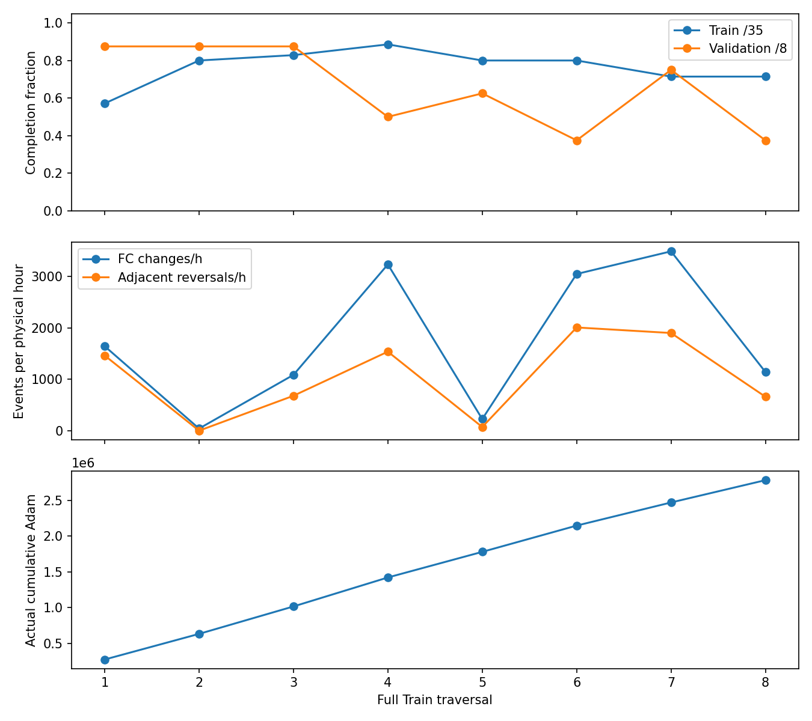

# 全部功率/SOC图与完整轨迹

正式run02共8轮×8条Validation。PNG为已有控制曲线；CSV.gz为原始每1秒记录，包含全部13动作Q与合法排名。

## 第1轮

|航段|结果|功率/SOC图|完整1秒轨迹|失败前300秒|
|---|---|---|---|---|
|parent_002_seg01|完成|[PNG](raw/run02/round_01_validation/parent_002_seg01.png)|[CSV.gz](raw/run02/round_01_validation/parent_002_seg01.csv.gz)|—|
|parent_011_seg01|完成|[PNG](raw/run02/round_01_validation/parent_011_seg01.png)|[CSV.gz](raw/run02/round_01_validation/parent_011_seg01.csv.gz)|—|
|parent_016_seg01|完成|[PNG](raw/run02/round_01_validation/parent_016_seg01.png)|[CSV.gz](raw/run02/round_01_validation/parent_016_seg01.csv.gz)|—|
|parent_020_seg01|完成|[PNG](raw/run02/round_01_validation/parent_020_seg01.png)|[CSV.gz](raw/run02/round_01_validation/parent_020_seg01.csv.gz)|—|
|parent_033_seg01|完成|[PNG](raw/run02/round_01_validation/parent_033_seg01.png)|[CSV.gz](raw/run02/round_01_validation/parent_033_seg01.csv.gz)|—|
|parent_040_seg01|完成|[PNG](raw/run02/round_01_validation/parent_040_seg01.png)|[CSV.gz](raw/run02/round_01_validation/parent_040_seg01.csv.gz)|—|
|parent_044_seg01|失败|[PNG](raw/run02/round_01_validation/parent_044_seg01.png)|[CSV.gz](raw/run02/round_01_validation/parent_044_seg01.csv.gz)|[CSV](browser/validation_failure_windows/round_01_parent_044_seg01_last300s.csv)|
|parent_045_seg01|完成|[PNG](raw/run02/round_01_validation/parent_045_seg01.png)|[CSV.gz](raw/run02/round_01_validation/parent_045_seg01.csv.gz)|—|

[本轮30秒抽取概览](browser/validation_30s/round_01.csv)；变载精确统计请用原1秒轨迹或已有逐航段指标。

## 第2轮

|航段|结果|功率/SOC图|完整1秒轨迹|失败前300秒|
|---|---|---|---|---|
|parent_002_seg01|完成|[PNG](raw/run02/round_02_validation/parent_002_seg01.png)|[CSV.gz](raw/run02/round_02_validation/parent_002_seg01.csv.gz)|—|
|parent_011_seg01|完成|[PNG](raw/run02/round_02_validation/parent_011_seg01.png)|[CSV.gz](raw/run02/round_02_validation/parent_011_seg01.csv.gz)|—|
|parent_016_seg01|完成|[PNG](raw/run02/round_02_validation/parent_016_seg01.png)|[CSV.gz](raw/run02/round_02_validation/parent_016_seg01.csv.gz)|—|
|parent_020_seg01|完成|[PNG](raw/run02/round_02_validation/parent_020_seg01.png)|[CSV.gz](raw/run02/round_02_validation/parent_020_seg01.csv.gz)|—|
|parent_033_seg01|完成|[PNG](raw/run02/round_02_validation/parent_033_seg01.png)|[CSV.gz](raw/run02/round_02_validation/parent_033_seg01.csv.gz)|—|
|parent_040_seg01|完成|[PNG](raw/run02/round_02_validation/parent_040_seg01.png)|[CSV.gz](raw/run02/round_02_validation/parent_040_seg01.csv.gz)|—|
|parent_044_seg01|失败|[PNG](raw/run02/round_02_validation/parent_044_seg01.png)|[CSV.gz](raw/run02/round_02_validation/parent_044_seg01.csv.gz)|[CSV](browser/validation_failure_windows/round_02_parent_044_seg01_last300s.csv)|
|parent_045_seg01|完成|[PNG](raw/run02/round_02_validation/parent_045_seg01.png)|[CSV.gz](raw/run02/round_02_validation/parent_045_seg01.csv.gz)|—|

[本轮30秒抽取概览](browser/validation_30s/round_02.csv)；变载精确统计请用原1秒轨迹或已有逐航段指标。

## 第3轮

|航段|结果|功率/SOC图|完整1秒轨迹|失败前300秒|
|---|---|---|---|---|
|parent_002_seg01|完成|[PNG](raw/run02/round_03_validation/parent_002_seg01.png)|[CSV.gz](raw/run02/round_03_validation/parent_002_seg01.csv.gz)|—|
|parent_011_seg01|完成|[PNG](raw/run02/round_03_validation/parent_011_seg01.png)|[CSV.gz](raw/run02/round_03_validation/parent_011_seg01.csv.gz)|—|
|parent_016_seg01|完成|[PNG](raw/run02/round_03_validation/parent_016_seg01.png)|[CSV.gz](raw/run02/round_03_validation/parent_016_seg01.csv.gz)|—|
|parent_020_seg01|完成|[PNG](raw/run02/round_03_validation/parent_020_seg01.png)|[CSV.gz](raw/run02/round_03_validation/parent_020_seg01.csv.gz)|—|
|parent_033_seg01|完成|[PNG](raw/run02/round_03_validation/parent_033_seg01.png)|[CSV.gz](raw/run02/round_03_validation/parent_033_seg01.csv.gz)|—|
|parent_040_seg01|完成|[PNG](raw/run02/round_03_validation/parent_040_seg01.png)|[CSV.gz](raw/run02/round_03_validation/parent_040_seg01.csv.gz)|—|
|parent_044_seg01|失败|[PNG](raw/run02/round_03_validation/parent_044_seg01.png)|[CSV.gz](raw/run02/round_03_validation/parent_044_seg01.csv.gz)|[CSV](browser/validation_failure_windows/round_03_parent_044_seg01_last300s.csv)|
|parent_045_seg01|完成|[PNG](raw/run02/round_03_validation/parent_045_seg01.png)|[CSV.gz](raw/run02/round_03_validation/parent_045_seg01.csv.gz)|—|

[本轮30秒抽取概览](browser/validation_30s/round_03.csv)；变载精确统计请用原1秒轨迹或已有逐航段指标。

## 第4轮

|航段|结果|功率/SOC图|完整1秒轨迹|失败前300秒|
|---|---|---|---|---|
|parent_002_seg01|失败|[PNG](raw/run02/round_04_validation/parent_002_seg01.png)|[CSV.gz](raw/run02/round_04_validation/parent_002_seg01.csv.gz)|[CSV](browser/validation_failure_windows/round_04_parent_002_seg01_last300s.csv)|
|parent_011_seg01|完成|[PNG](raw/run02/round_04_validation/parent_011_seg01.png)|[CSV.gz](raw/run02/round_04_validation/parent_011_seg01.csv.gz)|—|
|parent_016_seg01|失败|[PNG](raw/run02/round_04_validation/parent_016_seg01.png)|[CSV.gz](raw/run02/round_04_validation/parent_016_seg01.csv.gz)|[CSV](browser/validation_failure_windows/round_04_parent_016_seg01_last300s.csv)|
|parent_020_seg01|完成|[PNG](raw/run02/round_04_validation/parent_020_seg01.png)|[CSV.gz](raw/run02/round_04_validation/parent_020_seg01.csv.gz)|—|
|parent_033_seg01|完成|[PNG](raw/run02/round_04_validation/parent_033_seg01.png)|[CSV.gz](raw/run02/round_04_validation/parent_033_seg01.csv.gz)|—|
|parent_040_seg01|完成|[PNG](raw/run02/round_04_validation/parent_040_seg01.png)|[CSV.gz](raw/run02/round_04_validation/parent_040_seg01.csv.gz)|—|
|parent_044_seg01|失败|[PNG](raw/run02/round_04_validation/parent_044_seg01.png)|[CSV.gz](raw/run02/round_04_validation/parent_044_seg01.csv.gz)|[CSV](browser/validation_failure_windows/round_04_parent_044_seg01_last300s.csv)|
|parent_045_seg01|失败|[PNG](raw/run02/round_04_validation/parent_045_seg01.png)|[CSV.gz](raw/run02/round_04_validation/parent_045_seg01.csv.gz)|[CSV](browser/validation_failure_windows/round_04_parent_045_seg01_last300s.csv)|

[本轮30秒抽取概览](browser/validation_30s/round_04.csv)；变载精确统计请用原1秒轨迹或已有逐航段指标。

## 第5轮

|航段|结果|功率/SOC图|完整1秒轨迹|失败前300秒|
|---|---|---|---|---|
|parent_002_seg01|失败|[PNG](raw/run02/round_05_validation/parent_002_seg01.png)|[CSV.gz](raw/run02/round_05_validation/parent_002_seg01.csv.gz)|[CSV](browser/validation_failure_windows/round_05_parent_002_seg01_last300s.csv)|
|parent_011_seg01|完成|[PNG](raw/run02/round_05_validation/parent_011_seg01.png)|[CSV.gz](raw/run02/round_05_validation/parent_011_seg01.csv.gz)|—|
|parent_016_seg01|失败|[PNG](raw/run02/round_05_validation/parent_016_seg01.png)|[CSV.gz](raw/run02/round_05_validation/parent_016_seg01.csv.gz)|[CSV](browser/validation_failure_windows/round_05_parent_016_seg01_last300s.csv)|
|parent_020_seg01|完成|[PNG](raw/run02/round_05_validation/parent_020_seg01.png)|[CSV.gz](raw/run02/round_05_validation/parent_020_seg01.csv.gz)|—|
|parent_033_seg01|完成|[PNG](raw/run02/round_05_validation/parent_033_seg01.png)|[CSV.gz](raw/run02/round_05_validation/parent_033_seg01.csv.gz)|—|
|parent_040_seg01|完成|[PNG](raw/run02/round_05_validation/parent_040_seg01.png)|[CSV.gz](raw/run02/round_05_validation/parent_040_seg01.csv.gz)|—|
|parent_044_seg01|失败|[PNG](raw/run02/round_05_validation/parent_044_seg01.png)|[CSV.gz](raw/run02/round_05_validation/parent_044_seg01.csv.gz)|[CSV](browser/validation_failure_windows/round_05_parent_044_seg01_last300s.csv)|
|parent_045_seg01|完成|[PNG](raw/run02/round_05_validation/parent_045_seg01.png)|[CSV.gz](raw/run02/round_05_validation/parent_045_seg01.csv.gz)|—|

[本轮30秒抽取概览](browser/validation_30s/round_05.csv)；变载精确统计请用原1秒轨迹或已有逐航段指标。

## 第6轮

|航段|结果|功率/SOC图|完整1秒轨迹|失败前300秒|
|---|---|---|---|---|
|parent_002_seg01|失败|[PNG](raw/run02/round_06_validation/parent_002_seg01.png)|[CSV.gz](raw/run02/round_06_validation/parent_002_seg01.csv.gz)|[CSV](browser/validation_failure_windows/round_06_parent_002_seg01_last300s.csv)|
|parent_011_seg01|失败|[PNG](raw/run02/round_06_validation/parent_011_seg01.png)|[CSV.gz](raw/run02/round_06_validation/parent_011_seg01.csv.gz)|[CSV](browser/validation_failure_windows/round_06_parent_011_seg01_last300s.csv)|
|parent_016_seg01|失败|[PNG](raw/run02/round_06_validation/parent_016_seg01.png)|[CSV.gz](raw/run02/round_06_validation/parent_016_seg01.csv.gz)|[CSV](browser/validation_failure_windows/round_06_parent_016_seg01_last300s.csv)|
|parent_020_seg01|完成|[PNG](raw/run02/round_06_validation/parent_020_seg01.png)|[CSV.gz](raw/run02/round_06_validation/parent_020_seg01.csv.gz)|—|
|parent_033_seg01|完成|[PNG](raw/run02/round_06_validation/parent_033_seg01.png)|[CSV.gz](raw/run02/round_06_validation/parent_033_seg01.csv.gz)|—|
|parent_040_seg01|完成|[PNG](raw/run02/round_06_validation/parent_040_seg01.png)|[CSV.gz](raw/run02/round_06_validation/parent_040_seg01.csv.gz)|—|
|parent_044_seg01|失败|[PNG](raw/run02/round_06_validation/parent_044_seg01.png)|[CSV.gz](raw/run02/round_06_validation/parent_044_seg01.csv.gz)|[CSV](browser/validation_failure_windows/round_06_parent_044_seg01_last300s.csv)|
|parent_045_seg01|失败|[PNG](raw/run02/round_06_validation/parent_045_seg01.png)|[CSV.gz](raw/run02/round_06_validation/parent_045_seg01.csv.gz)|[CSV](browser/validation_failure_windows/round_06_parent_045_seg01_last300s.csv)|

[本轮30秒抽取概览](browser/validation_30s/round_06.csv)；变载精确统计请用原1秒轨迹或已有逐航段指标。

## 第7轮

|航段|结果|功率/SOC图|完整1秒轨迹|失败前300秒|
|---|---|---|---|---|
|parent_002_seg01|完成|[PNG](raw/run02/round_07_validation/parent_002_seg01.png)|[CSV.gz](raw/run02/round_07_validation/parent_002_seg01.csv.gz)|—|
|parent_011_seg01|完成|[PNG](raw/run02/round_07_validation/parent_011_seg01.png)|[CSV.gz](raw/run02/round_07_validation/parent_011_seg01.csv.gz)|—|
|parent_016_seg01|失败|[PNG](raw/run02/round_07_validation/parent_016_seg01.png)|[CSV.gz](raw/run02/round_07_validation/parent_016_seg01.csv.gz)|[CSV](browser/validation_failure_windows/round_07_parent_016_seg01_last300s.csv)|
|parent_020_seg01|完成|[PNG](raw/run02/round_07_validation/parent_020_seg01.png)|[CSV.gz](raw/run02/round_07_validation/parent_020_seg01.csv.gz)|—|
|parent_033_seg01|完成|[PNG](raw/run02/round_07_validation/parent_033_seg01.png)|[CSV.gz](raw/run02/round_07_validation/parent_033_seg01.csv.gz)|—|
|parent_040_seg01|完成|[PNG](raw/run02/round_07_validation/parent_040_seg01.png)|[CSV.gz](raw/run02/round_07_validation/parent_040_seg01.csv.gz)|—|
|parent_044_seg01|失败|[PNG](raw/run02/round_07_validation/parent_044_seg01.png)|[CSV.gz](raw/run02/round_07_validation/parent_044_seg01.csv.gz)|[CSV](browser/validation_failure_windows/round_07_parent_044_seg01_last300s.csv)|
|parent_045_seg01|完成|[PNG](raw/run02/round_07_validation/parent_045_seg01.png)|[CSV.gz](raw/run02/round_07_validation/parent_045_seg01.csv.gz)|—|

[本轮30秒抽取概览](browser/validation_30s/round_07.csv)；变载精确统计请用原1秒轨迹或已有逐航段指标。

## 第8轮

|航段|结果|功率/SOC图|完整1秒轨迹|失败前300秒|
|---|---|---|---|---|
|parent_002_seg01|失败|[PNG](raw/run02/round_08_validation/parent_002_seg01.png)|[CSV.gz](raw/run02/round_08_validation/parent_002_seg01.csv.gz)|[CSV](browser/validation_failure_windows/round_08_parent_002_seg01_last300s.csv)|
|parent_011_seg01|完成|[PNG](raw/run02/round_08_validation/parent_011_seg01.png)|[CSV.gz](raw/run02/round_08_validation/parent_011_seg01.csv.gz)|—|
|parent_016_seg01|失败|[PNG](raw/run02/round_08_validation/parent_016_seg01.png)|[CSV.gz](raw/run02/round_08_validation/parent_016_seg01.csv.gz)|[CSV](browser/validation_failure_windows/round_08_parent_016_seg01_last300s.csv)|
|parent_020_seg01|完成|[PNG](raw/run02/round_08_validation/parent_020_seg01.png)|[CSV.gz](raw/run02/round_08_validation/parent_020_seg01.csv.gz)|—|
|parent_033_seg01|失败|[PNG](raw/run02/round_08_validation/parent_033_seg01.png)|[CSV.gz](raw/run02/round_08_validation/parent_033_seg01.csv.gz)|[CSV](browser/validation_failure_windows/round_08_parent_033_seg01_last300s.csv)|
|parent_040_seg01|完成|[PNG](raw/run02/round_08_validation/parent_040_seg01.png)|[CSV.gz](raw/run02/round_08_validation/parent_040_seg01.csv.gz)|—|
|parent_044_seg01|失败|[PNG](raw/run02/round_08_validation/parent_044_seg01.png)|[CSV.gz](raw/run02/round_08_validation/parent_044_seg01.csv.gz)|[CSV](browser/validation_failure_windows/round_08_parent_044_seg01_last300s.csv)|
|parent_045_seg01|失败|[PNG](raw/run02/round_08_validation/parent_045_seg01.png)|[CSV.gz](raw/run02/round_08_validation/parent_045_seg01.csv.gz)|[CSV](browser/validation_failure_windows/round_08_parent_045_seg01_last300s.csv)|

[本轮30秒抽取概览](browser/validation_30s/round_08.csv)；变载精确统计请用原1秒轨迹或已有逐航段指标。

## 历史run01

[旧配置首轮8条Validation曲线/轨迹](raw/run01/round_01_validation/)；[8次不可达专项分析](raw/run01/pause_reachability_analysis_20261024/analysis_report.md)。
