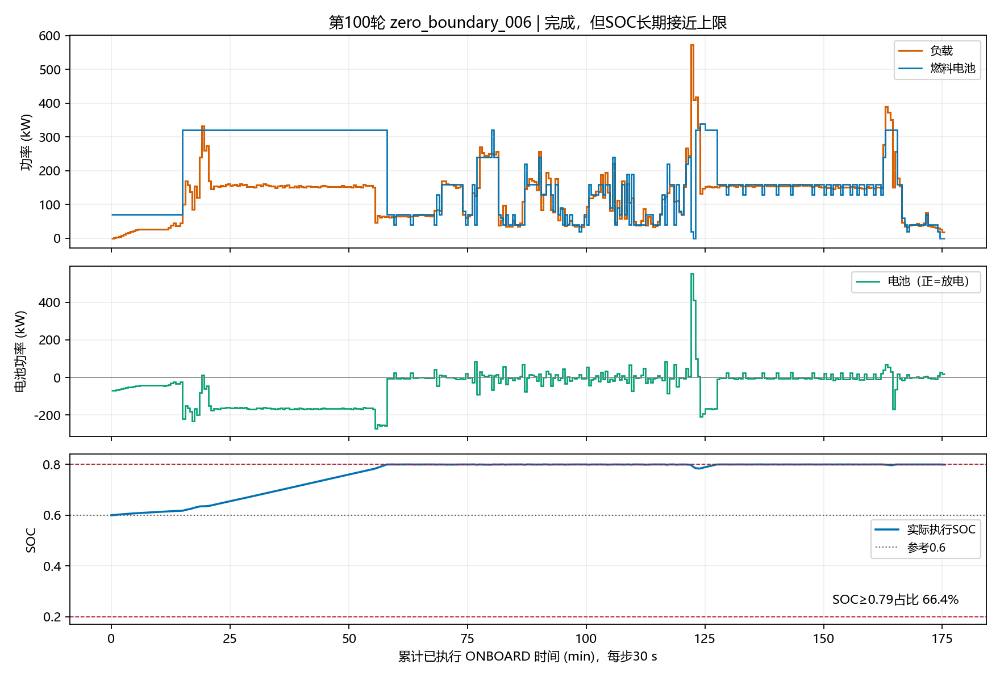
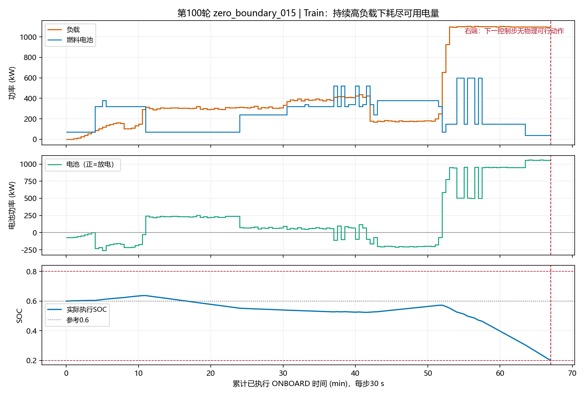
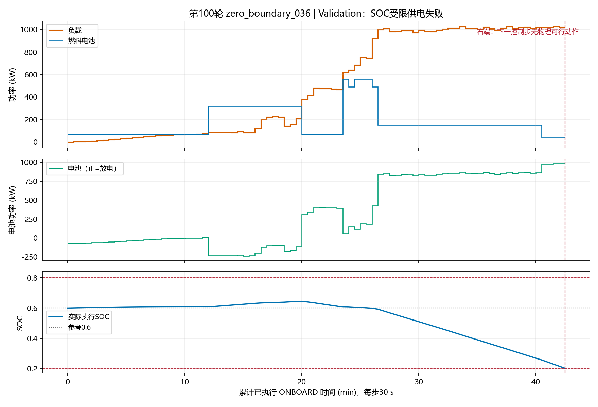

# B组 observed_nstep 100轮结果与典型功率曲线

## 1. 结论

**本次完整完成100轮，但还没有获得合格策略。**最终Greedy Train17/21、Validation6/7；Train曾达到21/21，但Validation从未7/7。`best_agent.pt`没有生成，不能进入Test。

与旧A第100轮13/21、5/7相比，最终完成数有提高，但全100轮平均完成率略低，后期仍波动。相同完成样本的经济费用反而增加；不能认为整体控制质量已经改善。

UNKNOWN前有效经验确实进入了Replay，累计515807条。新增覆盖和更新量没有解决正常终止附近的大残差、部分高负载下过度放电、低负载时FC反复大幅跳变，以及长期高SOC。

本轮只读取既有报告、归档轨迹和Q诊断，新增本报告、三张图及小型选样摘要。没有训练、环境回放、pytest、Test读取、算法修改或Git提交推送。

## 2. 实验与完成情况

结果目录：`outputs/v4_replay_ab_B_observed_seed42_100r_socmaskfix_resume30`，实验编号`V4-RPL-B-s42-socfix`。来源HEAD为`a40afa2c8fd0a967d40d8aa30472b228232fbc0e`，源码SHA256为`6c39c47efac5e740d0265c1c9604b0395c4df7061c2880185ebfec53352c200f`。

正式参数：7–128–128–61、61个0～600kW绝对动作、Adam0.001、gamma1、n8、batch64、FIFO300000、replay32、soft target tau0.001、reward_scale0.001、SOC平方辅助项beta200/参考0.6、失败配额2、失败倍率1、seed42。电池能量奖励重分配关闭。**没有启用另一个工作树中准备的PER候选。**

前30轮沿用原B输出的历史；第31轮起采用严格SOC掩码，通过迁移保留第30轮网络、优化器、Replay和RNG，迁移时没有Replay mask被实际缩窄。中途手动中断后按完整轮次checkpoint恢复。因此本次不是一个在全过程只有单个代码差异的严格独立消融。

`completed_training=true`、`run_status=completed`，JSON/CSV均完整记录1～100轮，最后epsilon≈0.05。续训checkpoint存在；`best_checkpoint=null`、`eligible_rounds=[]`、`test_payloads_opened=0`。

| 指标 | Train | Validation |
|---|---:|---:|
| 固定完整可评价集合 | 21 | 7 |
| 第100轮完成 | 17/21（80.95%） | 6/7（85.71%） |
| 第100轮SOC受限物理失败 | 4 | 1 |
| 第100轮UNKNOWN截断 | 9 | 1 |
| 历史最高完成数 | 21/21（第80、84、90、95轮） | 6/7 |
| 后10轮平均完成率 | 83.33% | 84.29% |
| 全100轮平均完成率 | 77.62% | 81.86% |

后10轮Train完成数为18、20、17、20、21、17、12、17、16、17；第95轮全部完成后，第97轮降到12/21，说明控制性能没有稳定收敛。Validation `_036` 在100轮中每轮均出现物理失败。

第100轮真实物理失败：Train `_008`行85、`_015`行134、`_044`行222、`_050`行272；Validation `_036`行85（行号为归档错误中0起始数据行）。均为`soc_limited`；结构性功率容量失败、程序执行错误均为0。含UNKNOWN的Train9条与Validation `_010` 单列，截断前没有物理失败，不计成功或供电失败。

## 3. 典型功率分配

以下只绘实际执行ONBOARD区间，每步30s。选取的四个样本都没有中途SHORE；没有补画模拟终端充电功率或虚构控制点。失效竖线表示**下一控制步**无合法功率分配，之前实际SOC仍在硬边界内。

### 3.1 Train `_002`：完成，但FC制造额外的大幅波动

405步、202.5分钟，SOC最低0.30724、末端0.58065；最大相邻FC变化500kW，超过300kW达52次。当负载≤100kW且相邻负载变化<5kW时，仍出现42次FC跳变>300kW。

例如第160步，负载78.2122kW、变化−0.0572kW，FC从20升到520kW；下一步再降到70kW。当前物理mask有全部61个动作，这个500kW跳变不是物理约束强迫。

该样本四项费用5551.92元，其中FC退化4287.11元。按现有模型复算FC退化：低工况运行320.36、高工况运行224.53、变载3383.57、启动358.65元，和原账本一致。**变载占FC退化78.9%；此例只有一次启动，高费用主要来自正功率档位间的反复切换。**不能把所有高退化费用归于启停。

### 3.2 Train `_006`：完成，但SOC长期贴上限

351步、175.5分钟，前段FC约320kW持续给电池充电，SOC随后长期接近0.8；233/351步（66.38%）SOC≥0.79，末端0.79917。并非SOC物理越界，但未形成期望的参考SOC附近运行。

该样本SOC辅助项累计2103.18奖励等价值，已计入训练奖励，不能说SOC惩罚漏算；四项模型费用2588.51元，辅助项不计入该费用。3个FC=0动作的物理mask都仍含正功率动作，分别最大600、40、60kW，所以这些零输出均不是“只能选0”的受迫停机。

### 3.3 Train `_015`：末段低FC出力与SOC耗尽

实际执行134步、67分钟；最后7步FC维持40kW，负载约1095～1105kW，电池持续承担约1055～1065kW，SOC从0.30440降至0.20036。下一数据行134的负载1092.60kW，全部动作将违反下一步SOC约束，因此终止。

当前轮已保存实际Greedy状态的61动作Q值，以下不是用最终模型重新冒充过去决策：

| 实际决策索引 | SOC_before | 负载kW | 选FC | 最大当前可行动作 | Q_selected | Q_600 | 差值 |
|---|---:|---:|---:|---:|---:|---:|---:|
| 120 | 0.39789 | 1103.13 | 150 | 600 | −10.29251 | −10.36432 | 0.07182 |
| 129 | 0.27465 | 1097.52 | 40 | 600 | −9.99404 | −10.17792 | 0.18388 |
| 133 | 0.21519 | 1095.29 | 40 | 600 | −9.78722 | −10.06367 | 0.27645 |

Q单位为scale0.001后的训练奖励等价值。能够确认：这些低FC选择由Q排序产生，600kW未被mask排除。**当前一步600合法，并不能证明到这个晚期改选600已足以完成余程。**确认排名是否错误需要区分更早阶段可达性、训练目标与状态混淆，不能只凭最后几步断定因果。

### 3.4 Validation `_036`：持续高负载阶段过度依赖电池

85步、42.5分钟。负载达到约1000kW后，FC长时间仅150kW，最后4步降到40kW，电池承担约975～982kW。SOC最终0.20253，在下一数据行85、负载1017.08kW时无可行动作。

最后4个已执行状态的mask仍为0～600kW；低出力不是当时物理mask强迫。但本轮没有采集Validation实际Q诊断，不能虚构 `_036` 的61动作排名或解释其唯一学习原因。

**旧图命名提醒：**原输出的 `greedy_train_failed_trajectory.png` 选的是UNKNOWN `_007`，`greedy_validation_failed_trajectory.png` 选的是UNKNOWN `_010`，不是本节物理失败。旧绘图按`voyage_index`连接SOC，也没有标出 `_010` 内部SHORE重置；本轮不修改旧图或正式绘图代码。

## 4. 经济性：相同完成集合对比

不能直接比较A完成13条与B完成17条的成本总和。本节仅取第100轮两组共同完整完成集合：Train13、Validation5；没有使用失败或UNKNOWN截断成本证明经济性。

| 同一集合 | 分项，CNY | A旧discard | B observed_nstep | B变化 |
|---|---|---:|---:|---:|
| Train13 | 氢耗 | 8542.57 | 9943.92 | +16.4% |
| | FC退化 | 24757.50 | 28071.77 | +13.4% |
| | 电池退化 | 1729.42 | 840.21 | −51.4% |
| | 岸电购电 | 1576.43 | 273.56 | −82.6% |
| | **总计** | **36605.92** | **39129.46** | **+6.9%** |
| Validation5 | 氢耗 | 4249.55 | 5025.80 | +18.3% |
| | FC退化 | 11123.25 | 13812.64 | +24.2% |
| | 电池退化 | 885.88 | 448.62 | −49.4% |
| | 岸电购电 | 665.50 | 121.08 | −81.8% |
| | **总计** | **16924.18** | **19408.13** | **+14.7%** |

共同集合：Train005、006、011、013、020、021、022、040、048、049、051、052、053；Validation004、009、019、032、043。B新增完成Train002、016、038、045、Validation047；这些新增样本未混入共同费用比较。

共同Train13的FC均值225.65→259.98kW，平均绝对变化32.26→38.03kW；共同Validation5的FC均值210.86→244.45kW，变化22.39→33.60kW。共同Train13启动14→16次，Validation5均8次。因此同一批样本的FC平稳性未改善，费用增加也不只来自完成数变化。

账本采用归档 `original_economic_ledger + modeled_terminal_settlement`。前者已经包含附着的中途固定目标SHORE，不能再次加中途SHORE费用。所有岸电结算都是模型值，不是实测交易；SOC辅助项及10132.66失败训练惩罚完全排除。

费用口径限制：既有模拟终端补能函数先将FC历史设为0，因此没有核算该边界FC>0→0的变载费用；中途SHORE停机瞬态则已经核算。本节按保存的原账本比较，没有自行补算或修改模型，不能声称覆盖所有真实运营边界费用。

## 5. 学习质量与未解决问题

累计训练环境动作1192209，另预填充14876；累计Replay1202338、经济Q更新37573（预填充463、正式37110）、soft target37573。新增UNKNOWN窗口515807，尾窗舍弃4747；正常/失败回放机制实际执行。

第100轮399次更新、25536抽样位置：

| 类别 | 实际采样数 | TD MAE（缩放训练单位） |
|---|---:|---:|
| 全体 | 25536 | 0.30257 |
| 正常终止窗口 | 262 | **4.54357** |
| 失败终止窗口 | 798 | 0.17558 |
| 失败非终止前缀 | 1267 | 0.45066 |
| 普通非终止 | 13489 | 0.29038 |
| UNKNOWN已观测窗口 | 9720 | 0.19630 |

正常终止窗口平均Q−4.63904、目标−0.09546，262/262条绝对TD误差>1；后10轮该类MAE4.53413，说明不是仅末轮偶发。失败终止较好拟合不代表正常末端、早期风险及动作差异学准。

第100轮平均/最大梯度范数0.69985/1.33416，裁剪0/399；全100轮最大范数1.98876，没有裁剪。抽样Q范围−11.7123～−1.9595，未观察到数值爆炸。整体loss/TD较小不能证明控制收敛。

第100轮所有已执行Train ONBOARD步骤的SOC≥0.79占34.54%，后10轮41.80%；Validation分别13.63%、21.44%。全部执行的严格阶段SOC满足[0.2,0.8]。这与 `_006` 的上沿运行和 `_015/_036` 的低SOC失败并存，说明不是简单统一“电池用得过多”或统一“FC出力过低”。

## 6. 下一步优先顺序

1. **正常终止与共享价值拟合问题。**优先核对终止窗口、近邻非终止状态、类别采样和目标冲突；当前证据不支持继续把失败传播只归于末端惩罚拟合不足，也不能仅因梯度未爆炸就否定拟合干扰。
2. **持续失败航段的更早决策与Q动作差异。**重点 `_036` 每轮失败和 `_015` 的实际Q排序；用已有诊断与独立受控分析区分经验覆盖、不可辨识状态和未来价值估计，不能从晚期一步600可行推断能救回全程。
3. **FC跳变与高SOC的经济权衡。**共同样本的变载、氢耗和FC费用均未改善。先分清价值估计与经济目标本身的偏好，不自动提高SOC权重，也不加入人工FC门控。

**当前不建议进入Test。**本轮没有启动新的训练、启用PER、修改奖励或改变评估资格。

## 7. 来源

- 本次结果目录中的 `run_metadata.json`、`checkpoint_migration.json`、`report.json`、`round_metrics.csv`、`train.log`、`learning_curves_metadata.json`。
- 第100轮 `round_100_train_trajectories.json`、`round_100_validation_trajectories.json`，按单样本流式读取。
- 第100轮 `diagnostic_checkpoints/round_100_decisions.json`，只读取现存Q诊断，不加载网络重算。
- 旧A `outputs/v4_socref060_beta200_100r_seed42` 的最后轮摘要及归档轨迹，用于同集合比较。
- 本轮选样复算：[profiles_summary.json](results/v4_B_observed_100r_analysis_20261013/profiles_summary.json)。
