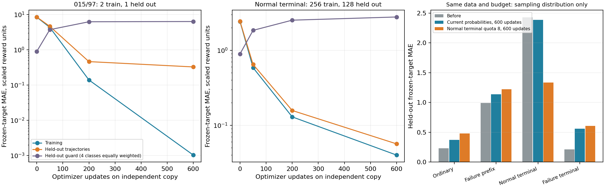
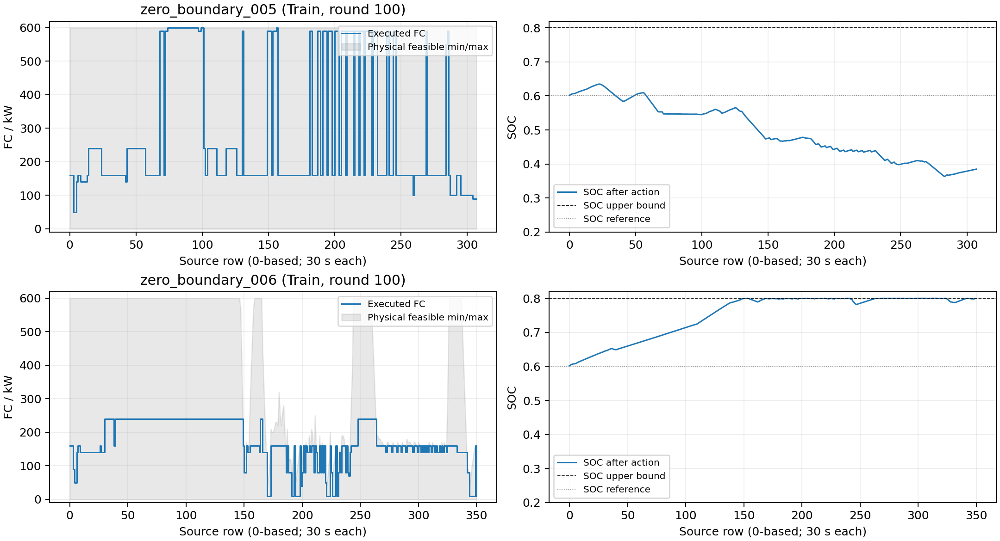

# V4 直接功率 DDQN 根因诊断与最小改进路径

日期：2026-10-12。以 `feat/direct-power-mlp-ddqn`、HEAD `52e9232916b4e64883cf6b09d5697fb68f6446cd` 为准，先阅读了 [30万条Replay审计](v4_replay_coverage_td_audit_2026-10-12.md)。

## 1. 结论

1. **没有发现已核查路径中的 Double DQN、8步累计、奖励缩放、终止 bootstrap 或合法动作掩码计算错误。**5336条正常终止窗口确实没有拟合好，但不能将残差直接归为 `done` 或 target 公式错误。
2. **现有网络有局部拟合能力，混合训练存在类别分配及共享函数相互干扰。**独立副本能拟合 `_015` 高残差及正常终止；只强化这些类别，会损害其他留出状态。模拟当前类别抽样概率增加600次更新，也没有改善整体留出误差。不能简单说“再加轮数、增大学习率或扩大网络即可”。
3. **有确定的训练覆盖损失。**9个含 UNKNOWN 的 Train 样本，全程未贡献经济Replay；含 bootstrap 丢弃520554个已执行前缀决策。固定最终池的600批独立抽样，三个 `_015`/97、160 kW同源记录均未抽到。后者不是历史采样次数复原。
4. **`_036` 完整任务在当前模型下可行，但归档策略早在第20行就失去了余程可行性。**失败前8或32步才改为最高合法FC仍救不回来。因此只拟合供电失败最后几步、或在低SOC时临时提高FC，无法解决这条航段。
5. **`_005` 大跳变主要来自固定网络的Q排序交叉，不是MPC修改动作或物理mask强迫。**一次430 kW跳变的即时经济费用反而多43.42元，说明已有即时费用不鼓励该跳变；长期Q是否准确才是关键。
6. **`_006` 没有任何FC=0动作。**上沿约束限制继续充电的功率，但0仍合法；高SOC下0的Q持续最低。SOC奖励已计入，不能称为漏算，也不能把受迫降功率和主动保持偏高SOC混为一谈。
7. **推荐先补真实更新覆盖诊断并确认任务终止定义，再逐项研究有效前缀入池、采样分配和状态信息。**功率平滑属于后续独立目标；目前没有证据支持同时改变奖励、网络、γ及控制规则。

本次没有修改正式代码、算法、数据、参数、权重、Replay或旧结果，没有运行完整重训练及pytest，没有读取Test。只使用独立网络副本、已有数据和限定预算的物理诊断，新增报告与小型诊断附件。

## 2. 版本、参数与实验边界

正式结果仅取 `outputs/v4_socref060_beta200_100r_seed42`，100轮已完成；最终 Greedy Train为13/21、Validation为5/7，另有9/1个 UNKNOWN 样本。100轮没有合格checkpoint，不能进入Test。

| 项目 | 本次实际核查值 |
|---|---|
| 实验记录源码 | `a3746c4278369669c58f59535bc8ac9860df0b22`，原metadata记录worktree dirty |
| 网络/动作 | 7–128–128–61，ReLU；FC 0～600 kW，10 kW格点 |
| 优化 | Adam 0.001，batch64，Smooth L1 beta=1，gradclip10 |
| TD/Target | γ=1、n=8；每次经济更新后tau=0.001软更新；初始硬复制1次 |
| Replay/调度 | FIFO300000，replay32，失败终止配额2 |
| 奖励 | 四项模型经济费用的负值，另扣200×(实际SOC_next−0.6)²；失败惩罚倍率1 |
| 缩放/重分配 | 统一scale=0.001；battery energy redistribution关闭 |
| 岸电/截断 | v3标签；固定目标0.6模型岸电；UNKNOWN截断，不造终止奖励 |
| checkpoint SHA256 | `ca501ba949446482c5433f47bf2a77b2d70599e2e0638359738ce210e7817525` |

核心训练/控制文件与实验源码提交的差异为空。独立拟合前后checkpoint SHA256一致，未保存副本为正式模型。本次拟合使用单CPU线程，正式历史配置为16线程；原训练资源配置未修改。

**单位：**下面Q、TD误差、监督目标和SOC辅助项均为训练奖励等价值。默认数值采用scale=0.001后的单位；除以0.001只是还原训练奖励，不是实际经济支出。氢耗、退化和购电账本单独用CNY。模型化岸电/终端费用不代表实测交易。

## 3. 根因证据矩阵

| 优先级 | 问题/假设 | 代码与实验依据 | 判断 | 尚不能证明 |
|---|---|---|---|---|
| P0 | n8/scale/terminal target计算错误 | `dqn.py:173,234,299`；7096条终止y等于已存奖励；4096条重新计算与缓存≤2e−6 | 未发现 | 未保存历史目标，不能复原每次当时y |
| P0 | 正常终止被中途岸电误标 | 5336=667完成事件×8；m=1…8各667，都到样本最后ONBOARD行 | 此猜测不成立 | 样本零边界是否是真实任务完成事件 |
| P1 | 正常末端/失败早期采样稀疏 | 独立600批：正常终止656次、615条不同记录；关键3条抽0次 | 当前算法采样密度的实证 | 历史3条是否/何时抽过 |
| P1 | 网络完全没有拟合能力 | 两个高残差训练tuple拟合MAE降至0.001；正常终止留出MAE降至0.056 | 此强断言被否定 | 7维网络能否同时泛化完整任务价值 |
| P1/P2 | 只强化某类造成共享表示干扰 | 局部拟合时留出guard MAE升至6.334/2.776；混合quota8也损害非终止类别 | 已观察到干扰/泛化损失 | 是容量、状态歧义还是抽样分布的唯一原因 |
| P1 | UNKNOWN前缀不贡献训练 | `remember_completed_prefix`需要真正done，9样本909次均截断，经济入池0 | 确定覆盖损失，符合现行保守契约 | 恢复合法窗口能否提高完成率 |
| P2 | 状态缺少阶段/任务信息 | 末端/中途近邻目标差2.6～2.9；7维无任务时域；边界由功率零点裁切 | 有较强依据的疑点 | 添加某个可观测变量一定有效 |
| P2 | `_036`是容量结构性不可行 | 正式环境max合法FC策略222步完成，SOC最小0.23136 | 当前模型下被否定 | 引入真实设备ramp后是否仍可行 |
| P2 | 临近失败再提高FC能救回来 | row70/94起max策略仍失败；精确后向可达集row20已不可恢复 | 此补救对本例不成立 | 在线可预测未来所需SOC门槛 |
| P3 | `_005`跳变是mask/MPC强迫 | 308步mask全61动作；40次>200两动作前后均合法；未调用MPC.solve | 被否定 | 准确最优Q是否也会选择部分大动作 |
| P3 | 经济瞬态费漏算/符号反了 | 四项FC费用659步匹配；row208保持590即时更便宜43.42元 | 未发现该错误 | 保持590全程是否更经济 |
| P3 | `_006`SOC奖励没计/人工门控阻止停机 | 659步reward和mask匹配；0始终合法；_006无0动作 | 被否定 | 高SOC0动作Q的历史学习原因 |

## 4. P0：实际训练链与终止语义

### 4.1 当前是直接功率DDQN，没有在线MPC执行层

`feedback_study.py:63` → `run_monitored_training` → `DirectPowerDDQN` → `replay_episode`。`control.py:328–330` 直接将选出的 `fc_kw` 送入 `EconomicMPC.interval`，实际FC轨迹等于该动作。共享类在此提供物理与经济核算；没有调用v3的五步 `solve`，也没有优化器再分配功率。

物理mask（`control.py:218`）只核对：FC格点、电池母线功率[-624,1248] kW、正式效率下下一步SOC∈[0.2,0.8]。**当前v4没有FC爬坡率硬约束**，不能拿旧MPC约束解释本次轨迹。

### 4.2 目标、缩放及失败惩罚

原执行奖励组成后，`remember_trajectory`累计：

\[
R_k^{(m)}=\sum_{j=0}^{m-1}\gamma^j r_{k+j},\qquad
\widetilde R_k^{(m)}=0.001R_k^{(m)},\quad m\le8.
\]

\[
y_k=\widetilde R_k^{(m)}+(1-d)\gamma^m
Q_{\theta^-}(s_{k+m},\arg\max_{a\in A(s_{k+m})}Q_\theta(s_{k+m},a)).
\]

冻结模型岸电标签触发的**模型固定目标费用**挂到前一动作；样本内后续ONBOARD仍存在则done=False，使用补能后的模型状态/mask。样本结束done=True；无末尾岸电才作原MODELED终端结算。UNKNOWN不生成成功terminal，不越缺口bootstrap。

`failure_replay.py:58,85`只接纳真正 `no_feasible_action`，最后一个已执行动作追加一次失败惩罚、done=True、空mask；原账本不变。多条重叠n-step窗口共享该奖励，不是重复原始计费。576次实际SOC失败对应累计4608个终止窗口，最终保留220次失败的1760个窗口。

**ReplayItem没有存储TD目标。**它存已缩放奖励及后继等字段；`learn`每次用当时网络重算y。本报告的−11.40是最终Online/Target快照重新计算的目标，而非证明第76轮更新时就一直使用同一y。4096条独立重计算检查与数值缓存在2e−6内一致，故本次拟合的起点不存在混用参数快照。

### 4.3 5336条正常终止的异常来源

它们的y全部逐条等于存储奖励，不含bootstrap；Online均值−2.47228，y均值−0.08334，MAE2.38894。同状态动作Target均值−2.34645也偏离末端回报。**这项终止误差不能直接归因于tau导致的后继bootstrap滞后。**

Train末端来自 `zero_boundary_dataset.py:252` 的parent时间窗内零功率边界：19个观测死区、11个构造交叉，没有任务完成事件字段。零点本身不是最后一个30秒决策，最后已执行负载仍可为正。

- 若目标定义为“有限样本运行成本＋末端补能”，done=True合理，但有限任务价值需要足够的阶段信息。
- 若文件只是连续运营的采集切片，结束不等于物理任务结束。当前没有可信后继，不能把done改False再复制末状态bootstrap，也不能跨独立样本拼接。

此区分与 [Pardo等，Time Limits in Reinforcement Learning，第2～3节](https://arxiv.org/pdf/1712.00378) 一致。当前不能认定所有样本done错误，必须先确认研究任务与业务终点。另有确定文档错误：`docs/v4_mode_labels_v3.md:15` 仍称UNKNOWN前缀入池，与当前源码及统计矛盾；本轮未修改。

## 5. 独立冻结目标监督拟合：方法与结果

### 5.1 预先限定预算与留出规则

四个副本都从相同最终Online权重开始，使用**新建的独立Adam**、lr0.001、Smooth L1 beta1、clip10；每个最多600次更新，共2400次。目标y固定为同一最终快照，不软更新Target，不新采集航迹、不写正式Replay、不保存为正式模型。

以 `(源Train样本, 原采集轮次)` 整组分离训练/留出，避免同一次轨迹的重叠n8窗口分散到两边。887组中265组留出；相同原负载样本在不同轮次仍可能出现，因此这是**未见轨迹组测试，不是未见航次泛化保证**。

- A：`_015`/97、160 kW三条记录，ID493205/516139训练，584126留出；每次完整训练两条。
- B：256条正常终止训练，128条留出；batch64。
- C/D：同一固定子集，4类别各256训练、128留出，总1024/512；C模拟最终池类别概率，失败终止2条；D只改变抽样分配为正常终止8条、失败终止2条，其余54从非终止抽取。两者样本、标签、初始网络、种子、学习率、更新预算一致。
- 另用2048条留出组的guard，各类别等额，用于发现局部改进的副作用。它不是自然频率全Replay总体MAE，不能和0.3549直接比较。

### 5.2 拟合结果

| 探针 | 训练MAE：前→后 | 留出MAE：前→后 | guard MAE：前→后 | 可证明什么 |
|---|---|---|---|---|
| A 高残差2训/1留出 | 8.4288→0.00103 | 8.5252→0.3263 | 0.8939→6.3344 | 网络能拟合该局部目标；集中训练严重损伤其他价值 |
| B 仅正常终止 | 2.4130→0.03995 | 2.4303→0.05636 | 0.8939→2.7761 | 正常末端低回报可以拟合，但与其他类别存在干扰 |
| C 当前类别概率 | 0.9472→0.9269 | 0.9667→1.1136 | 0.8939→1.0250 | 此固定子集上，单纯多600次相同分布更新未改善留出 |
| D 正常终止配额8 | 0.9472→0.7252 | 0.9667→0.9097 | 0.8939→0.8477 | 分配改变有作用，仍有明显类别间权衡 |

C/D独立拟合副本中的实际抽样位置均38400：

| 训练类别 | C抽取次数 | D抽取次数 |
|---|---:|---:|
| 普通非终止 | 32046 | 28586 |
| 失败非终止前缀 | 4496 | 3814 |
| 正常终止 | 658 | 4800 |
| 失败终止 | 1200 | 1200 |

| 留出类别 | 拟合前MAE | C拟合后 | D拟合后 |
|---|---:|---:|---:|
| 普通非终止 | 0.2295 | 0.3706 | 0.4780 |
| 失败非终止前缀 | 0.9939 | 1.1365 | 1.2202 |
| 正常终止 | 2.4303 | 2.3865 | 1.3358 |
| 失败终止 | 0.2132 | 0.5608 | 0.6047 |

因此不能将D的总体均值下降称为全面改善：正常末端好转，其他三类恶化；`_015`高残差留出仍为8.397，C为8.303。**不建议立即把配额8设为正式默认，也没有证据证明仅增更新预算能解决当前问题。**

### 5.3 动作排序及限制

`_015`/97原Greedy为160，次优240，gap仅0.02661。A拟合后160在当前物理合法动作中降到第61，greedy改为210；C/D改为580，但160的Q仍未靠近其高风险目标。副本的动作排序确实会改变，**不能推断新动作就能完成航段**：没有给未执行600的动作虚构目标，也没有把副本作闭环策略测试。

A极端局部拟合48/600次触发clip，B/C/D均0；这些是诊断副本统计，不能倒推原正式训练梯度爆炸。正式历史20953次更新的clip触发为0。

## 6. P1：Replay覆盖与有效更新

### 6.1 历史实际计数与本次独立计数

原报告累计670498条入池、20953次经济更新、1340992个采样位置。历史实际success1112913、failure228079，其中失败终止41906，占3.125%。只有类别汇总，**没有逐Replay ID采样次数、正常终止独立历史次数或历史y序列**。

另直接调用现有 `_sample_replay_batch`，固定最终300000条池、独立 `random.Random(42)`、600批×64，不更新网络。内部池按FIFO ID排列而非旧swap-delete顺序，故这不是原随机流重建：

- 38400个位置、35901条不同记录。
- 正常终止656个位置、615条不同记录；5336条中4721条未在本次600批中抽到。
- 失败终止1200个位置，配额准确执行。
- `_015`/97三条同源160 kW记录抽0次；SOC±0.03、6功率特征各±30 kW的17条160近邻合计抽2次。
- SOC、负载、动作、终止类型、失败前缀和源样本阶段的池分布/本次抽取次数见附件CSV。任务阶段仅用于离线统计，没有输入策略。

这支持“关键状态的更新密度值得检查”，不能说历史3条从未学过。当前池72.25%来自第71～100轮ε=0.05，不应继续将池主要描述为早期ε=1随机经验。

### 6.2 UNKNOWN确定的覆盖损失

`_007/_017/_029/_033/_034/_037/_041/_042/_046`，909次含bootstrap的执行全部是数据截断，没有先发生物理失败。由于 `remember_completed_prefix` 只接受真正done，当前跨SHORE结构在UNKNOWN前没有独立成功终止，整条前缀丢弃。

正式轮次丢弃515400条、bootstrap5154条，合计520554条。UNKNOWN后的ONBOARD行也未执行。**不能通过伪造done解决；但普通非终止n-step学习并不要求整个任务已经结束，只要求该窗口与真实后继已观测。**

最小候选是只保留UNKNOWN前完整8步窗口，且窗口尾部的真实下一决策状态及非空mask已观测；接触UNKNOWN的尾部窗口继续舍弃。记录为“已观测前缀、最终结果未知”，不能计成功/失败航段，也不加终端补能或失败罚款。该规则与此前保守弃前缀的契约不同，需要批准后单独验证。

当前 `experience_outcome` 只接受success/failure；新增结果未知的前缀必须同步修改 `remember` 校验、成功/失败经验计数和checkpoint版本，不能落入success默认分支。若前缀含L个已执行决策、最后一个动作的后继未知，起点i的窗口必须满足 `i+8<L`；只有8条奖励、没有已观测后继状态仍不足以入池。

### 6.3 不同更新方案的适用性

| 方案 | 适合的问题 | 风险/判断 |
|---|---|---|
| 正常终止/高残差分层采样 | 指定类别曝光不足 | D已显示均值改善但其他类别退化；不能无限增某类配额，不能只报告均值 |
| PER | 存在可学习但未被充分更新的高残差窗口 | 可能反复追逐状态歧义或bootstrap噪声；需多样性及明确的概率/重要性权重；本次未实施 |
| replay32→replay16 | 已有目标可共同拟合而实际覆盖低 | C未支持“仅多更新即可”；且同tau下Target按环境步骤跟得更快，必须分开记录该自然效果 |
| 调整tau/同步机制 | 证明确有Target滞后或漂移问题 | 正常终止目标不bootstrap，不能靠tau直接解释2.389；应先记录关键目标随更新变化 |
| 保留可信UNKNOWN前缀窗口 | 已执行但整段未入池的覆盖缺口 | 需严格保证后继观测/边界；有效插入增多也自然增加replay32更新额度 |

[Schaul等PER原论文，第3.3～3.4节](https://arxiv.org/html/1511.05952)明确讨论优先抽样的多样性损失和偏差校正；不是高TD误差必然可学。本项目固定失败配额同样改变训练样本分布，不能把它当成均匀Replay。以上各方案应分别实验。

## 7. P2：`_036`物理可行性与早期供能

### 7.1 正式环境见证

Validation `_036`有222个ONBOARD控制步，初始SOC0.6，负载最大1047.809 kW。600+1248=1848 kW的瞬时总能力足够；实际失败行102为SOC受限：SOC0.200795，负载1005.651，即使用600下一SOC也仅0.195092。

限定最多三个固定策略，由正式 `replay_episode` 执行，核对每步mask、功率和SOC，MPC.solve调用0、Test读取0：

| 策略 | 完成情况 | SOC/解释 |
|---|---|---|
| 全程选择当前最高物理可行动作，因果 | 222步全部完成 | min0.231363，max0.799997，终端0.552247；203步FC600 |
| 保留归档至69行，70行起max | 行128失败 | 晚于原失败，仍不能完整完成 |
| 保留归档至93行，94行起max | 行105失败 | 最后8步才提高FC不足以补救 |

成功见证没有中途岸电，MODELED末端补能44.214元只是之后的经济费用，不改变执行SOC，不提供额外航行能源。2436.568元可比成本仅是该成功见证的模型账本，**不能与归档失败截断费用比较并宣称经济改善**。未验证真实设备ramp/启动动态下的见证。

### 7.2 精确离线后向可达性

仅用于事后诊断，设终点允许集 `R_N=[0.2,0.8]`，不强制航行结束SOC=0.6。对每行全部61格点动作，正式SOC更新对固定负载和动作是平移：

\[
\delta_k(a)=f_{SOC}(0.5,L_k-a,30s)-0.5,
\]
\[
R_k=[0.2,0.8]\cap\bigcup_{a:\,-624\le L_k-a\le1248}(R_{k+1}-\delta_k(a)).
\]

计算维护**区间并集**，没有以凸包填补间隙；在此样本各行恰为单一区间。归并容差降为0结果相同；直接效率公式与正式 `next_soc` 递推门槛最大差2.22e−16。

| 开始行/窗口 | 归档SOC | 完成余程最低SOC，离线 | 结果 |
|---|---:|---:|---|
| 19 | 0.630202 | 0.627853 | 仍存在完整余程可行策略 |
| 20 | 0.632395 | 0.634614 | 首次失去余程可行性 |
| 46 | 0.637452 | 0.766890 | 已不可恢复 |
| 70，失败前32步 | 0.466289 | 0.663161 | 已不可恢复 |
| 94，失败前8步 | 0.267701 | 0.525301 | 已不可恢复 |

原失败前100步平均负载598.41、FC316.00、Battery282.41 kW；前32步负载1007.69、FC417.50、Battery590.19 kW；前8步负载1004.93、FC410.00、Battery594.93 kW。三窗口内更高FC/600均合法，但后32/8步开始时电量已经不足以完成余程。

第20行距第102行82个控制间隔，约41分钟；n8单个窗口只有4分钟。早期控制必须学到更远处的风险，不能靠最后8步终止信号单次拟合完成。这里的离线阈值利用了已知完整未来负载，**不得作为在线SOC约束、策略输入或新的训练标签直接使用**。

### 7.3 7维状态、γ与n8

当前状态含SOC、前FC及两个FC差分、当前负载及两个负载差分。容量与功率上限固定，因此当前FC调节余量/单步电池风险可从这些量和mask推导；无需重复增加同义变量。它没有任务阶段/已知计划时域，也不保证两步负载趋势足以区分长时间后的高负载。

末端/中途近邻及Validation `_036`附近Train目标分布不同，支持状态条件分布混合的疑点；没有完全相同float32状态与动作的直接冲突组。不能宣称信息不足是唯一原因，更不能用Validation真实剩余长度或未来负载作输入。

γ=1对于定义明确、有限结束的总成本目标可以使用，但不提供有限样本神经网络拟合保证；8步缩短若干传播链，不消除采样、泛化或目标偏差。现有n-step前7个后续动作来自ε-greedy行为，尾部才用greedy Double DQN，缺少off-policy回报修正；这是待单独对照的机制，不能混同终止公式bug。[Double DQN原论文](https://arxiv.org/html/1509.06461v3)、[Rainbow的多步学习与消融分析](https://arxiv.org/pdf/1710.02298)说明机制，不能将其Atari结果直接等同船舶最优参数。

## 8. P3：功率跳变、SOC上沿与经济费用

### 8.1 `_005`：不是强迫跳变

`_005/_006`实际属于**Train**，不是Validation。冻结第100轮网络的masked argmax、物理mask、四项FC退化及奖励与659个归档动作逐步匹配。

`_005`308步全部61动作合法，无mask变化；内部66次变化，严格绝对跳变>100/>200/>300 kW为41/40/40。40个>200的旧、新动作在前后两步均合法；19次负载变化小于10 kW。最大FC跳变440 kW。

| 源行 | FC变化 | 负载变化 kW | 新动作Q−旧动作Q：前状态→当前状态 |
|---|---|---:|---|
| 130 | 160→590 | +260.357 | −0.199245→+0.007390 |
| 131 | 590→160 | −65.604 | −0.007390→+0.028849 |
| 208 | 590→160 | −0.969 | −0.032166→+0.027329 |

这属于固定参数网络随闭环状态变化发生排序交叉，不能说Greedy期间网络在更新或参数震荡。最优/次优gap小也不直接证明动作错误；需要真实未来回报证据。

row208按已有208步动作重建完整SOC、FC累计退化和电池weightedAh，逐步账本误差≤1e−8，再计算两个单步分支：

| 单步项 | 已选160 kW重算 | 保持590 kW反事实 |
|---|---:|---:|
| 氢费CNY | 1.417430 | 5.879752 |
| FC低/高载CNY | 1.271250 / 0 | 0 / 1.467500 |
| FC变载/启停CNY | 47.407500 / 0 | 0 / 0 |
| Battery退化CNY | 0.916348 | 0.242747 |
| 真实模型区间费用CNY | 51.012529 | 7.589999 |
| SOC_next | 0.436244 | 0.442152 |
| SOC辅助项等价值 | 5.363215 | 4.983194 |
| 即时reward等价值 | −56.375743 | −12.573192 |

保持590单步少花43.422530元，即时reward好43.802551，但Online Q仍偏好160。这排除了“这次跳变由即时费用优势驱动”的解释；**不能排除正确长期收益确实会改变排序，也不能据此保证持续590全程更优**。

该样本FC退化2824.655元，低载287.303、高载120.335、变载2058.368、启动358.650；变载占72.87%。实际ONBOARD模型费用3751.566元，另有206.973元MODELED终端补能。模型已包含 `0.11025 CNY/kW × |ΔFC|` 的变载费用，暂不应重复添加同一物理损耗罚款。

### 8.2 `_006`：上沿限制＋0动作价值偏低

351步FC10～240 kW、没有0；SOC最大0.799998，终端0.799764。SOC_before≥0.79有191步，其中0全部合法，却191/191在合法Q中垫底。内部103次功率变化，46次旧动作已被物理mask排除，57次是旧动作仍合法的切换。

例如row170，SOC0.799904、负载40.891、上一FC140，mask缩至0～40：必须降低FC，但不强制只能选10。不能把这一类限幅归成主动异常停机。

SOC辅助项累计1916.920等价值，真实模型ONBOARD费用2055.230元；辅助项已计入。末步row350正常终止，Q10=−2.92755而该一步终止目标为−0.02619，偏差2.90136；合法0的即时目标还略优于10，Q却偏好10约0.34686。未知任务结束状态与价值拟合问题需要优先检查，不能只靠提高β处理。

### 8.3 平滑方案比较，均未实施

| 候选 | 作用 | 必要条件与副作用 |
|---|---|---|
| 真实FC ramp硬约束 | 直接限制每30秒功率变化 | 需设备依据；与SOC/电池约束交集可能为空；训练和后继mask必须一致。现有可行性见证不自动适用于新ramp。 |
| 动作切换/绝对或平方变化辅助目标 | 改变经济—平稳性权衡 | 当前已有FC线性变载经济费；新项应明确是偏好，不能再称相同退化费用。可能牺牲供电或氢耗。 |
| Q差迟滞/保持上一合法动作 | 减少小gap造成的切换 | 上一动作非法时必须释放；可能迟缓补能；改变策略与学习目标关系，需要统一设计，不可仅事后裁剪。 |

这些方案不能代替早期能量管理。当前没有可信设备ramp值或已批准的平滑权重，本轮不指定。

简单的上一动作迟滞可以利用当前状态中的前FC功率；若增加最短运行时间或停机等待时间，则还需要相应计时状态，不能悄悄引入未观测的执行逻辑。任何动作过滤都必须记录实际执行动作并核对策略与TD后继选择的一致性。

## 9. 具体修改建议与优先级

下表是建议，正式文件尚未修改。

| 次序 | 文件/函数 | 最小候选修改 | 预期收益 | 副作用与验证 |
|---|---|---|---|---|
| P0-1 | `FormalEpisode`、`control.replay_episode`、文档 | 明确研究样本终止与原始cutoff来源；修正文档中UNKNOWN入池错误 | 避免错误理解正常末端、伪造bootstrap | 不将样本索引/N当成可在线剩余时间；确认任务定义前不改done |
| P1-1 | `dqn._sample_replay_batch/learn/training_state`、`monitored_training` | 保留ID来源及关键区域真实draw计数；单列normal terminal TD/采样/目标漂移统计 | 区分稀疏曝光、目标移动及共同拟合失败 | 仅诊断，不能消耗训练RNG或改变抽样顺序；元数据/续训兼容须版本化 |
| P1-2 | `dqn.remember_trajectory/remember_completed_prefix`、UNKNOWN训练分支 | 新增严格“已观测完整n8窗口”入池路径，标签为结果未知；尾部不可靠窗口丢弃 | 恢复已执行前缀覆盖，不虚构终止 | 需批准变更旧弃前缀契约；不跨UNKNOWN、不作成功费用比较；新增insertions自然增加更新额度 |
| P1-3 | `_sample_replay_batch`、`td_statistics`及研究配置 | 在固定经验上再检验小幅正常终止/关键前缀分层或带校正PER；一次一种 | 给高残差类别真实更新机会 | 本次quota8未满足全类别改善；不能立即正式定稿 |
| P1-4 | `EconomicUpdateSchedule.consume`、研究入口 | 只有目标可共同拟合且曝光不足证据明确，再单独比replay32/16 | 提高有效样本复用 | 同tau按环境推进更快，不等于只改变反向次数；C实验不支持直接加预算 |
| P2 | `build_state`、STATE_FEATURES、保存/加载/诊断 | 经业务确认后，检验一个在线可观测阶段/计划信息 | 减少有限任务/未来负载分布混合 | 需要新模型初始化；禁止未来负载、Validation真实剩余长度和任意文件ID记忆 |
| P2后续 | `remember_trajectory`与研究配置 | 固定其他因素时比n1/n8，或分析行为回报偏差 | 检验多步偏差与传播距离 | 不与γ/奖励/采样同时变；不是恢复旧MPC |
| P3 | `feasible_fc_actions`、策略/TD选择、独立reward配置 | 设备依据确认后才研究ramp；或独立研究平滑偏好/迟滞 | 减少无必要大动作 | 必须先复验可行性；不重复退化计费，不以少跳变掩盖SOC失败 |

**首选路径：终止定义与真实计数 → 合法前缀覆盖及共同拟合 → 必要的可观测信息 → 独立平滑目标。** 当前不推荐先扩大网络、再增大学习率或直接降低γ。最大合法FC仅是可行性见证，不是新的经济控制器。

## 10. 能区分竞争假设的最小后续实验

除本次已完成的四副本/600批/三个物理策略外，以下均待批准，尚未启动。

| 实验 | 主动变化因素/固定条件 | 预算与种子 | 判定标准 |
|---|---|---|---|
| E0 共同拟合复核 | 相同现有tuple、固定y，仿当前抽样 vs 一个更小的正常终止/高残差曝光候选；网络、lr、目标、预算固定 | 单一候选，seed42及43，各≤600更新，不新交互 | 同时降低目标类别留出误差，不损害普通/失败前缀；不能只看类别平衡均值 |
| E1 已观测前缀入池 | 基线弃前缀 vs 只保留已验证完整n8窗；先用同预算离线诊断，再获批后闭环 | seed42先筛查；确有改善再42/43/44受控短训练，建议最大20轮，非已批准预算 | 来源/后继可靠、无虚假done；新增经验及自然更新次数单独报告；固定评价集合完成率改善 |
| E2 更新预算 | 条件是E0显示可共同拟合且真实采样仍低；replay32 vs replay16，其他不改 | 与E1分开；同种子/轮次与有效更新计数 | 关键早期TD、完成率、后期稳定性同步改善；记录Target按环境更新的自然差异 |
| E3 状态信息 | 仅一个有设备/运营依据的在线可观测变量；同经验/预算/奖励 | 先固定经验留出；必要时独立3种子闭环 | 未见轨迹/样本泛化改善，不能仅训练误差降低；禁止用真实剩余长度或未来功率 |
| E4 平滑 | 只一个经批准的ramp或平稳性偏好/迟滞，原经济模型不动 | 先物理可行性再短闭环，与E1～E3分开 | 全程可行、跳变减少、同完整集合经济费用与寿命成本合规比较 |

正式 `feedback_study.main` 目前锁定100轮冻结配置；以上研究需批准后使用明确的研究配置入口或解冻指定选项，不能静默绕过门槛。不同策略会自然改变成功轨迹、Replay插入数及更新量；必须报告这些差异，不能声称闭环收集经验完全相同。没有合格当前best，不能以部分完成费用充当经济基准。

## 11. 建议验收标准

下列为后续可审查的工程门槛，**不是本次已取得的策略结果，也不是文献保证**。

- 实现：同参数快照TD复算≤2e−6；同固定动作序列SOC/经济账本≤1e−8；原始失败惩罚恰好一次；正常/失败/UNKNOWN无跨界伪造。
- 全程供电：固定完整Train21/21、Validation7/7；含UNKNOWN前缀无物理失败且独立统计；SOC始终[0.2,0.8]、功率合法。至少3种子报告达标轮次及后期保持情况，不能只挑一次偶然成功。
- 局部学习：建议 `_015` 高残差留出MAE≤1、正常终止留出≤0.5，同时普通/失败前缀留出MAE相对基线不恶化超过10%；不足时不以单类loss改善通过。阈值以当前Huber转折点和本次副作用为参考，不保证闭环成功。
- 经济：只在相同完整可评价集合、同参数、同结算口径下比较四项CNY账本；模型岸电/终端补能、SOC辅助项及失败惩罚分开。当前完整费用null，无法设置相对其完整费用的下降百分比。
- 平稳性：若进入P3，建议以 `_005` 的>200 kW次数40为代表性基准，预先约定至少减少一半且不增加物理失败；同时报告全集合绝对变载、最大跳变、FC启动及变载费用，不能用这两条样本代表全部任务。
- Q排序：检查实际合法动作、top2 gap及对应回报证据；不能规定任何低SOC状态都必须600，也不能用副本中“改选580”认定它更安全。
- Test：以上Train/Validation资格未满足前保持封存。

## 12. 附件及未能确认的事项

主要数值产物位于 `docs/results/v4_root_cause_diagnostic_20261012/`：

- [拟合预算与结果](results/v4_root_cause_diagnostic_20261012/fit_probe_summary.json)、[分组误差曲线](results/v4_root_cause_diagnostic_20261012/fit_probe_curves.csv)、[61Q及动作排序](results/v4_root_cause_diagnostic_20261012/fit_probe_q_rankings.csv)、[训练/留出ID与实际抽取次数](results/v4_root_cause_diagnostic_20261012/fit_probe_sample_draws.csv)。
- [原始训练链/边界分析](results/v4_root_cause_diagnostic_20261012/mechanism_replay_findings.md)、[固定池600批摘要](results/v4_root_cause_diagnostic_20261012/mechanism_replay_fixed600_sampling.json)、[分类覆盖/采样CSV](results/v4_root_cause_diagnostic_20261012/mechanism_replay_fixed600_groups.csv)。
- [物理见证与后向递推说明](results/v4_root_cause_diagnostic_20261012/feasibility036_notes.md)、[三策略结果](results/v4_root_cause_diagnostic_20261012/feasibility036_summary.json)、[失败窗口](results/v4_root_cause_diagnostic_20261012/feasibility036_windows.csv)。
- [功率/Q/费用专项说明](results/v4_root_cause_diagnostic_20261012/fc005006_diagnostic.md)、[659步实际状态/61Q/mask](results/v4_root_cause_diagnostic_20261012/fc005006_steps_state_q61.csv)、[row208精确单步反事实](results/v4_root_cause_diagnostic_20261012/fc005006_row208_exact_single_step.csv)。

限制：没有逐条历史抽样及目标演化记录，没有第9/74轮真实网络可用来解释当时排序；本次训练探针只有一个固定起点、一个seed及有限监督预算，未作经济闭环验证。未确认真实任务完成事件、可在线获取的任务计划、FC ramp或待机设备参数。不能给这些缺口填入猜测值。当前证据支持覆盖/共同拟合与任务信息诊断，尚不足以选定最终新算法或承诺下一轮一定成功。
