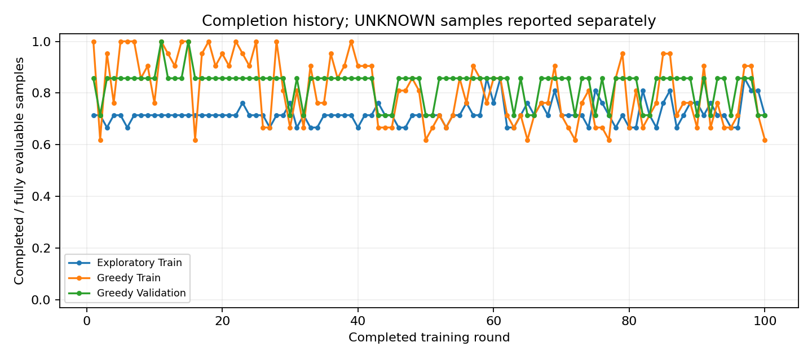
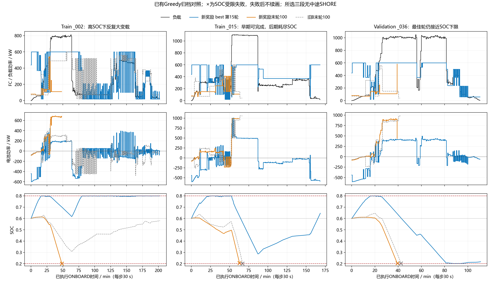
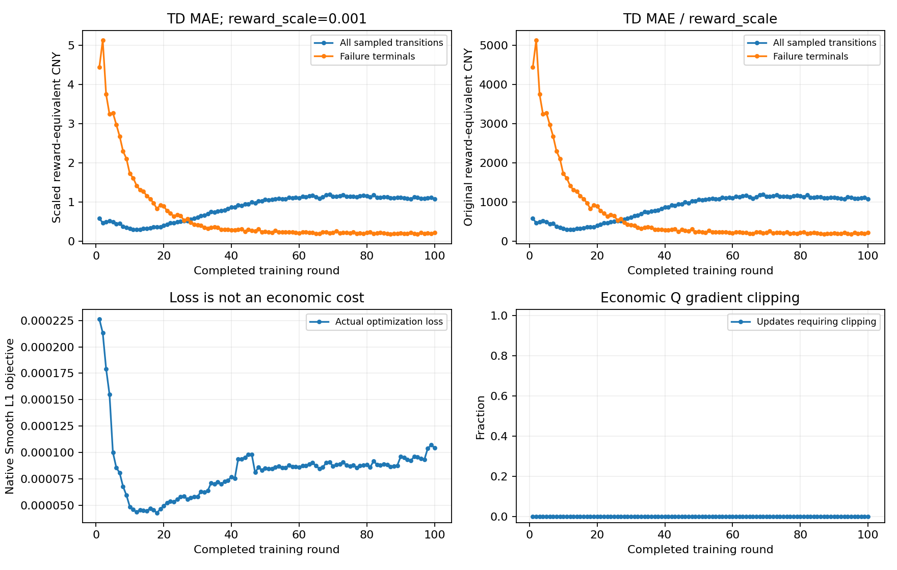

# 新奖励＋PER的100轮正式训练分析

日期：2026-10-15。仅分析现有报告、CSV及少量逐样本归档；未训练、未重新Greedy回放、未运行测试、未读取Test、未修改源码或历史结果。

## 1. 结论

**出现了合格最佳模型，但没有稳定收敛，也没有实现经济合理、平稳的FC基础负载控制。**

- 第11轮首次满足资格，第15轮为最佳；只有这两轮同时满足完整Train21/21、Validation7/7，且UNKNOWN已观测前缀无物理失败。
- 最佳轮的可行性是真实进步：`_015`和Validation`_036`均完整运行。但完整样本约79%的控制步SOC≥0.79，FC仍频繁大变载，综合成本高。
- 第40轮后不再有Train21/21；第100轮Train13/21、Validation5/7，比旧B末轮17/21、6/7更差。不能用末轮已完成子集的较低费用证明整体经济性改善。
- 与旧B末轮在**共同完整样本**上比较，最佳轮Train费用增加86.44%，Validation增加87.18%；主要增加FC变载退化。
- PER失败终止配额确实执行，终止处TD误差下降；失败前缀与普通非终止经验的残差却增大。极小的PER加权Loss不能证明整体价值拟合已收敛。

## 2. 实验身份与实际配置

新运行：`outputs/v4_energy_soc_per_beta200_seed42_100r_20261015/`。
依据：`run_metadata.json`、`report.json`、`round_metrics.csv`，并核对`round_history.json`。

训练元数据记录源码提交`6a470deefe91921384eef5624a839a7419e3df73`，启动时工作树有未提交候选修改，实际源码指纹为`d54835f24b73277bf0bdfc132b84b74edef501fe69eed399c03f2ad77687bd2a`。因此不能只用该HEAD还原实验，必须同时保留候选源码/指纹。该候选此前已同步提交到DDQN分支；本次没有再次提交。

| 项目 | 实际值 |
|---|---|
| 网络、动作 | MLP 7–128–128–61，ReLU；FC0–600kW，步长10kW |
| Adam学习率 | 0.001 |
| γ、n-step | 1.0、8 |
| Replay、Batch、更新 | 300000、64、replay32 |
| Target | 初始化完整复制一次；每次经济Q更新后soft update，τ=0.001 |
| Loss、梯度裁剪 | Smooth L1/Huber δ=1；max_norm=10 |
| 新奖励 | 氢耗＋岸电购电＋SOC参考值平方偏差，FC/电池退化训练权重均为0 |
| SOC项 | β=200，SOC_ref=0.6，使用ONBOARD动作后实际SOC |
| Replay缩放 | 0.001，仅进入经济Replay时缩放一次 |
| 失败机制 | 独立失败惩罚倍率1，参考10132.6600879；失败终止配额2 |
| PER | α=0.6、IS β=1、ε_priority=1e-6 |
| UNKNOWN | observed_nstep，仅保留已观测闭合的有效窗口 |
| 探索 | ε第1轮1.0，第70轮0.05，此后保持；Greedy ε=0 |
| 轮数、种子 | 100、42；全新权重、空Replay、新Adam |
| 模式、约束 | v3标签、固定目标模型岸充0.6、原物理掩码；无人工FC门控 |

实际ONBOARD训练奖励（未缩放）：

\[
r_k=-\{C_{H2,k}+C_{shore,purchase,k}+200(SOC_{k+1}-0.6)^2\}.
\]

岸充及必要终端补能购电只结算一次；失败处另扣独立训练罚项。FC退化、电池退化仍完整计算经济账本和最佳模型评价，但不进入该次Q训练奖励。没有电量价值重分配或势函数终端校正。

**本轮并非旧B的单变量对照：奖励目标与采样机制同时变化。** 新旧数据manifest完全一致，物理参数/状态/网络/n-step等关键配置一致；不能把收益或退化单独归因于PER或奖励简化。

## 3. 完成情况和收敛性

训练完整完成100轮，耗时17608.61秒，约4小时53分。每轮Validation均执行；报告记录Test访问0、manifest未变、资格核验通过。

| 指标 | 最佳第15轮 | 最后第100轮 | 旧B第100轮 |
|---|---:|---:|---:|
| Greedy Train完整集合 | 21/21 | 13/21 | 17/21 |
| Greedy Validation完整集合 | 7/7 | 5/7 | 6/7 |
| 合格best | 是 | 否 | 无合格best |
| 完整Train费用/元 | 169892.21 | 不成立，8个失败 | 不成立，4个失败 |
| 完整Validation费用/元 | 44280.13 | 不成立，2个失败 | 不成立，1个失败 |

Train另有9个UNKNOWN样本，Validation另有1个；不计入完整集合分母，不是正常成功，也不是物理失败。新运行全程UNKNOWN观测前缀没有先发生的物理失败，执行异常数为0。

完整Train21/21的轮次：1、5、6、7、11、14、15、18、22、25、28、39。Validation7/7仅11、15；资格轮次也仅11、15。第100轮探索完成15/21，另9个数据截断，不能把尝试30样本的显示分母当作完整任务数。

| 阶段 | 新Greedy Train平均完成/21 | 旧B平均/21 | 新Validation平均/7 | 旧B平均/7 |
|---|---:|---:|---:|---:|
| 1–20 | 19.05 | 16.30 | 6.05 | 5.70 |
| 21–40 | 17.95 | 15.90 | 5.90 | 5.60 |
| 41–70 | 16.03 | 15.93 | 5.73 | 5.73 |
| 71–100 | 15.80 | 16.93 | 5.67 | 5.83 |
| 最后10轮 | 15.80 | 17.50 | 5.60 | 5.90 |

`best_agent.pt`存在（120801字节），对应15轮；`training_state_latest.pt`存在（122055283字节），对应100轮续训状态，两者不能混用。

## 4. 最佳模型的经济账本

以下均是**完整固定样本集合**，包括模型补能；不是缩放reward、不是实测全额支出，失败训练罚项不计入。

| 成本/元 | Train21 | Validation7 |
|---|---:|---:|
| 氢耗 | 31067.62 | 7663.08 |
| FC退化 | 136541.44 | 35609.38 |
| 电池退化（含模型补能） | 2283.15 | 731.29 |
| 岸电购电 | 0.00 | 276.38 |
| 合计 | **169892.21** | **44280.13** |

Train FC退化占总费用80.37%，Validation占80.42%。岸电0不表示免费补能：最佳轮很多航段终点和中途靠港时SOC已高于0.6，因此没有SOC缺额。Validation终端模型补能购电276.38、电池充电退化108.07，合计384.46元；中途固定目标充电购电/充电退化0，但岸停FC变载6.615元仍计账。

按现行正式四工况模型逐动作复算，FC各项之和与每个归档profile账本误差均小于1e-6：

| FC退化子项/元 | Train21 | Validation7 |
|---|---:|---:|
| 低载运行 | 8052.10 | 2307.32 |
| 高载运行 | 5218.43 | 1132.91 |
| ONBOARD变载 | 114661.10 | 28217.38 |
| 岸停变载（仍属变载项） | 2.205 | 6.615 |
| 启动 | 8607.60 | 3945.15 |

Train约84%的FC退化来自变载。完整Train启动24次=21个样本首次＋1次岸后＋2次内部；Validation11次=7首次＋3岸后＋1内部。**本次高费用主要是大变载，不是频繁重新启动主导。**

### 4.1 与旧B同一批完整航段比较

| 比较集合 | 旧B100费用/元 | 新模型费用/元 | 变化 | 旧→新内部mean∣ΔFC∣/kW | 旧→新>300kW跳变 |
|---|---:|---:|---:|---:|---:|
| best15与旧B共同Train17 | 68681.43 | 128048.44 | +86.44% | 41.91→114.73 | 185→794 |
| best15与旧B共同Validation6 | 21802.37 | 40810.06 | +87.18% | 33.97→101.76 | 43→198 |
| final100与旧B共同Train13 | 43010.17 | 50595.65 | +17.64% | 37.65→54.44 | 62→351 |
| final100与旧B共同Validation5 | 19408.13 | 19317.15 | −0.47% | 33.47→34.12 | 37→74 |

注：表头`mean|ΔFC|`表示每30秒相邻ONBOARD动作绝对变化的平均值；排除了样本首次和岸后首次，不把边界阶跃冒充内部变载。末轮Validation仅共同5个样本费用略低，不代表完整7样本经济性改善。

Train共同17：002、005、006、011、013、016、020、021、022、038、040、045、048、049、051、052、053。Validation共同6：004、009、019、032、043、047；末轮共同5去掉047。完整对照分项见[同集合CSV](results/v4_energy_soc_per_100r_analysis_20261015/same_sample_comparison.csv)。

## 5. SOC、功率分配和代表航段

**使用完整样本集合口径**：best15 Train21的SOC≥0.79占78.68%，Validation7占79.41%；平均SOC0.76866/0.76188，平均样本终端SOC0.79239/0.71650。最小实际SOC0.28670/0.20054，最大均<0.8。因此没有实际越界，但Validation已经十分接近下限。

报告原生全执行步统计包含UNKNOWN有效前缀，得84.94%/80.72%；该统计与上述完整集合不同，不能混用。

最佳轮高SOC零FC：完整Train7步、Validation21步，全部物理掩码仅允许0；包含UNKNOWN前缀后为2341/22步，仍全部受迫。**没有这些高SOC点主动拒绝合法正功率的证据。**但非零正功率档位之间仍有剧烈切换，不能以“零动作受迫”解释全部跳变。

- **Train `_002`**：best15完整405步，SOC终点0.79990；内部mean|ΔFC|101.04kW、最大500kW、>300共34次。第280行动600kW，负载496.35、SOC动作后0.798979；下一行动100kW，负载494.33、物理候选仍有58个，SOC降至0.793435。说明上限附近掩码确实在变化，但候选数远非只有一个，不能把500kW跳变全部归为必需的物理动作。末轮仅97步后SOC受限失败。
- **Train `_015`**：best15完成337步，最低SOC0.28670；末轮第126行失败。最佳轮更早使用高FC补充储能，后期在高负荷时仍能够供电；末轮同样本在100步以上的已观测时间内逐渐消耗SOC。
- **Validation `_036`**：best15完成222步，但最低SOC0.200544，末端0.21748；末轮第79行失败，旧B第85行失败。最佳模型在该样本具有可行执行证据，但裕量仍很小。
- **Train `_006`**：best15 SOC≥0.79占91.74%，内部mean|ΔFC|148.23kW，费用7255.16元；末轮该样本完成，mean|ΔFC|11.37、费用1665.87元。说明某些工况改善与其他工况失败可以同时发生，不能把末轮的整体退化解释为每条样本都变差。

### 5.1 末轮物理失败及前缀窗口

Train失败（0-based源行索引）：002@97、008@65、015@126、016@164、044@135、045@171、050@216、052@108。Validation：036@79、047@97。均归类SOC受限，无结构性容量失败或程序执行错误；UNKNOWN另外计数。没有本次新负载可行性搜索，只使用历史已证实的可行性及本轮best15实际完成证据。

| 末轮失败前窗口 | 实际步数 | 平均负载/kW | 平均FC/kW | 起始→末SOC |
|---|---:|---:|---:|---:|
| Train015最后8步 | 8 | 1100.39 | 110.00 | 0.31640→0.20503 |
| Train015最后32步 | 32 | 795.98 | 177.50 | 0.48470→0.20503 |
| Train015最后100步 | 100 | 471.34 | 197.30 | 0.59371→0.20503 |
| Val036最后8步 | 8 | 1011.53 | 168.75 | 0.29839→0.20361 |
| Val036最后32步 | 32 | 949.84 | 129.06 | 0.57283→0.20361 |
| Val036已执行全79步（不足100） | 79 | 464.45 | 108.61 | 0.60000→0.20361 |

Train015最后8个已执行状态的物理候选均有61个，说明较高FC并未被掩码禁止；下一失败点才无可行动作。低FC与SOC下降有直接轨迹证据，但选择原因需要Q值与TD共同判断，不能仅凭均值认定优化器或物理模型有错。

## 6. PER、TD拟合与训练更新

正式训练环境动作1171649，预填充14876；Greedy评价1579545，不进入Replay。经济Replay累计插入1181778，优化36930次=预填充463＋正式36467；Target软更新36930次，初始化硬复制1次，周期硬同步0。插入数=36930×32＋剩余credit18。

正式更新共有2333888个采样位置，失败终止抽取72934次=36467×2，严格3.125%。累计失败终止Replay条目4704，末尾池中1136，属于重叠n=8窗口，不是4704次真实失败；正式探索物理失败事件587次。采样量增加已得到确认，不能等同于控制性能改善。

| 每轮采样统计（缩放训练奖励单位） | 第15轮 | 第100轮 |
|---|---:|---:|
| 总体TD MAE | 0.31712 | 1.07183 |
| 失败终止TD MAE | 1.15539 | 0.21765 |
| 失败前缀非终止TD MAE | 0.93367 | 3.23101 |
| 正常终止TD MAE | 0.16932 | 0.88038 |
| 普通非终止TD MAE | 0.30352 | 1.20807 |
| 未解决UNKNOWN前缀TD MAE | 0.04158 | 0.16545 |
| PER实际加权Huber | 0.00004469 | 0.00010464 |
| 未加权Huber | 0.20641 | 0.88913 |
| 平均IS权重 | 0.00068788 | 0.00064744 |
| 平均梯度范数 | 0.00032262 | 0.00024916 |

原奖励单位TD误差=表内值÷0.001；例如末轮总体1071.83、失败前缀3231.01。它们包含SOC和失败训练项，不是实际经济账单误差。各轮Replay/采样分布也在变化，所以这些数字描述实际更新遇到的问题，不能单独作为固定验证集损失比较。

第100轮采样Q范围[-11.98004,-0.01983]，均值-2.57249；Target范围[-11.34360,-0.000528]。全100轮最大梯度范数0.007664、未触发裁剪、没有执行异常。没有梯度爆炸的证据；同时也不能因数值有限而判定价值已准确拟合。

### 6.1 关键状态的真实Q证据

新run报告`rounds[99].td_statistics.watched_replay_targets`在经济优化第36930次后的同一Online/Target快照，记录Train015源行97：

| Replay ID | 源轮次 | 动作/kW | Q | 当下重算TD target | 绝对残差 | 累计draw |
|---|---:|---:|---:|---:|---:|---:|
| 1154659 | 98 | 280 | −0.957625 | −10.612376 | 9.654752 | 1 |
| 1160472 | 99 | 280 | −1.031113 | −10.259502 | 9.228390 | 2 |
| 1172330 | 100 | 80 | −1.032072 | −10.474360 | 9.442287 | 0 |

这些是**当前快照重算的n-step目标，不是固定历史存储target**，也不是当时Greedy的全动作Q排名。它们证明在最新Replay中仍有明显低估未来负面回报的局部经验。经验来自最近三轮，0–2次抽样同时受年龄影响，不能据此推断全部100轮同类状态从未被充分采样。

**已确认的现象**：终止误差降低而前缀误差增大、后期策略退化、PER加权Loss与未加权误差相差很大。

**尚未证实的原因**：类别间梯度干扰、长距离off-policy多步目标偏差、状态混淆、IS归一化导致实际更新幅度偏小等。全局IS归一化可产生小权重，小权重本身不构成PER实现错误；本次没有独立冻结目标实验，不能选其中一个作为确定根因。

## 7. 为什么简化奖励没有解决跳变

源码`src/v4/control.py:25`、`:373`、`:405`、`:410`将energy_only模式的训练成本限定为氢耗与购电，再扣SOC平方项；`:411`及后续诊断单独记录被排除的退化。`src/v4/monitored_training.py:344`记录退化训练权重0，但经济选模仍使用四项完整账本。

因此，**本轮训练目标与“综合退化经济最优、FC相对稳定”的评价目标并不相同**。对能源相近而变载差别很大的动作序列，训练不再直接区分FC变载费用；这能解释为什么移除费用不能保证平稳，并不能证明所有跳变都由奖励删项导致。

另外，完整Train21最佳轮未缩放训练回报−100776.37，其中SOC罚项69708.75（69.17%）；Validation7回报−28274.14，其中SOC项20334.68（71.92%）。所以不能把高SOC简单解释成“β=200的SOC惩罚太小、没有作用”；同样不能据此擅自增大β。

轨迹还显示上限附近物理候选不断变化，叠加Q偏好产生充放电往复。仅靠PER解决“哪些经验更新更多”，不保证跨类别共同拟合，也不重新定义平稳目标。

## 8. 下一步建议（未实施）

1. **先保留best15和final100，停止把末轮视作部署模型。** 按相同状态/动作及固定类别留出集，检查当前PER的采样概率、IS权重、未加权TD误差和关键状态全动作Q排序。用独立副本、冻结TD目标区分类别干扰与更新幅度问题，不启动新的长训练；不能因为失败终止MAE下降就宣称传播问题解决。
2. **明确奖励目标与最终经济目标的差距，再做一次单变量决定。** 若仍要求优化FC退化，当前完全排除FC退化的energy_only奖励不能天然代表该综合目标。可在用户确认后固定PER及其他参数，对照恢复已有退化经济项，或采用经文献/物理依据确认的双目标；不能同时改β、网络、采样、学习率，也不加入人工FC门控、强制平滑或覆盖Q排名。
3. **可行性和后期保持同时验收。** 后续候选必须在固定21/7完整集合及UNKNOWN已观测前缀保持无物理失败，并在同一完成样本集上降低完整成本和内部大变载；不以部分失败样本截断后的低费用作胜出依据。至少多种种子再判断稳定性，不能凭这一个seed宣布解决。

本次best15符合现有代码的Test资格门槛，但综合成本和FC大变载仍未达到研究目标，**建议继续封存Test**，先解决上述训练/目标问题。本次没有启动后续实验或修改任何参数。

## 9. 输出与可复算来源

- 新报告：本文件。
- 新增图：`docs/results/v4_energy_soc_per_100r_analysis_20261015/representative_power_soc.png`。
- 新增轻量同集合CSV：同目录`same_sample_comparison.csv`。
- 复用现有完成率、TD、SOC、费用图，不重复保存整套轨迹。
- 原始证据：新run的`report.json`、`round_metrics.csv`、`round_history.json`及第15/100轮Train/Validation逐样本归档；旧run为相邻`direct-power-mlp/outputs/v4_replay_ab_B_observed_seed42_100r_socmaskfix_resume30/`第100轮报告与压缩轨迹。按profile流式读取，没有将全部大型JSON同时装入内存。
