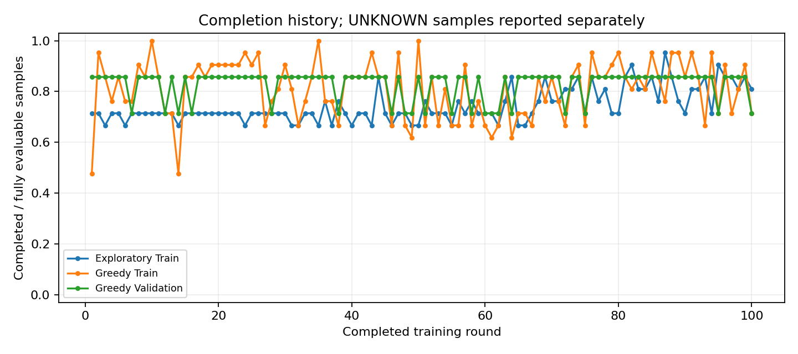
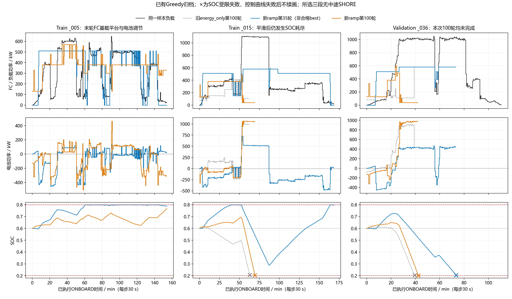

# FC功率波动惩罚＋PER：100轮结果分析

日期：2026-10-16。仅分析已有报告、CSV、已保存Q诊断和代表性归档轨迹；没有训练、额外Greedy回放、测试、算法修改或Test读取。未提交推送。

## 1. 结论

**新增波动项确实改善了FC大幅变载和共同完整样本的综合经济费用，但没有解决完整供电与稳定收敛，也没有让启停行为全面改善。**

- 已完成100轮。Train最高21/21（第10、35、50轮），Validation从未7/7；没有合格`best_agent.pt`。
- 末轮Train15/21、Validation5/7，上一组为13/21、5/7；全100轮平均完成数几乎相同。
- 新旧末轮共同完整Train13：费用下降25.83%，内部mean∣ΔFC∣从54.44降至24.91kW，>300kW变化从351降至15次。Validation共同5也改善，但没有覆盖失败样本的费用优势。
- 第35轮完整Train21费用10.12万元，比上一组best15同21样本16.99万元下降40.46%；但新35的Validation只有6/7，不能称合格best。
- 第35轮真正ONBOARD内部重启54次，旧best15只有2次；“减少大变载”和“减少启停”不是同一个结果。
- 末轮仍有高负载下自主选择40kW、耗尽SOC的真实Q证据；正常终止TD误差反而明显恶化。不建议进入Test。

## 2. 运行身份与配置核实

新目录：`outputs/v4_energy_fc_ramp_beta200_per_seed42_100r_20261015/`。

对照目录：相邻工作树`v4-energy-soc-per/outputs/v4_energy_soc_per_beta200_seed42_100r_20261015/`。

新运行元数据：提交`fcba5396f5adcd778035e6eaf4742858c8f6431d`，`source_worktree_dirty=true`，源码树指纹`a93908e93345e1312b63b8e0670fef1966cbfff166f2e8869ba8d7a5a4a5a425`。启动时新增奖励尚未提交，不能只凭HEAD还原该实验，须保留对应源码/指纹。

新旧正式数据manifest完全相同。记录的超参数仅变化`reward_cost_mode`、公式和新增系数0.11025；网络7–128–128–61、61动作、Adam0.001、γ1、n8、Replay300000、Batch64、replay32、Target软更新τ0.001、scale0.001、SOCβ200/ref0.6、seed42、ε1→0.05/第70轮、失败惩罚和配额2均一致。PER仍为α0.6、ISβ1、ε_priority=1e-6。无人工门控、硬爬坡或滤波。

新奖励（未缩放）为：

`-(C_H2 + C_shore_purchase + 0.11025*abs(actual_FC-previous_actual_FC) + 200*(SOC_next-0.6)^2)`。

真实失败处另扣原独立训练惩罚；n-step累计后进入Replay时统一乘0.001。四项经济账本仍独立统计，不把辅助SOC/波动/失败项再加入经济费用。

从全部100轮探索/Greedy Train/Greedy Validation报告复算，归档波动惩罚与`0.11025 × Σ|实际FC变化|`最大差2.91e-11原奖励等值，确认新项实际执行。

两组轨迹和入池量不同，经济更新次数也自然不同；这是相同replay32调度下的结果，不能说两组梯度预算完全相等。

## 3. 完成率与稳定性

| 指标 | 新ramp＋PER | 旧energy_only＋PER |
|---|---:|---:|
| 实际完成轮数 | 100 | 100 |
| 合格轮次 | 无 | 11、15 |
| Train21/21轮次 | 10、35、50 | 共12轮 |
| Validation7/7 | 从未出现 | 11、15轮 |
| 第100轮Train | 15/21 | 13/21 |
| 第100轮Validation | 5/7 | 5/7 |
| 100轮Train平均完成 | 17.03/21 | 16.95/21 |
| 100轮Validation平均完成 | 5.80/7 | 5.81/7 |
| 后20轮Train平均 | 17.70/21 | 16.05/21 |
| 后20轮Validation平均 | 5.90/7 | 5.65/7 |

有后期平均改善，但尚不能认定稳定达标。Validation `_036`新运行100轮全部SOC受限失败；旧运行在第11、15轮曾完成，不能宣称该样本在现有物理模型下无解。

Train9个、Validation1个含UNKNOWN，单独统计。末轮这些样本均在UNKNOWN截断，未先发生物理失败；全100轮中分别有1次、2次UNKNOWN之前已发生真实SOC受限失败，报告仍按物理失败保留，不能把它们用数据截断掩盖。

`training_state_latest.pt`存在，约118.7MB；`best_agent.pt`不存在，报告`best_checkpoint=None`、`eligible_rounds=[]`，不是保存遗漏。第35轮只作为已有轨迹的诊断代表：它在三次Train全完成轮中费用最低，**没有第35轮诊断网络权重**，不能拿末轮权重冒充该轮模型。

## 4. 波动与经济性：严格同集合比较

下表只比较双方都完整完成的相同样本。内部变化排除样本第一个决策和SHORE后的第一个决策，不将边界阶跃混作内部变载。费用包含四项完整模型账本和必要补能；失败截断费用不参与比较。

| 同集合比较 | 旧→新费用/元 | 变化 | 内部mean∣ΔFC∣/kW | >300kW次数 |
|---|---:|---:|---:|---:|
| 两组第100轮，Train共同13 | 50595.65→37529.23 | −25.83% | 54.44→24.91 | 351→15 |
| 两组第100轮，Val共同5 | 19317.15→18691.72 | −3.24% | 34.12→28.62 | 74→1 |
| 旧best15→新35，Train共同21 | 169892.21→101160.32 | −40.46% | 104.38→29.29 | 977→83 |
| 旧best15→新35，Val共同6 | 40810.06→25356.90 | −37.87% | 101.76→36.00 | 198→16 |

前两行是最终模型同集合比较；后两行是诊断轮次比较，不能代替合格模型评比。详细分项见[同集合CSV](results/v4_fc_ramp_per_100r_analysis_20261016/same_sample_cost_and_ramp.csv)。

### 4.1 新第35轮完整Train21成本

| 成本项 | 元 |
|---|---:|
| 氢耗 | 30154.20 |
| FC退化 | 68833.51 |
| 电池退化（含模型补能） | 2164.00 |
| 岸电购电 | 8.61 |
| 完整费用 | **101160.32** |

其中FC低载2902.26、高载7148.19、变载31884.30、启动26898.75元。旧best15同21样本变载114661.10元，启动8607.60元：**变载费用大降，但启动费用增加。**所有复算子项与各profile原账本最大差1.42e-10元，没有改变原退化系数。

新35的75次启动正确拆分为：首个ONBOARD块延迟首次20次、岸后延迟首次1次、真正内部重启54次。不能把75次都叫“内部重启”。旧best15为首次21＋岸后首次1＋内部重启2。新35完整Train的589个高SOC零FC步骤均仍有合法正功率动作，属于自主选择零功率；对应75次内部停机也均有正动作可行，不是物理强制。

新100完整Train15启动17次=首次15＋岸后1＋内部重启1；完整Validation5启动9次=首次5＋岸后3＋内部重启1。与旧100共同Train13/Val5的真正重启数均为0→1，因此不能写成启停全面改善。

### 4.2 SOC与补能

完整集合口径：新35 Train21的SOC≥0.79占33.97%，旧best15同21为78.68%，有所改善，但平均终端SOC仍0.78570。新100已完成Train15的高SOC占30.12%，已完成Val5占46.94%，终端均值0.78452/0.79238，仍有较明显的末端过量储能。

在末轮共同Train13上，旧→新SOC高位占比为0→31.54%，氢耗9954.90→12894.69元；说明相对旧末轮低SOC策略，新策略更保守、更耗氢，尽管变载退化降低后综合费用仍下降。

新35中途模型岸充购电8.61元、对应电池充电退化2.23元；终端模型补能为0。新100已完成样本中途和终端购电均0，是因为相关抵港/终点SOC已不低于0.6，不表示免费恢复SOC。失败样本不做虚构补能。这里是模型化经济结算，不能称实测岸电交易。

## 5. 代表性功率/SOC曲线及失败

蓝色新35（非合格best）、橙色新100、灰色旧energy_only100。`_005`没有重复扫描旧大档提取曲线，因此该列仅展示两条新ramp轨迹；其余列有旧组。三段均无中途SHORE；黑色为归档同一样本负载，控制曲线失败后不续画。

- **Train005**：新100出现较长380kW平台，电池承担负荷差额，SOC约0.6–0.77。这是FC基载/电池调节在该样本上的具体改善证据，不能代表所有工况。
- **Train015**：新35完整337步；新100第139行失败，旧energy_only100第126行失败。延后失败不能称为成功；末轮在约1100kW负载下长期选40kW。
- **Validation036**：新35第147行失败，新100第85行，旧100第79行。新35失败前100步平均FC566.8kW，已经接近600上限，所以不能把每种失败都概括为“最后FC太低”；前期储能和整体能量配分同样重要。

末轮失败列表（0-based源行）：

- Train：002@111、008@69、015@139、016@215、044@165、050@239。
- Validation：036@85、047@111。

全部是SOC受限；没有结构性总功率不足或程序执行异常。剩余UNKNOWN另列，不能混入失败名单。

| 末轮失败前窗口 | 平均负载/kW | 平均FC/kW | SOC起→末 | 合法动作 |
|---|---:|---:|---:|---|
| Train015最后8步 | 1095.39 | 40.00 | 0.32146→0.20277 | 8步均61动作 |
| Train015最后32步 | 1099.06 | 45.63 | 0.67665→0.20277 | 32步均61动作 |
| Train015最后100步 | 574.21 | 275.20 | 0.63075→0.20277 | 100步均61动作 |
| Val036最后8步 | 1016.20 | 40.00 | 0.31013→0.20035 | 7步61动作，最少59 |
| Val036最后32步 | 1003.99 | 59.69 | 0.62513→0.20035 | 31步61动作，最少59 |

这些已执行状态允许更高FC；真正失败点才没有合法动作。但“动作物理合法”不等于能挽救剩余全航程，尤其已经过度放电的末端状态不能仅凭单步反事实宣称能救回。

### 5.1 同轮真实Q证据

来源：新运行`diagnostic_checkpoints/round_100_decisions.json`，匹配第100轮网络快照及Greedy Train实际状态，不是用末轮Q冒充早期轮次。该诊断没有Validation实际Q，不能给036虚构Q排名。

| Train015源行 | SOC | 负载/kW | 实选FC | Q(40) | Q(600) | 600排名 |
|---|---:|---:|---:|---:|---:|---:|
| 111 | 0.61954 | 1103.27 | 40 | −10.37128 | −10.97116 | 55/61 |
| 126 | 0.39582 | 1098.97 | 40 | −10.16055 | −10.70175 | 54/61 |
| 138 | 0.21759 | 1094.05 | 40 | −9.86440 | −10.30307 | 42/61 |

因此，低出力不是人工门控或600被mask排除，网络确实赋予40kW更高估值。该证据不提供真实最优Q：仍不能仅由这一表断言缺陷是奖励权重、拟合干扰、状态信息还是多步off-policy目标。

## 6. 学习数值与更新量

新正式训练环境动作1201533，预填充14876；Replay累计1211662，优化37864次=预填充463＋正式37401，Target软更新37864次，初始化硬复制1次，credit剩14。旧组优化36930次，所以新组多934次（约2.53%），不能称等优化预算。

| 末轮TD MAE（缩放奖励单位） | 旧energy_only | 新ramp |
|---|---:|---:|
| 总体 | 1.07183 | 0.58468 |
| 失败终止 | 0.21765 | 0.17626 |
| 失败前缀 | 3.23101 | 1.37401 |
| 普通非终止 | 1.20807 | 0.61256 |
| 正常终止 | 0.88038 | **2.82829** |
| UNKNOWN有效窗口 | 0.16545 | **0.23038** |

奖励目标、状态访问和采样分布不同，不能把总体TD变小当作严格拟合优劣结论。新末轮正常终止抽样中98.97%的绝对误差>1，平均Q−2.879、平均目标−0.0509；这个类别仍明显存在价值偏差。

新末轮PER平均IS权重0.00045486，加权Huber0.00006181、未加权Huber0.36588；梯度均值0.00024781、无裁剪。沿用已完成的PER审查：小加权Loss不能当作收敛，小梯度也不能直接当作Adam不更新；本轮没有重复PER审查或冻结拟合。

## 7. 判断与下一步重点（均未实施）

1. **可以保留新增波动项作为有实证支持的候选目标。**同集合上大变载和综合成本均改善；但不能宣布整个控制问题已解决，也不能据单种子认定全工况泛化有效。
2. **优先处理失败风险价值与正常终止价值的共同拟合。**已有真实Q显示015在较早高负荷阶段偏向低FC；新正常终止残差又加重。下一步应围绕015/036的早期状态及终止邻域，固定目标、拆分类别和动作覆盖验证，避免再次只根据总体Loss或延长轮数判断。保留已有PER，不据此改变学习率、β或gamma。
3. **单独审视启停与过量储能。**当前训练仍不含FC启动退化，数学上只惩罚功率变化总量；它不能等价代表启动寿命费用。新35的主动零功率/重启增加是具体证据，但是否恢复已有启动经济项须另行单变量确认，不加人工禁停机、阈值FC规则或硬平滑。

单次500kW变载惩罚55.125原奖励等值，失败参考10132.66；不能仅凭“有波动项”就解释所有供电失败为合理取舍。反过来，也不能在已经不可挽救的状态下把任何偏低FC一概称为网络错误，需要区分早期可避免风险与末端既成失败。

**当前不具备最终Test评价条件。**原因既包括没有合格best，也包括持续验证集供电失败和未稳定保持的控制效果。保留所有旧成果，本轮只增加本报告、一张对照图、复用完成率图和轻量CSV。

## 数据来源

新/旧`run_metadata.json`、`report.json`、`round_metrics.csv`；新第35/100轮Greedy Train/Validation归档；旧energy_only第15/100轮的已有合法诊断统计和必要轻量轨迹。按单profile流式解析新大档，没有同时载入整套大型轨迹。Test访问0来自原运行报告，本轮未打开Test载荷。
