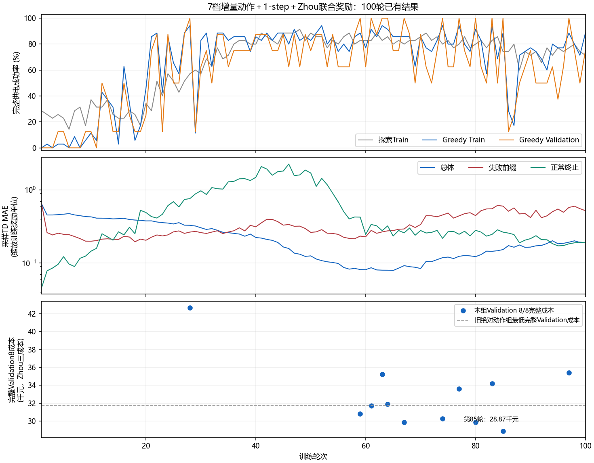
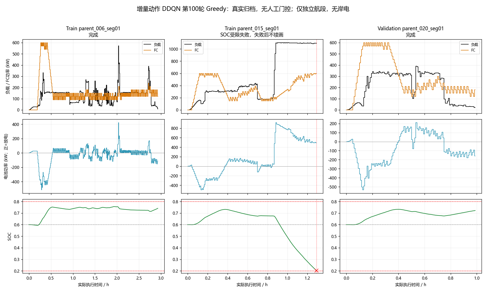
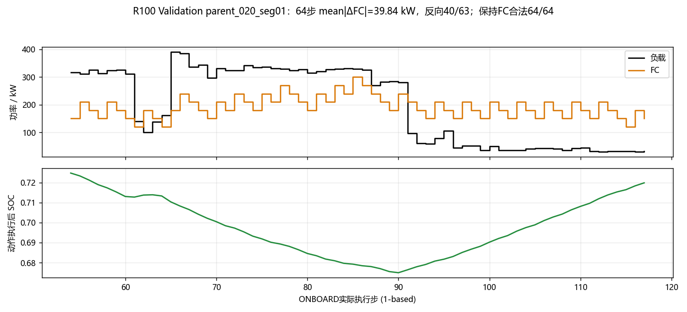

# V4独立航段增量动作DDQN：100轮正式结果分析

## 结论

本组100轮训练完整结束，但**未收敛、未获得合格最佳模型，不具备最终Test评价资格**。Greedy Train最高33/35，最终31/35；Validation有12轮8/8，最终6/8。7档增量动作限制了单步跳变幅度，但没有消除频繁往返变载；部分失败还受到离散增量可达性的限制。完整Validation的最低三成本有改善信号，但后期控制和价值拟合均未稳定。

本次只分析已有Train及Validation归档；没有重新训练、策略回放、消融或Test访问。新增的轨迹压缩与读取支持仅属于离线文件处理，没有修改训练算法、奖励、物理模型或超参数。

## 1. 运行身份与完整性

|项目|实际值|
|---|---|
|实验分支|`feat/v4-increment7-zhou-td1`|
|训练源码提交|`82e21cc46fef163b8680550e35252e2f7c8fa0db`|
|实验编号|`V4-INDEP35-M3-DELTA7-ZHOU-TD1-PER-S42`|
|输出目录|`outputs/v4_independent35_m3_delta7_zhou_td1_per_seed42_100r`|
|状态和网络|`[SOC, P_load/600, P_FC_previous/600]`，3–128–128–7，ReLU|
|动作|增量[-60,-30,-10,0,10,30,60] kW，物理FC范围0–600 kW，无裁剪或绝对动作回退|
|数据|独立航段Train35/Validation8；Test4封存；初始SOC0.6、FC0|
|学习|gamma=1、n_step=1、Adam0.001、batch64、Replay300000、replay32|
|Target|初始化复制1次，此后每个经济Q更新后tau=0.001软更新|
|PER|alpha0.6、IS beta1、epsilon1e-6，失败终止固定配额2|
|探索|seed42；第70轮epsilon降至0.05，此后保持；Greedy评价epsilon=0|
|正常奖励|Zhou逐步三成本＋200(SOC_next−0.6)²＋(0.11025/60)ΔP_FC²的负值，再统一乘0.001进入Replay|
|终止|保留独立真实失败惩罚；无SHORE、终端充电或额外终端等效氢耗重复结算|

`report.json`的`run_status=completed`、`completed_training=true`，轮次1—100齐全。最终epsilon为0.05。正式训练交互1,098,846步，bootstrap另有14,995步；Greedy评价共1,445,749个已执行步。

经济Q共更新34,807次＝bootstrap468＋正式训练34,339，Target软更新也是34,807次。`training_state_latest.pt`存在，其pickle头的`completed_round=100`已核对，未将Replay反序列化；`best_agent.pt`不存在，报告的`best_checkpoint`和`first_qualification`均为null、`eligible_rounds=[]`。Test读取计数为0。

原始小报告、每轮CSV、元数据和日志的可移植压缩副本归档在[结果目录](results/v4_increment7_zhou_td1_per_100r_20261018/)，副本已按解压数据SHA-256与原件核对。权重和大型逐轮轨迹不纳入Git。

## 2. 完成率及收敛性

|范围|探索Train|Greedy Train|Greedy Validation|
|---|---:|---:|---:|
|最终第100轮|25/35|31/35|6/8|
|第61–70轮平均|详见CSV|29.9/35|6.9/8|
|最后10轮平均|详见CSV|26.8/35|4.9/8|

Greedy Train最高33/35，出现在28、52、63、74、77、83轮，从未35/35。Validation达到8/8的轮次为28、59、61、63、64、67、74、77、80、83、85、97；这些轮次均没有同时完成全部Train，因此都不是合格最佳模型。

|最后10轮|91|92|93|94|95|96|97|98|99|100|
|---|---:|---:|---:|---:|---:|---:|---:|---:|---:|---:|
|Greedy Train /35|26|24|21|28|27|27|31|28|25|31|
|Validation /8|4|4|4|5|3|5|8|6|4|6|

因此不能由最后一轮比前一轮回升就认定收敛。评价时没有epsilon探索，轮间变化反映学习中的网络策略及其闭环状态变化。

## 3. 价值拟合：后期误差重新上升

总体采样TD MAE最低为第65轮0.078784，第100轮回升至0.188440。以下误差均为**缩放后的训练奖励单位**，不是实际人民币费用：

|类别|第59轮TD MAE|第100轮TD MAE|
|---|---:|---:|
|普通非终止|0.05887|0.11164|
|失败前缀|0.23244|0.51794|
|失败终止|0.20483|0.54362|
|正常终止|0.42282|0.18877|

正常终止拟合有改善，但失败前缀、失败终止和普通经验同时恶化，不能宣称各类经验已经共同学准。这些是各轮实际采样统计，样本分布和目标网络都在变化，不能当成固定留出集的因果实验。

第100轮PER加权Huber Loss为0.0000273139，未加权Huber为0.1098489，平均IS权重0.00100260；三者必须区分。平均裁剪前梯度范数0.000632，未触发max_norm10裁剪。小梯度或小加权Loss本身不能证明Adam没有更新，也不能证明Q值已收敛。本轮未额外开展冻结目标拟合或重新诊断PER。

## 4. 第100轮控制效果

以下统计来自正式report，按实际控制时长加权，包含失败样本已执行前缀，排除独立样本初始化边界的FC变载。不同轮失败位置不同，不能将这些均值当成同一批完整航程的经济对照。

|指标|Greedy Train|Greedy Validation|
|---|---:|---:|
|平均FC功率/kW|286.62|308.64|
|连续ONBOARD平均绝对变载/kW/步|34.66|34.74|
|连续ONBOARD发生变载的时长比例|96.65%|98.57%|
|最大单步变载/kW|60|60|
|FC=0的时长比例|3.57%|1.64%|
|SOC低于0.4的时长比例|13.42%|11.36%|
|SOC≥0.79的时长比例|5.91%|3.33%|
|已执行SOC最低值|0.200244|0.200265|
|已执行SOC最高值|0.799940|0.799965|

单步大于100/200/300 kW的跳变为0，但这是增量动作定义直接保证的，不能单独作为已学会稳定控制的证据。FC几乎每步都在改变，仍没有稳定承担基础负荷；电池同时承担负载差额和FC主动变载所造成的差额。

实际执行SOC保持在0.2–0.8内；失败表现为下一步已无合法动作，而不是允许实际SOC越界。低SOC失败与高SOC贴边在不同航段并存，不能用总体平均SOC概括全部样本。

最终真实执行轨迹、逐样本启停、反向变载、失败前8/32/100步和代表图见结果目录中的`round100_sample_metrics.csv`、`round100_failure_windows.csv`及`profile_summary.json`。没有合格模型，因此这些明确是**最终轮轨迹，不是最佳策略轨迹**。

逐样本核对确认：Train35次、Validation8次启动均为各独立样本的首次启动，**没有停机后重启**。Train037有一次中途停机，之后持续关闭。因此频繁重新启动已经不是本轮主要异常，持续变载才是。

代表Validation020的64步局部中，相邻63对动作有40次方向反转，平均绝对变载39.84 kW；64步全部7个增量动作和0增量都合法。这说明该处振荡来自Greedy策略选择，并非物理掩码强迫。

高SOC且FC=0的154步全部来自Train037：其中1步物理域仅允许0，153步仍有正增量可行。037在SOC≥0.79区间累计18,120秒。不能将这154步全部解释为“物理强制停机”，也不能仅因选择0就断言不合理：该样本停机后没有再次启动，经济性需结合完整任务判断。

### 实际决策时的Q值证据

本轮保存的10个Train015/017诊断状态已与实际轨迹的状态及动作逐一匹配，选择动作均为当时合法Q排名第一；以下不是用最终网络重新预测的历史Q值。单位为已缩放训练奖励的Q值，不是人民币支出。

|实际状态（0基row）|SOC|负载/kW|上一FC/kW|所选FC及Q|保持FC的Q|更高可行动作及Q|
|---|---:|---:|---:|---|---|---|
|Train015 row130|0.393129|1096.85|500|470：−5.256315|500：−5.503900|560：−5.303121|
|Train017 row114|0.399075|815.19|360|330：−0.107120|360：−0.195921|420：−0.154204|
|Train015 row153|0.215998|见Q明细CSV|600|590：−9.946136|600：−10.085745|600合法但排名较低|

能够确认低SOC高负载时，合法更高FC确实被Q网络排在更低位置；不能仅由此区分估计偏差、状态混淆或未来风险传播不足。Validation020/044没有这些实际决策Q归档，本报告不虚构其Q优势。

## 5. 经济性及可比范围

完整航段经济评价为：实际氢耗加首尾SOC净变化折算的带符号等效氢耗，再加原FC退化和电池退化；不加SOC/平方变载辅助惩罚，也不将失败训练惩罚计入实际费用。参考效率0.5711999752720877、电池624 kWh、氢低热值33.333333 kWh/kg、氢价21.9元/kg沿用既定研究参数。

本组完整Validation8最低成本在第85轮：

|三成本|元|
|---|---:|
|等效氢耗|13,344.05|
|FC退化|14,457.37|
|电池退化|1,066.63|
|总计|28,868.05|

当轮Train仍只有31/35，因此它只是“完整Validation最低费用轮”，**不能命名为合格最佳模型**。

与旧独立航段绝对功率100轮实验核对：数据manifest、固定Validation8样本及Zhou评价参数一致。旧组完整Validation最低31,741.01元，本组最低低约9.05%。这说明存在一定经济改善的样本证据；但动作空间、n-step和奖励三项同时改变，且仅seed42，不能归因单一改动，也不能据此宣称整体策略已经优于旧组或适合Test。

第100轮Train的115,101.96元仅对应31个完成样本，Validation的28,603.87元仅对应6个完成样本。二者不是固定35/8样本完整费用，不能与上述28,868.05元或其他轮不同完成集合成本直接排名。

### 最终轮FC退化来源

根据真实执行的FC功率、上一功率和实际步长，对正式四工况模型进行代数分解；与每步原始账本最大误差8.25×10⁻¹³元，未达到EOL截断。下表范围为**全部实际执行前缀，含失败**，不是完整Train35/Validation8费用：

|FC退化分项/元|Train执行前缀|Validation执行前缀|
|---|---:|---:|
|低载运行|13,146.50|3,476.49|
|高载运行|4,522.83|1,361.84|
|变载|53,132.78|14,238.79|
|启动循环|12,552.75|2,869.20|
|FC退化合计|83,354.87|21,946.31|

变载约占各自FC退化的63.7%/64.9%。本轮费用问题主要来自持续变载，不能继续简单归因为反复启动。SOC软项、平方变载辅助项和独立失败惩罚均单独记录，没有混入这些真实模型费用。

## 6. 最终失败清单与增量可达性

所有row均为归档中的0基样本内索引：

|集合|样本|失败row|归档原因|
|---|---|---:|---|
|Train|parent_010_seg02|243|soc_limited|
|Train|parent_015_seg01|155|soc_limited|
|Train|parent_017_seg01|210|soc_limited|
|Train|parent_036_seg01|123|soc_limited|
|Validation|parent_016_seg01|254|soc_limited|
|Validation|parent_044_seg01|196|increment_action_limited|

前五项是当前状态下物理绝对动作域也为空，不等于已经证明整条航段从SOC0.6起点起结构性不可行；合理提前分配是否能避免，需要独立的可行性证据。最后一项明确仍有物理绝对动作可行，但现有7档增量不可达，不能归因于FC600 kW容量本身不足。

Validation044失败状态为SOC0.2027275601、观测负载790.3425 kW、前FC560 kW。按正式30秒SOC及功率平衡公式代数复算，物理绝对可行域只有600 kW；+30→590 kW会使下一SOC为0.1999112，而600 kW对应0.2000518。但+40不在7档动作中，+60→620又越界，所以该状态没有合法增量。这个计算不执行环境回放，也不能证明整航段必然不可行。

失败前100个实际步，Train015平均负载700.32 kW、FC333.9 kW，SOC0.71756→0.20196，更高FC在73/100步存在；Train017的SOC0.42809→0.20024，更高FC在59/100步存在；Validation044更高FC在81/100步存在。这说明较早阶段有供能选择余量，但不构成替代控制序列的完整可行性证明。

本组没有UNKNOWN数据截断和程序执行错误。因此不能再把本次未收敛直接解释为UNKNOWN终止语义问题。

## 7. 优先处理的问题与边界

1. **价值拟合和闭环稳定性。** 后期多个类别TD残差增加、Greedy完成率退化已经有数据支持。目标漂移、共享网络干扰、状态信息不足各自占比尚未由本轮实验确定，不能仅归因学习率或PER。
2. **增量动作可达性与SOC储备。** 044存在绝对可行而离散增量不可达的直接证据；其余SOC受限失败需要区分更早决策可避免与真正能量不足。不能用人工门控或强制FC出力替代验证。
3. **持续变载及费用。** 60 kW幅度上限没有消除频繁往返，且FC退化仍是重要费用来源。下一组实验应隔离动作表示、价值学习或奖励因素，不能同时再修改多项，也不能单凭TD下降宣布控制改善。

本次不实施新方案、不启动下一组训练、不使用Test选参。

## 8. 轨迹压缩与后续分析

按“先归档并提交推送，再压缩”的顺序处理已停止DDQN运行中的逐轮轨迹。每份`round_*_trajectories.json`无损转为同名`.json.gz`，逐文件比较原数据与解压数据的SHA-256和字节数，一致且原件未发生变化后才移除未压缩副本。权重、Replay、报告、数据集、DDPG/TD3输出不在删除范围。

新增纯stdlib读取支持接受原`.json`路径，并在原件不存在时寻找`.json.gz`；按样本流式解析，不必将整个大JSON读入内存。`v4.learning_curves`的已归档轨迹选择也适配该读取方式。压缩不丢弃任何字段，旧报告中的原始轨迹文件名仍可用于兼容读取。

Git只保存本报告、指标、元数据、代表图和压缩清单；**大型压缩轨迹与模型仍保留在本地，并不因为提交推送就自动成为GitHub备份**。压缩后的实际空间节省与逐文件核验结果在完成后补入本节及结果目录清单。
