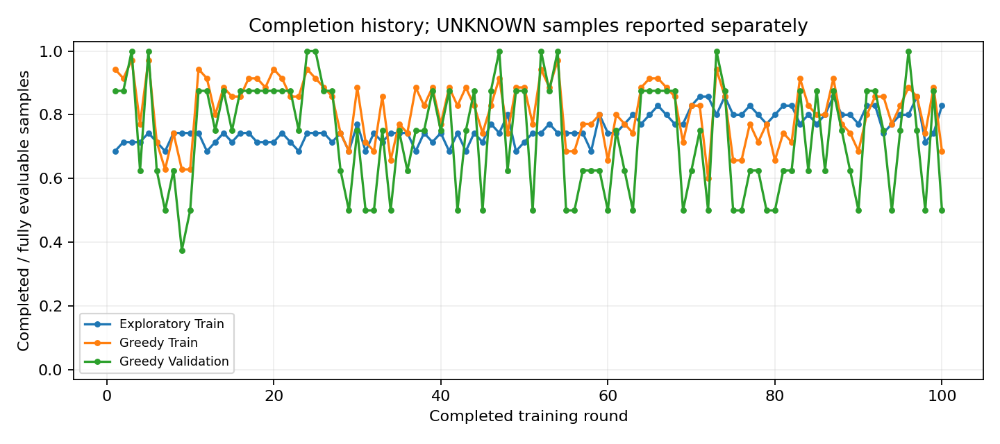
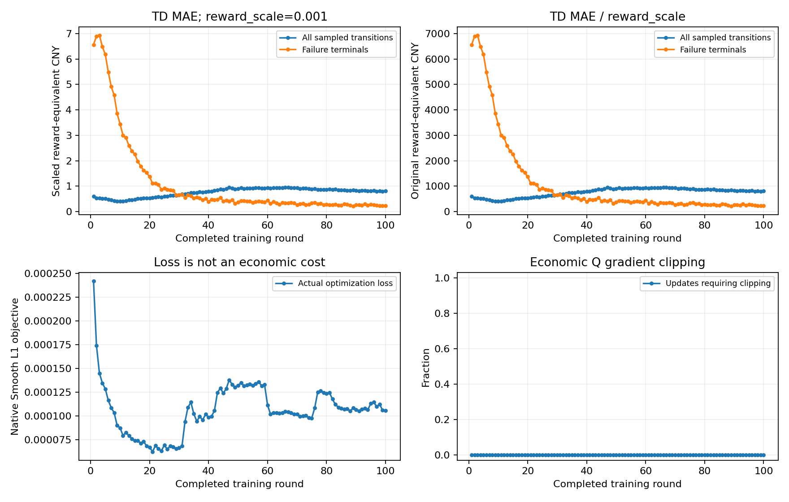
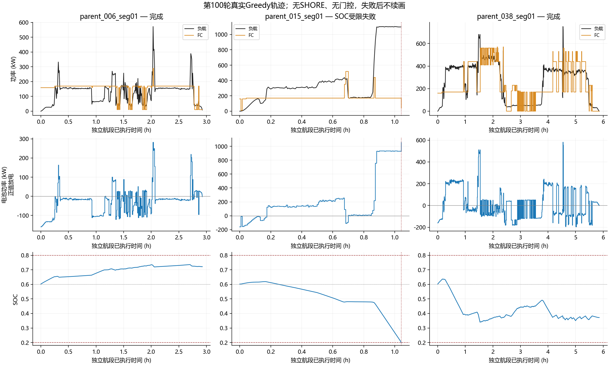

# V4独立航段3维纯控制奖励＋PER 100轮训练分析

## 1. 范围与完成情况

- 实验：`V4-INDEP35-M3-CTRL-PER-S42`，目录：`outputs/v4_independent35_m3_control_per_seed42_100r_splitv2_io_resume`；本报告不混入旧零边界数据实验或新增7档增量动作实验。
- 源码身份：`82e792e6dce32099251e333756af0c1b3a3d39b4`；续训源码树SHA256：`c2628661e8d408ce7069ad77d729b787f07a7541d31900cfe7ab7a4abd808b12`。最初99轮源码为`a765dd151a099d278725e62907deb63499020843`。第100轮曾在JSON轨迹序列化时发生MemoryError，由第99轮完整checkpoint续训完成；续训只修复输出内存峰值，算法配置不变。
- 已完成100/100轮，最后ε=0.05；训练环境动作1,153,227步，bootstrap 14,995步，经济Q更新36,506次（bootstrap 468＋正式36,038）；目标软更新同为36,506次。
- `resume_provenance.json`记录续训前后Agent训练状态指纹一致，原第99轮checkpoint与历史输出未动；第100轮最终更新36,506次与原中断报告的同轮partial更新计数相同，未重复累计中断轮次。
- 固定Train35/Validation8；Test4封存，报告记录Test访问次数为0。无UNKNOWN或SHORE控制步、无末端补能。
- `training_state_latest.pt`已保存；合格最佳模型：**不存在**。没有任何一轮同时满足完整Train和Validation供电资格，不能把最后一轮称为最佳模型，**不建议进入最终Test评价**。

| 项目 | 实际配置 |
| --- | --- |
| 网络/状态/动作 | minimal3；3–128–128–61；SOC、当前负载/600、上一实际FC/600；0～600 kW绝对动作，间隔10 kW |
| 学习 | Adam0.001；γ=1；n=8；Batch64；Replay300000；replay32；soft tau=0.001 |
| 采样/探索 | PER alpha=0.6、IS beta=1、epsilon=1e-6；失败终止配额2；seed42；ε第1～70轮1→0.05，之后固定 |
| 正常奖励 | `-0.001*(0.11025*abs(FC-FC_prev)+200*(SOC_next-0.6)^2)`；另保留真实失败惩罚，不含三项经济成本 |
| 经济评价 | Zhou：实际氢耗＋有符号SOC差额等效氢耗，再加FC退化、电池退化；eta_ref=0.5711999752720877；各航段SOC从0.6独立初始化，无充电操作 |

## 2. 完成率、奖励及收敛

| 评价 | 第1轮 | 100轮范围 | 第100轮 | 末10轮均值 | 全部完成轮次 |
| --- | --- | --- | --- | --- | --- |
| Exploratory Train | 24/35 | 24～30/35 | 29/35 | 27.70/35 | 无 |
| Greedy Train | 33/35 | 21～34/35 | 24/35 | 28.60/35 | 无 |
| Greedy Validation | 7/8 | 3～8/8 | 4/8 | 5.90/8 | 3,5,24,25,47,52,54,73,96 |

**本轮未获得稳定收敛的合格策略。** Greedy评价不含ε探索，完成率仍反复下降，因此不能仅用探索噪声解释；Validation偶尔8/8也未伴随Train35/35。

CSV中的奖励为固定35/8样本任务的已执行控制奖励合计，包含失败惩罚；失败会缩短执行长度，不能把失败截断时少付的控制惩罚当成收益。它不是经济费用负值。

### TD拟合

| 类别 | 第1轮TD MAE | 第100轮TD MAE |
| --- | --- | --- |
| 总体 | 0.598 | 0.817 |
| 正常终止窗口 | 0.150 | 1.510 |
| 失败终止窗口 | 6.562 | 0.223 |
| 失败前缀 | 1.408 | 1.551 |
| 普通非终止 | 0.206 | 0.714 |

均为**缩放训练奖励单位**（反换算除以0.001，仍非实际人民币费用）。第100轮PER加权Huber=0.00010599，未加权Huber=0.563083。二者差异不能单独证明Adam失效；本轮没有另外运行冻结目标拟合或修改PER。已记录的失败终止拟合改善，不能代替正常终止、失败前缀和闭环性能改善。

## 3. 第100轮功率分配与SOC

| 集合 | 平均FC kW | 内部平均绝对变载 kW | 内部最大跳变 kW | 内部>100/200/300次数 | 0→正启动次数 | SOC<0.4时间 | SOC≥0.79时间 |
| --- | --- | --- | --- | --- | --- | --- | --- |
| Train | 222.5 | 16.48 | 430 | 711/251/111 | 145 | 20.32% | 3.85% |
| Validation | 257.6 | 14.45 | 400 | 126/52/21 | 17 | 15.81% | 0.00% |

统计包含失败前已执行动作；内部变载排除每个独立样本的FC0出发边界。启动按既有经济模型的0→正功率事件计数，不能宣称是已标定的设备物理启停。硬SOC边界内执行不等于任务成功：下一步没有可行动作时仍会终止。

图选取已完成普通样本`parent_006_seg01`、失败样本`parent_015_seg01`及已完成样本中内部平均变载最大的样本（parent_038_seg01）。仅绘制实际执行部分，没有失败后的虚构延长；本任务无岸电区间。全部43条逐样本统计见CSV。

- `_006`的FC长时停在约170 kW，SOC由0.6升至约0.72；电池虽承担负载差额，但并未围绕0.6维持能量平衡。
- `_015`长期FC约170 kW，持续高负载后电池放电加剧，最终SOC耗尽。失败前最后一个已执行动作FC为40 kW；实际失败观测点SOC=0.200382、负载1098.97 kW。轨迹证明了功率分配与SOC后果，不能据此虚构各动作Q值或断言某个替代动作一定完成全程。
- `_038`虽完成，局部FC仍反复在相隔数百kW的档位间切换。完成供电与平稳控制是不同指标，均须保留。

## 4. 失败位置与失败前窗口

| 集合 | 样本 | 归档失败位置 | 失败观测SOC | 失败时负载kW | 上一执行FC kW |
| --- | --- | --- | --- | --- | --- |
| Train | parent_003_seg01 | row 183 (onboard): no feasible FC action for actual battery power and SOC bounds | 0.200092 | 609.40 | 410 |
| Train | parent_008_seg01 | row 73 (onboard): no feasible FC action for actual battery power and SOC bounds | 0.204688 | 937.86 | 170 |
| Train | parent_010_seg02 | row 202 (onboard): no feasible FC action for actual battery power and SOC bounds | 0.200514 | 665.02 | 600 |
| Train | parent_012_seg01 | row 309 (onboard): no feasible FC action for actual battery power and SOC bounds | 0.200526 | 644.25 | 170 |
| Train | parent_015_seg01 | row 126 (onboard): no feasible FC action for actual battery power and SOC bounds | 0.200382 | 1098.97 | 40 |
| Train | parent_017_seg01 | row 107 (onboard): no feasible FC action for actual battery power and SOC bounds | 0.200181 | 825.92 | 570 |
| Train | parent_035_seg01 | row 228 (onboard): no feasible FC action for actual battery power and SOC bounds | 0.200005 | 653.44 | 600 |
| Train | parent_036_seg01 | row 86 (onboard): no feasible FC action for actual battery power and SOC bounds | 0.202000 | 996.34 | 170 |
| Train | parent_041_seg01 | row 138 (onboard): no feasible FC action for actual battery power and SOC bounds | 0.200131 | 618.51 | 600 |
| Train | parent_047_seg01 | row 105 (onboard): no feasible FC action for actual battery power and SOC bounds | 0.200447 | 716.09 | 170 |
| Train | parent_050_seg01 | row 229 (onboard): no feasible FC action for actual battery power and SOC bounds | 0.200034 | 690.81 | 530 |
| Validation | parent_002_seg01 | row 111 (onboard): no feasible FC action for actual battery power and SOC bounds | 0.202550 | 790.42 | 170 |
| Validation | parent_016_seg01 | row 191 (onboard): no feasible FC action for actual battery power and SOC bounds | 0.200369 | 680.38 | 600 |
| Validation | parent_044_seg01 | row 152 (onboard): no feasible FC action for actual battery power and SOC bounds | 0.201176 | 772.60 | 530 |
| Validation | parent_045_seg01 | row 203 (onboard): no feasible FC action for actual battery power and SOC bounds | 0.200894 | 666.79 | 530 |

以上归档均分类为SOC受限（真实物理供电失败），不是UNKNOWN截断；具体失败行的物理掩码为空。这不证明整个航段结构性不可行，也不能仅凭低FC出力断言网络决策错误。失败前8/32/100步的负载、FC、电池、SOC和600 kW合法步数已逐项写入 `round100_failure_windows.csv`；该表描述事实，不替代历史逐动作Q值证据或反事实可行控制验证。

## 5. 经济费用与评价边界

**第100轮Train和Validation都有失败，下表仅为已执行费用诊断，不能与别轮的不同完成集合成本直接比较，也不是完整35/8航段Zhou总成本。** 不为失败任务虚构末端SOC补能或等效费用。每个已完成航段的Zhou三成本及SOC修正另列在逐样本CSV；失败行完整总成本留空。

| 集合 | 实际氢耗元 | FC退化元 | 电池退化元 | 岸电元 | FC低载元 | FC高载元 | FC变载元 | FC启停元 |
| --- | --- | --- | --- | --- | --- | --- | --- | --- |
| Train | 22,299.57 | 84,949.25 | 3,173.06 | 0.00 | 10,862.07 | 2,025.15 | 20,057.78 | 52,004.25 |
| Validation | 5,924.66 | 13,164.07 | 761.04 | 0.00 | 2,269.18 | 788.05 | 4,009.79 | 6,097.05 |

FC四项按既有600→100 kW参考映射、15元/μV折算，从实际功率逐步复算；四项之和与归档FC费用的单样本最大差为7.28e-11元，未改变退化系数。经济费用与失败训练惩罚分账；无实际或模拟岸电费用。Validation图中只比较8/8的相同固定集合成本，但这些轮次依然不具备合格best资格。

## 6. 结论与下一步

1. **完整供电与价值拟合仍未解决。** 失败终止窗口TD下降不代表前缀或正常终止共同改善；100轮内无合格最佳checkpoint，先保留本轮作为历史基线。
2. **平均变载下降不能代表整体平稳性达标。** 已执行范围内，内部平均绝对变载从第1轮Train59.78/Validation78.04 kW降至16.48/14.45 kW；但内部大于300 kW的跳变由22/10次增至111/21次。不同轮失败前缀长度和覆盖范围不同，不能据此认定完整航程控制改善；成功与SOC高位驻留也没有形成稳定平衡。当前奖励只优化SOC与一次绝对变载，不直接学习Zhou经济目标，因此经济费用偏高不能全部解释为DDQN实现错误。
3. 新的1-step＋7档增量＋联合经济奖励实验在独立分支准备，尚未启动；它同时改动三项因素，若改善也不能单独归因于其中一项。不追加门控、强制FC出力或修改本轮模型。后续仍须按同一完整集合完成率、Zhou三成本、SOC轨迹、FC大跳变以及多种子稳定性验收，不能只看TD Loss。

## 文件与方法

- 原始依据：本次`report.json`、`run_metadata.json`、`round_metrics.csv`及第100轮Train/Validation归档；没有重跑Greedy、读取Test或训练新模型。
- `results/v4_independent35_control_per_100r_20261017/round_metrics_compact.csv`：100轮必要指标及奖励。
- 同目录`round100_sample_metrics.csv`：Train35＋Validation8逐样本经济/功率/SOC。
- 同目录`round100_failure_windows.csv`：失败前8/32/100步。
- `analysis_summary.json`：训练计数与代表样本索引；两张训练曲线原样复用本次自动保存图；一张代表功率/SOC图由实际归档绘制。
- 同目录保留已校验SHA的压缩`report.json`、原始指标与训练日志，以及源码输出修复补丁、续训元数据和`artifact_manifest.json`；大Replay和checkpoint仍保留本地，不提交大权重。
- 大轨迹按单样本流式读取，未将全部大型轨迹JSON或Replay/checkpoint载入内存；未运行pytest或新增训练。
