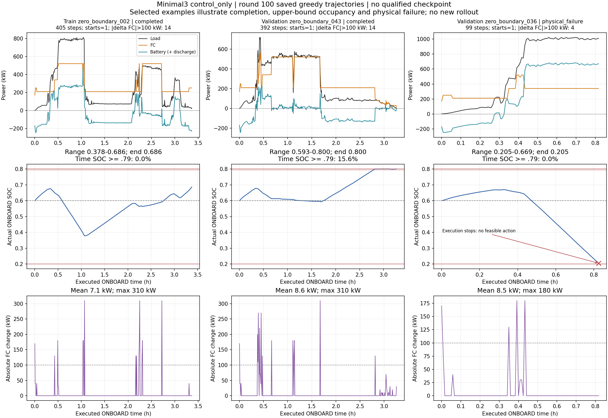

# V4三维状态＋纯控制奖励＋PER：100轮结果与新任务准备状态

## 1. 结论

本轮已完成100轮，但**没有合格最佳模型，不能认定收敛或进入最终Test评价**。第100轮Greedy Train为18/21、Validation为6/7；Train仅第31轮达到21/21，Validation从未达到7/7，`best_checkpoint=null`，没有`best_agent.pt`。`training_state_latest.pt`存在，仅是旧任务续训状态，不是最佳模型。

这次训练仍使用旧30个Train/8个Validation文件，其中固定完整可评价集合为21/7，另9/1个文件包含UNKNOWN。它没有使用刚选定的独立航段36/8/4划分。两套任务不能混报。

## 2. 本次训练身份与真实配置

输出：`outputs/v4_minimal3_control_per_seed42_100r_20261016_141000_807`。

- 源提交：`0e5ad4ce531ba7c1f64ed1e85048f1189ca3275d`，训练时工作树有修改。
- 训练源码指纹：`b1c8e9782967e8445c0ff629e62e5ac98de2d2efc7f0b32a5fd487156a0264bd`。
- 实验ID：`V4-M3-CTRL-PER-S42`；100轮、seed42，约6.11小时。
- 状态：`[SOC, P_load/600, P_FC_previous/600]`；网络3–128–128–61，ReLU，61档绝对FC功率动作。
- 正常ONBOARD原奖励：`-[0.11025*abs(P_FC-P_FC_previous)+200*(SOC_next-0.6)^2]`。
- 奖励进入Replay统一乘0.001，保留一次物理失败惩罚；正常奖励不含四项经济账本，但完整账本继续用于评价。
- Adam学习率0.001；gamma=1；n=8；batch64；Replay300000；replay32；Target每次经济优化后软更新tau=0.001。
- PER alpha=0.6、beta=1、epsilon=1e-6；失败终止配额2；UNKNOWN模式observed_nstep。
- epsilon第1轮1、第70轮0.05，71–100轮保持0.05；本轮最终0.05。
- 旧岸电固定目标0.6与终端模拟补能仍属于旧任务的经济评价；不是新的Zhou评价模型。

完整参数、数据manifest哈希见归档[run_metadata](results/v4_minimal3_control_per_100r_analysis_20261016/raw/run_metadata.json)。报告与CSV都完整覆盖1–100轮，选定核心字段逐轮一致，`run_status=completed`，报告记录Test访问数0。

## 3. 供电完成率和稳定性

| 指标 | 本轮三维纯控制奖励 | 上轮七维energy_with_fc_ramp |
|---|---:|---:|
| 第100轮Greedy Train | 18/21 | 15/21 |
| 第100轮Greedy Validation | 6/7 | 5/7 |
| Train全完成轮 | 31 | 10、35、50 |
| Validation全完成轮 | 无 | 无 |
| 合格最佳模型 | 无 | 无 |

两轮旧数据manifest和固定21/7评价ID一致。但这次同时改变状态和奖励组成，不是仅改变状态的单变量实验；不能将变化单独归功于降维或删去经济奖励。

第100轮Train物理失败：`_008、_015、_044`；Validation物理失败：`_036`，均为SOC受限的无可行动作。未知数据截断另计，不能伪装为成功或物理失败。100轮中Validation `_036`每轮都失败，`_047`另有13轮失败；UNKNOWN样本 `_010`有1轮在截断前已物理失败。未报告程序执行异常。

奖励仍明显波动。对完全相同的六条成功验证子集004/009/019/032/043/047，仅在该集合全完成的轮次统计：前10轮原奖励均值−14667.03、标准差7483.55，最后10轮−12618.69、标准差4958.31，71–80轮曾退至−18887.09。这是成功子集的诊断，不能代替完整Validation收益，更不能用失败导致的短轨迹奖励解释收敛。

逐窗口证据见[run_metrics_windows.csv](results/v4_minimal3_control_per_100r_analysis_20261016/run_metrics_windows.csv)。原有[完成率曲线](results/v4_minimal3_control_per_100r_analysis_20261016/raw/completion_rates.png)、[TD与梯度曲线](results/v4_minimal3_control_per_100r_analysis_20261016/raw/td_and_gradients.png)已归档，没有重新训练。

## 4. FC、电池与SOC的实际控制表现

下表只统计第100轮已完成的同轮样本，避免将UNKNOWN长前缀混作完整航段：

| 指标 | Train完成18条 | Validation完成6条 |
|---|---:|---:|
| ONBOARD步骤 | 7983 | 2386 |
| 平均绝对FC功率变化/kW | 16.777 | 10.855 |
| 最大FC跳变/kW | 370 | 580 |
| FC跳变>100kW次数 | 672 | 110 |
| 0→正功率启动次数 | 19 | 12 |
| SOC>=0.79占比 | 7.679% | 5.700% |

因此FC跳变仍未解决，尤其单步580kW不能称为平稳基础负荷控制。不能仅凭平均变化较小就忽略少数大跳变。

Train全部已执行13566步的SOC>=0.79占比为31.903%，但其中3715/4328步来自UNKNOWN样本前缀；所有2191个FC=0步骤也来自这些前缀。完整Train航段的FC=0占比为0。不能把全前缀统计直接当作完整航程的普遍边界行为。已保存轨迹中的SOC均在硬边界内，但后继供电仍会因SOC储备不足失败。

所有Train30/Validation8样本首个动作均为170kW；新状态在零负载初始时均为`[0.6,0,0]`，这是记录中的共同选择，不代表已找到合理的启动策略。

三个代表均来自第100轮现成Greedy轨迹：Train002完成、Validation043上SOC边界附近停留、Validation036失败。036在约1000kW负载时连续给出约340kW FC，电池约660kW放电；99步末SOC约0.205020，后续无物理可行动作。轨迹能够证明该功率分配和耗电过程，不能单凭它区分Q拟合不足、状态信息不足或奖励目标导致的偏好。

全38个样本的逐样本诊断见[key_profiles.csv](results/v4_minimal3_control_per_100r_analysis_20261016/key_profiles.csv)。没有重新运行Greedy，也没有读取Test轨迹。

## 5. 经济成本：必须区分完整集合和完成子集

唯一完整Train21的第31轮，可比经济总成本为**67861.9419元**。上轮同一固定Train21完整轮的最低值（第35轮）为101160.3205元，诊断上低32.92%；但第31轮Validation仍为6/7，两轮均无合格模型，不能据此宣称验证经济性改善。

第100轮因失败，完整Train/Validation的可比成本均为null。下面只列**当轮完成子集**的账本，不能与其他完成集合的总额直接比较：

| 成本/CNY | Train完成18条 | Validation完成6条 |
|---|---:|---:|
| ONBOARD氢耗 | 20872.766991 | 5580.998437 |
| ONBOARD FC退化 | 32044.091250 | 10247.155000 |
| ONBOARD电池退化 | 1843.403274 | 507.974212 |
| 中途模型化SHORE结算总额 | 27.562500 | 284.412091 |
| 模型化终端结算总额 | 367.395437 | 170.416284 |
| 子集可比总额 | 55155.219452 | 16790.956025 |

中途与终端结算总额可能同时包含电费和退化，不可全当电费：Validation中途为FC退化78.2775、电池47.962199、电费158.172393；终端为电池39.907249、电费130.509036。Train中途27.5625为FC退化，终端为电池82.219799、电费285.175638。独立失败惩罚、SOC及FC波动奖励均未算入真实经济费用。

## 6. Q学习与更新计数

- 正式训练环境transition：1211470；预填充14876；Greedy评价1581452，评价不进Replay。
- Replay新增1221599；预填充优化463次＋正式37711次＝**38174次**。
- `1221599 // 32 = 38174`，剩余31条credit；Target软更新38174次，初始完整复制一次。
- 实际失败来源经验90462条，其中失败终止n-step条目4088；终局Replay内失败终止条目624。终止条目不等于真实失败事件数。
- UNKNOWN前有效经验保留515807条，未闭合丢弃4747条。
- 第100轮未加权TD MAE为0.588798缩放控制奖励单位，换回原控制奖励单位约588.798，**不是588.798元经济支出**。
- IS加权loss约0.00005508，但未加权Huber约0.397423，平均IS权重0.000475273。小加权loss不能证明收敛。
- 正常终止样本TD MAE约2.668586；该轮抽到的980个正常终止窗口绝对残差均>1。长期目标拟合仍需关注，但本轮未修改PER、奖励或优化器，也没有用这些指标推断PER存在实现错误。

## 7. 新36/8/4任务是否已经可直接训练

**尚未。** 已完成的是数据裁剪、用户Test选择、父样本分组、36/8/4冻结及SHA256；训练接口中的三维状态和纯控制奖励也已经实现，但目前只能按旧数据任务运行。

| 项目 | 目前状态 |
|---|---|
| 新独立航段清单 | 已冻结36/8/4，同父子段同组 |
| minimal3与control_only代码 | 已实现；此次100轮已实际使用 |
| 正式入口数据源 | `feedback_study.py`仍固定旧power/AIS/modes_v3及30/8文件数 |
| 独立航段初始化与结束 | 尚未接入新数据；旧SHORE与模拟末端充电仍在旧环境中 |
| Zhou等效氢耗三成本 | 尚未实现，平均FC效率参考口径等需要核实 |
| 小负值及不满30秒尾段 | 原值与完整1秒尾部已保存，最终物理执行约定尚需明确 |
| 旧checkpoint续训新任务 | 禁止：旧模型已接触重新划入Test的数据，且数据与任务身份不同 |

冻结清单：[36/8/4 manifest](../data/processed/operating_dataset_independent_v2/metadata/splits_v1_seed42/sample_manifest.csv)。后续应只对新Train计算统计和参考尺度，Validation评价，4条新Test继续封存。

`EconomicMPC`名称在当前代码中用于复用物理/经济记账接口；v4实际执行是DDQN动作直接传给`accountant.interval`，不能仅因这个类名误称当前控制架构为DQN+MPC。

后续顺序：先完成新独立任务的数据/终止/三成本评价接入，再保持已批准的3维纯控制奖励及其他参数做新基线。不能把换数据后的成功率与旧任务直接作算法因果对比。本次没有自行增加控制规则或启动训练。

## 8. 提交、保留与磁盘说明

本次Git归档包含100轮完整报告/逐轮CSV/日志的无损压缩版、原参数、已有曲线、31/100轮Greedy轨迹及小型诊断权重，见[archive_manifest.json](results/v4_minimal3_control_per_100r_analysis_20261016/archive_manifest.json)。完整续训Replay checkpoint与其余原始逐轮JSON仍在本地，**不因推送报告而自动获得远程备份**。

本轮输出本身约10.87GiB，主要是300份未压缩逐轮轨迹JSON。不能把它们全部称为无用，也不能在唯一证据尚未另行保留时直接删除。推送后另作磁盘占用核查及清理建议；本任务不删除训练产物。
