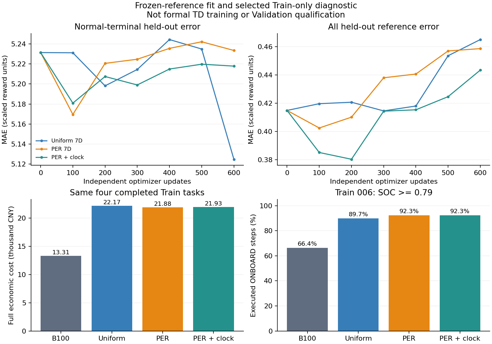

# V4：PER共同拟合、终止冲突与可观测状态诊断

日期：2026-10-13。正式分支：`feat/direct-power-mlp-ddqn`，HEAD `a40afa2c8fd0a967d40d8aa30472b228232fbc0e`，包含既有未提交修改。本轮仅新增独立诊断脚本和附件；正式源码、模型、Replay、经济模型和数据标签未改动，没有提交推送或正式训练。

## 1. 结论

1. **PER确实增加关键经验抽样，但未解决各类别共同拟合和FC跳变。**正常终止窗口抽取405→2269次，留出MAE却为5.23143→5.23355；不能把“抽得更多”解释成“价值已学准”。
2. **额外拟合改变了自主控制，但改善和损害并存。**三组均使Train `_015` 从第134步SOC受限失败变成完整337步；三组在另外四个共同完整样本上的经济费用均明显升高，SOC更长时间接近上限。该成功不能归因于PER或新增状态，因为均匀采样组也成功。
3. **已执行时间只有小幅拟合信号，没有解决终止冲突。**PER+时钟的留出总MAE比PER略低，但仍高于拟合前，且闭环费用、SOC边界和跳变没有整体改善。不推荐把这个8维候选直接换成正式状态。
4. **出现了具体动作价值干扰证据。**多个状态的greedy动作从原档位转成570 kW，而诊断拟合集只有13条570 kW经验。只拟合已执行动作的Q值，并不能保证其他60个输出的相对排序正确。
5. 保留Schaul PER候选；下一步优先明确有限任务终止的可观测依据，再检验跨动作的覆盖与泛化。当前不支持通过增大SOC权重、人工停机门控或覆盖Q排名解决问题。

## 2. 数据、实验与边界

复用[B100终止/Q/跳变报告](v4_terminal_q_conflict_fc_jump_followup_2026-10-13.md)，匹配B组第100轮诊断权重及Greedy Train轨迹。正式模型：7–128–128–61、Adam0.001、gamma1、n8、batch64、replay32、tau0.001、奖励缩放0.001、SOC二次项beta200/reference0.6、失败配额2、UNKNOWN observed_nstep。未加入FC动作限制。

导出12,780条**Greedy Train参考窗口**：正常终止136、失败终止32、失败非终止前缀681、普通非终止6,824、UNKNOWN前可验证窗口5,107；47条不具备完整已观测后继的尾部未导出。它们不是原30万条Replay，也不是历史优化器当时抽到的目标。

冻结参考目标采用同一B100 Online/Target快照、实际执行的后续奖励和物理后继mask：

\[
y_i=0.001\sum_{j=0}^{m-1}\gamma^j r_{i+j}
 +(1-d_i)\gamma^m Q_{\theta^-}(s_{i+m},\arg\max_{a\in A_{phys}}Q_\theta(s_{i+m},a)).
\]

终止窗口没有bootstrap；失败惩罚已在原轨迹终止奖励中计入一次。参考值保留旧网络的估值误差，不能称为真实最优Q。

按整条Train样本分组划分：拟合集10,054条，留出集2,726条。留出样本：完整 `_021/_040/_016/_020`、失败 `_050`、数据截断 `_029`。两集合不共享样本；但原B网络已经训练过这些Train样本，因此这是**额外拟合的留出检查，不是未见Validation泛化**。

| 独立组 | 初始模型 | 采样 | 新观察变量 | 梯度更新 |
|---|---|---|---|---:|
| Uniform 7D | B100 Online副本 | 原固定失败配额2，其余均匀 | 无 | 600 |
| PER 7D | 同一副本 | 固定配额2 + 普通池PER/IS | 无 | 600 |
| PER + clock | 同一副本，新增输入列权重为0 | 同上 | 当前已执行时间 | 600 |

种子42、fresh Adam0.001、Huber delta1、clip10、batch64均相同。7维两组初始输出完全相同；8维零扩展最大差1.907e-6，仅浮点舍入。没有在线采集新训练经验，目标完全冻结，不执行软更新；这是监督式价值拟合诊断，不是新的正式DDQN训练。

随后用每组独立副本及原B模型各执行一次5个Train诊断样本：`_002/_006/_015/_022/_021`，共20次、5,833个ONBOARD决策。动作全部由各自Q值在物理mask内argmax选择；没有保持功率、SOC阈值动作规则或预设参考动作。Validation和Test数据内容均未读取。

## 3. PER抽样与共同拟合

PER候选保存在独立工作树 `../v4-per-prep`。核心位置：该工作树 `src/v4/dqn.py:405`（weighted Huber/优先级刷新）、`:608`（采样）；`src/v4/prioritized_replay.py:100/118/124`（概率采样与IS）。主工作树本轮未合并PER。

依据[Schaul等，Prioritized Experience Replay，§3.3–3.4](https://arxiv.org/html/1511.05952v4)：

\[
P(i)\propto(|\delta_i|+10^{-6})^{0.6},\qquad
w_i=(N_o P(i))^{-1}/C,\quad C=\max(1,(N_oP_{min})^{-1}).
\]

普通池采用PER有放回采样；失败终止池继续每批2条不重复均匀采样，并乘相同的`1/C`。IS beta=1恢复原固定配额目标的期望梯度，乘公共尺度`1/C`；不是恢复整个Replay均匀目标，也不是扩大高TD经验的期望损失权重。本候选不是逐项复现论文的Atari探索、学习率和beta退火。

| 600次更新的实际抽样位置 | Uniform | PER | PER+clock |
|---|---:|---:|---:|
| 正常终止窗口 | 405 | 2,269 | 2,305 |
| 失败终止窗口 | 1,200 | 1,200 | 1,200 |
| 失败非终止前缀 | 1,558 | 1,887 | 1,890 |
| 普通非终止 | 19,471 | 20,388 | 20,152 |
| UNKNOWN前有效窗口 | 15,766 | 12,656 | 12,853 |
| 抽到的不同条目 | 9,812 | 10,053 | 10,053 |
| `_015`第97步抽样 | 5 | 18 | 25 |

每组总38,400个抽样位置。上述失败终止数量是n8训练条目抽样次数，不是1,200次真实物理失败。

以下为**留出集、未加IS权重的绝对误差**，单位均为缩放训练奖励单位（乘1000得到原奖励等值；其中含SOC辅助项和失败惩罚，不能叫实际支出）。

| 类别 | 初始B | Uniform后 | PER后 | PER+clock后 |
|---|---:|---:|---:|---:|
| 全部 | 0.41494 | 0.46503 | 0.45864 | 0.44343 |
| 正常终止 | 5.23143 | 5.12468 | 5.23355 | 5.21789 |
| 失败终止 | 0.39078 | 0.13024 | 0.08211 | 0.06100 |
| 失败非终止前缀 | 0.56861 | 0.60494 | 0.56541 | 0.54896 |
| 普通非终止 | 0.42911 | 0.50291 | 0.50658 | 0.48137 |
| UNKNOWN前有效窗口 | 0.16996 | 0.19135 | 0.17354 | 0.17620 |

拟合集总MAE：0.28357→Uniform0.28506、PER0.26452、clock0.26372。PER降低拟合集误差，但留出总体仍变差；正常终止的全部136条最终绝对误差仍大于1。不能用只降低失败终止误差宣布共同拟合成功。

所有组梯度裁剪触发0次。平均未裁剪范数Uniform0.64085、PER0.003354、clock0.002935；平均IS权重1/0.006094/0.004003。优先级归一化明显影响梯度尺度；Adam含自适应矩估计，不能把范数比直接换算成学习速度，也不能据此按倍数增大学习率。附件`priority_normalizer_after_update_*`明确是优先级更新后的快照，不是该批实际分母。

PER的抽样loss偏高是它更多抽取高残差的结果，不能与Uniform的batch loss直接比较策略质量。

## 4. 终止冲突和真实Q排序

此前确认最近一对：`_002`归档第397步（正常终止窗口）、`_022`第155步（中途窗口），同为70 kW动作。SOC只差0.000316，六个功率特征最大差1.429 kW；参考目标分别−0.03403与−5.89193，相差5.85790。该差异主要来自后者bootstrap。

| 同一近邻对的70 kW Q | `_002:397` | `_022:155` |
|---|---:|---:|
| 初始B100 | −5.72072 | −5.71462 |
| Uniform拟合后 | −5.54148 | −5.53458 |
| PER拟合后 | −5.69221 | −5.68536 |
| PER+clock拟合后 | −5.68648 | −5.75579 |
| 冻结参考目标 | −0.03403 | −5.89193 |

增加时钟后两状态Q差扩大到约0.0693，但距参考目标差5.8579很远。有限预算不能排除更多训练或其他因果信息有效；也不能证明网络数学上无法拟合这两个近邻。

此前该对的Huber梯度余弦约−0.999999；32对中只有10对为负，不能把所有末端样本都称为互相抵消。相关分析方法见[Bengio等，Interference and Generalization in TD Learning](https://proceedings.mlr.press/v119/bengio20a.html)。

高跳变真实状态 `_002:160` 原选择520 kW，Q520−Q20=+0.03297，而完整正式物理核算的单点固定序列反事实可减少98.86元经济费用和2次>300 kW变化；详见前报告。反事实证明存在更好的可行动作序列，不是最优Q标签，更不能部署成动作覆盖规则。

本轮PER拟合后该状态：Q520约−6.00510、Q20约−6.16138、Q570约−4.51198，最高合法动作改成570。`_002:161/397`、`_022:155`、`_015:97/120/133`亦均转成570。原执行动作的TD误差变小，并未保证正确的全61动作排序。

诊断拟合集570 kW只有13条，70 kW有2,726条。共享隐藏层改变未充分监督的动作输出，具有可观测的排序漂移；**该计数不能冒充正式30万条Replay的动作覆盖率**，后者仍需单独核对。此处也不能凭Q570升高直接证明真实最优价值一定更低。

## 5. 小规模自主闭环效果

原B模型5条诊断中的4条完成；三组额外拟合后5条均完成。`_015`原第134行SOC下限导致无可行动作，额外拟合后三组完整337步、最小SOC约0.289。没有额外失败罚款或强制高FC；改变来自独立网络自身Q排序。

经济比较严格限定所有模型均完整执行的 `_002/_006/_022/_021`，相同1,172个ONBOARD控制步。`_015`原失败前缀1,628.64元不参与完整成本比较。

| 相同四个完整样本 | 原B100 | Uniform后 | PER后 | PER+clock后 |
|---|---:|---:|---:|---:|
| H2费用/元 | 2,640.49 | 3,215.93 | 3,250.41 | 3,248.07 |
| FC退化/元 | 10,340.96 | 18,666.93 | 18,304.72 | 18,359.85 |
| Battery退化，含终端充电/元 | 272.63 | 289.24 | 323.60 | 323.39 |
| 终端模型岸电购电/元 | 59.54 | 0.00 | 0.00 | 0.00 |
| 可比四项经济费用/元 | **13,313.60** | **22,172.10** | **21,878.73** | **21,931.31** |
| 相对原B费用变化 | — | +66.54% | +64.33% | +64.73% |
| 平均绝对FC变化/kW | 54.33 | 113.23 | 118.52 | 118.98 |
| >300 kW变化次数 | 58 | 30 | 169 | 162 |
| 0→正功率次数 | 5 | 7 | 4 | 4 |

此表变化/启动统计包含初始出航动作，不是全部ONBOARD内部启停；没有将受SOC上界强制的变化一概归为错误主动决策。所有四项经济费用包括应计终端补能，SOC辅助项和失败惩罚不混入经济账本。三组终端SOC更高，无补能缺额，岸电为0并非免费补能。

`_006`的SOC≥0.79步骤比例：66.38%→Uniform89.74%、PER92.31%、clock92.31%；>300 kW变化1→3/87/87。高出力把SOC推向上限后，物理mask会限制后续充电；本轮未记录每一变化的反事实，不能声称87次全属网络主动错误。

可确定的是本诊断未改善综合控制效果。固定目标拟合会改变策略的访问状态，新的状态分布不在旧参考监督中；这也是不能用该模型代替正式在线交互训练的原因。

## 6. 可观测信息：什么能用，什么不能直接用

正式位置：`src/v4/control.py:189`是7维已观测SOC/FC历史/负载历史；`src/v2/data/formal_training_dataset.py:87`是时间、速度和来源字段。当前7维DDQN没有AIS输入。

本轮时钟定义为当前观察时间减样本初始化时间，包含已过去SHORE时间；没有输入总样本长度、剩余时间、样本编号、下一段真实负载或终点位置。当前/后继映射核对30个Train样本、12,827个已执行决策，负载差最大2.84e-14，岸电后没有把ONBOARD步号错误当时间。

但是这只是**仿真实验初始化后的已执行时间，不是已确认的物理离港时刻或已知任务期限**。各任务总长度不同，且零边界由离线数据处理产生（`src/v2/data/zero_boundary_dataset.py:252`）；不能仅加这个时钟就声称恢复了马尔可夫性。

依据[Pardo等，Time Limits in Reinforcement Learning，§2–3](https://arxiv.org/html/1712.00378v1)，必须先区分任务真正结束和观测/采样截止：

- 若研究目标是运营上已知的有限任务，使用真实可在线获取的计划阶段/期限；不能读取验证文件剩余行数。
- 若边界只是观测截止，需另行论证继续任务价值与补能模型，不能机械将当前`done=True`改成`False`并随意bootstrap，因为它改变优化边界。
- 已观测的更长负载/FC历史可供独立研究，但不能保证它辨认真实航程末端。历史处理部分可观测性的依据包括[Hausknecht与Stone的DRQN论文](https://arxiv.org/abs/1507.06527)，本轮未更换MLP或加入预测网络。

近邻对已有因果历史差异：过去300秒负载均值 `_002:397`约41.70 kW、`_022:155`约155.78 kW；过去900秒116.85/220.88 kW。它们是可观测候选证据，不是本轮已验证的新正式状态，也不是未来负载预测。

AIS存在具体限制：Train侧车23,590点中1,486点为PCHIP（6.30%），依赖右侧样本；其余22,104点最近匹配允许目标两侧±10秒，且侧车未保存带符号源时间偏移。`src/v2/data/ais_speed_sidecar.py:110`及后续插值逻辑不能直接认证为在线因果输入。**这不影响当前不输入AIS的7维DDQN；也不改变D3仅离线筛选的约定。**本轮未重建侧车。

## 7. 推荐的最小下一步

| 优先级 | 具体事项 | 本轮依据 | 验收与边界 |
|---|---|---|---|
| P0 | 明确真正任务终点与离线截断的关系，以及可在线获取的运营任务信息 | 正常终止参考仍残差约5；近邻状态目标相差5.86；单一时钟无有效解决 | 不使用真实未来/文件余长，不静默改done或终端费用；提出单一任务语义修正后再实施 |
| P1 | 保留PER；核查正式Replay中的状态×动作覆盖和各头排序漂移，明确IS有效梯度 | 关键抽样上升，未加权留出及经济效果未整体改善；稀疏570头变最高 | 固定状态、奖励、网络、预算；记录抽样/IS/类别/全动作排名，不根据TD下降自动宣布控制改善 |
| P2 | 仅独立检验有依据的因果历史候选，先于正式状态修改 | 300/900秒历史可区分近邻；AIS尚不满足在线因果认证 | 先按完整Train样本留出且固定预算；验证所有动作价值、完整成本及SOC，避免用样本时间记忆离线切片 |

当前没有证据支持增加SOC beta、强制FC保底功率、禁停机或人工平滑。PER保留作为可控采样选项，不宣称已解决状态歧义或FC跳变。后续正式实验应控制变量、从新权重和空池开始，并同时验收Train/Validation完整资格、相同完整集合经济费用、SOC边界、大跳变及多种子稳定性；本轮未启动。

## 8. 可复核附件、执行计数与未完成事项

附件目录：[results/v4_per_jointfit_state_followup_20261013/](results/v4_per_jointfit_state_followup_20261013/)

- `observation_metadata.json`：Train时间/源行映射、AIS证据和可观测性限制。
- `greedy_reference_dataset.npz`及summary：冻结Greedy参考窗口、原始/缩放奖励、状态、物理mask、出处。
- `jointfit_closedloop_summary.json`：每100次拟合曲线、实际采样、IS、全61动作Q及20个诊断闭环结果。
- `independent_probe_models.pt`：4个独立诊断模型，标记非正式/不可续训，不是`best_agent.pt`。
- `jointfit_control_tradeoff.png`：一个汇总图；未重复生成全航段曲线。

可复算脚本保存在PER候选工作树 `scripts/v4_per_jointfit_state_probe.py`，上限600次/组，拒绝覆盖结果。首次诊断脚本将固定配额失败ID错误送到普通PER优先级索引，在uniform600次、PER1次后抛KeyError。候选正式`learn()`原本已有`contains`检查，并无该错误；修正仅限诊断脚本，重新从相同初始模型/seed执行三组。完成实验1,800次独立优化，总计含中止尝试2,401次；正式优化0次、Validation/Test内容读取0次。失败尝试未执行物理闭环、未改变正式状态。

基线5个样本的结局和步数均复现旧归档，费用最大差9.1e-13元；四项账本和modeled terminal组件求和一致。参考当前合法动作、done/后继mask及时间映射由独立复核确认。

诊断前后正式source SHA256相同：`6c39c47efac5e740d0265c1c9604b0395c4df7061c2880185ebfec53352c200f`；B100权重SHA256仍为`31fe324400a4d0e64bb3906fd83d4d63eade63b5e9cbedc8774ff5b3616861e9`。输入NPZ SHA256：`a53241c0f401050dc19fddce1dee202df7779714801f247bd071725f930399b1`；观测附件SHA256：`1084c95961ff707b2c29fdf418f72e987370121e891741596155f62243421a7d`。

尚未完成的是：正式PER多种子闭环效果、真正运营任务信息的来源、动作覆盖修正的独立效应，以及新的可观测状态对未见工况的收益。有限冻结拟合与5个Train诊断不替代这些验证；本报告没有把假设写成已修复问题。
