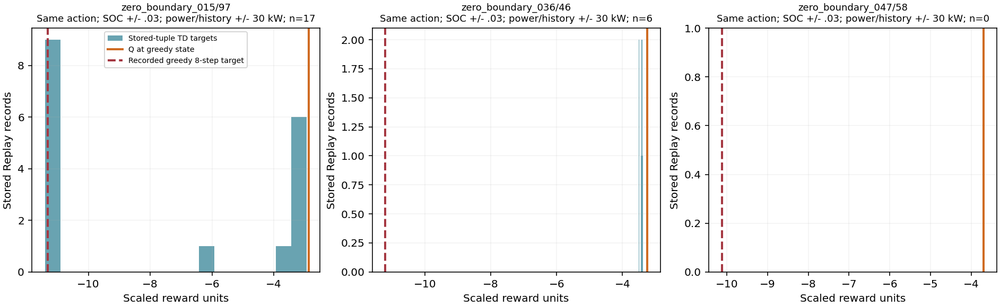

# V4 Replay 覆盖与长期 TD 传播核查

## 1. 本次结论与范围

**γ=1、n=8 已使部分后续风险进入当前位置的 TD 目标，但在线 Q 没有充分拟合这些目标；另外，Validation 存在局部经验覆盖缺口，正常任务终止附近也存在显著价值拟合偏差。不能将三者统一归因为“失败经验没有存入”或“学习率太小”。**

本次只读核查 `outputs/v4_socref060_beta200_100r_seed42` 的第100轮续训 checkpoint、已有报告、必要的归档轨迹和冻结 Train 标签。没有调用优化器、反向传播、环境回放或测试套件，没有读取 Test，也没有改动模型、奖励、超参数和历史结果。

- 当前审计提交：`52e9232916b4e64883cf6b09d5697fb68f6446cd`。
- 实验记录源码：`a3746c4278369669c58f59535bc8ac9860df0b22`，原实验 metadata 记录工作区非干净。当前与该提交的 `dqn.py`、`control.py`、`monitored_training.py`、`experiment_schedule.py`、`reward_feedback.py` 和 MLP 定义没有差异。
- checkpoint SHA256：`ca501ba949446482c5433f47bf2a77b2d70599e2e0638359738ce210e7817525`。
- 正式配置：7–128–128–61、Adam 0.001、γ=1、n=8、batch64、replay300000、replay32、tau=0.001、reward_scale=0.001、SOC固定参考0.6/β=200、失败终止配额2、seed42；电池能量奖励重分配关闭。

以下 Q、TD 目标和误差均为**缩放后的训练奖励单位**。除以0.001可以还原原训练奖励单位，但它包含 SOC 偏好和失败惩罚，不能称为实际经济费用。

## 2. 核查方式与证据可信度

### 2.1 实际使用存储的训练 tuple

将 checkpoint 内300000条 Replay 转成小型数值数组，冻结最终 Online/Target 网络，逐批计算：

\[
y_i=R_i^{(m)}+(1-d_i)Q_{\theta^-}(s_{i+m},\arg\max_{a\in A_{i+m}}Q_\theta(s_{i+m},a)),\quad m\le8.
\]

这使用**Replay 已存的奖励、后继状态、done 与掩码**，并非拿 Greedy 评价轨迹的后续动作冒充训练经验。此前 Greedy 轨迹计算的8步目标仍保留为单独的评价参照。

### 2.2 来源重建与核对

Replay 没有保存 sample_id、源行号、插入轮次及逐条历史采样次数。来源由 FIFO 插入 ID、冻结 Train ONBOARD 行、每轮失败行号、`seed+round` 的样本顺序推导，**不是 checkpoint 原有字段**。

- v3标签 manifest 和30份 Train 标签侧车 SHA256 与记录一致。
- 重建的100轮新增条数、累计插入数全部与报告相符。
- 进一步核对第100轮归档的6907条新入池记录：7维状态、动作、8步累计奖励、步数、done 和后继掩码全部一致。
- 当前300000条记录的 done 与空后继掩码对应关系正确，推理数值均有限。

这支持局部经验来源分析，但**无法恢复某条记录历史上真正被抽了多少次，或当时的 TD 目标变化过程**。

## 3. 已确认：风险目标已到达，在线 Q 仍有局部拟合缺口

### 3.1 全池快照

以下是最终网络对最终池的只读重计算，不能冒充每轮训练 batch 日志。

| 记录类别 | 数量 | 当前 TD MAE | TD绝对值>1 | TD绝对值>5 |
|---|---:|---:|---:|---:|
| 全部 | 300000 | 0.3549 | 19020 | 4615 |
| 非终止 | 292904 | 0.3184 | 13655 | 4609 |
| 失败终止 n-step 条目 | 1760 | 0.2582 | 29 | 6 |
| 正常终止 n-step 条目 | 5336 | 2.3889 | 5336 | 0 |
| 失败轨迹的非终止条目，属于非终止子集 | 35224 | 0.7484 | 4669 | 2259 |

“失败终止1760条”包括共享同一最终失败奖励的重叠8步窗口，**不是1760次独立供电失败**。正常终止条目同样包含结束前最多8个决策位置。

失败终止已有较好的总体拟合，不能说配额完全无效；但这不代表其较早前缀已学好。总体 MAE 也掩盖了正常终止及部分失败前缀的大残差。

### 3.2 Train `_015` 源行97：已有实际训练经验

第100轮 Greedy 此处选择160 kW，Q=-2.8794，按已记录 Greedy 后续计算的8步目标为-11.3207。实际存储证据更明确：

| 证据 | 数值 |
|---|---|
| 最终池中同源行、同动作160 kW | 3条，来自第76至88轮 |
| 三条实际 tuple 的当前目标均值 | -11.3721 |
| 三条当前 TD MAE | 8.4610 |
| 最近条目 ID / 推导来源 | 584126 / 第88轮 `_015` 源行97 |
| 最近条目与 Greedy 状态差异 | SOC差0.000974，其余6个特征完全相同 |
| 最近条目的 Online Q / 当前存储目标 | -2.8781 / -11.4034 |

**此处不是“惩罚没进池”或“风险还没有进入目标”：当前存储目标已很负，而 Online Q 仍接近-2.88。**它说明已见样本存在拟合缺口，但不能仅凭最终快照区分采样不足、相近目标干扰、目标随训练变化或模型表达能力。

## 4. Validation：覆盖与泛化问题不能当作同一训练 tuple 的拟合错误

为检查邻域，采用 SOC±0.03、其余6个归一化特征各对应±30 kW；同时保存±0.01/10 kW及±0.06/60 kW敏感性结果。阈值仅用于本次统计，**不是新的控制约束或已批准超参数**。

| Greedy 状态 | 同动作160 kW邻域条数 | 存储目标范围 | 存储 tuple TD MAE | Greedy状态Q / Greedy8步目标 | 同邻域600 kW条数 |
|---|---:|---|---:|---|---:|
| Train `_015`/97 | 17 | -11.403～-2.935 | 4.6599 | -2.879 / -11.321 | 0 |
| Validation `_036`/46 | 6，来自3个Train样本 | -3.507～-3.377 | 0.1386 | -3.250 / -11.204 | 0 |
| Validation `_047`/58 | 0 | 无 | 不适用 | -3.696 / -10.120 | 0 |

解释：

1. `_015`：部分近邻目标已经包含高风险，但网络没有相应降低Q。
2. `_036`：Train近邻的存储目标接近-3.44，并且已拟合较好；Validation后续却产生约-11.20的评价目标。不能要求网络通过反复拟合-3.44自动学出-11.20，需检查状态是否能区分后续负载/任务阶段分布。
3. `_047`：同动作最近训练条目仍相差SOC约0.069、某功率特征约75.17 kW，局部覆盖更弱。
4. 这三个邻域没有600 kW执行经验，反事实600 kW的Q主要依赖跨状态泛化。**没有监督支持不等于600 kW必然更好或必能完成任务。**

评价状态上160比600的Q优势仅约0.2064、0.1439、0.1093；这些差值不足以证明动作长期经济排序可靠。CSV中的 `recorded_chosen_action_greedy_n8_target` 只属于原轨迹的实际选择动作，不是600 kW的反事实目标。

## 5. 正常终止与状态表示：发现边界问题，但尚未证明唯一根因

5336条正常终止 n-step 记录的平均目标仅-0.08334，Online Q平均-2.47228，全部绝对误差>1。继续核查相同动作的非终止近邻：

- float32网络输入完全相同、动作相同、但一方正常终止一方非终止的组数：**0**。
- SOC差≤0.001且6个功率特征分别差≤1 kW的最近配对：131条。
- SOC差≤0.01、功率特征差≤10 kW：2463条。

最接近的例子：

| 来源 | 动作 | SOC | 当前负载 | 是否终止窗口 | 当前目标 | Online Q |
|---|---:|---:|---:|---|---:|---:|
| 第76轮 `_011`/825 | 90 | 0.622779 | 31.729 kW | 是 | -0.05780 | -2.80893 |
| 第81轮 `_021`/15 | 90 | 0.622756 | 31.779 kW | 否 | -2.66959 | -2.80994 |

二者SOC差约0.0000234，所有功率/差分特征差不超过0.264 kW，当前目标却相差2.612。另一个 `_011`/827与 `_021`/36的10 kW配对，目标相差2.899。

当前7维输入没有任务进度、剩余任务时域或航行阶段信息。因此**有限任务结束附近的价值与中途价值可能被相近状态混合**，这是需要优先验证的结构性疑点。但近邻不相同，非终止目标含估计值，随机MDP本来也允许同类状态出现不同结果；不能凭此直接认定“加时间特征一定解决”，更不能用未来负载或未知的样本剩余长度作弊。

另一例子是第88轮 `_015` 的源行95与97：状态与160 kW动作很接近，8步后负载分别约249.31和926.11 kW，当前目标分别-3.080和-11.403。这既可能包含缺少阶段信息，也可能是失败价值尚未继续传回更早位置。仅靠最终目标分布无法分离两者。

## 6. 为什么γ=1、n=8还没有自动解决

### 6.1 数学目标不等于已经完成拟合

Double DQN仍需用抽到的tuple，将当前Q向目标作梯度更新；γ只影响目标，不能保证每个状态被抽到并拟合正确。[Double DQN原论文，Background及Double DQN节](https://arxiv.org/html/1509.06461v3)。

当前代码路径：

- `src/v4/dqn.py:30`：Online在合法动作中选动作，Target估值，done禁止bootstrap。
- `src/v4/dqn.py:234`：真实已执行奖励累计成n-step窗口，样本终止截断；无虚拟岸电动作。
- `src/v4/dqn.py:284`：Smooth L1、Adam、梯度裁剪与经济Q更新。
- `src/v4/dqn.py:350`：失败终止配额2，其余62从非失败终止池抽取。
- `src/v4/dqn.py:444`：每次经济Q更新后tau软更新。
- `src/v4/monitored_training.py:619`、`:651`、`:665`：先执行一个样本，再插入完整/失败轨迹并消费更新额度。

### 6.2 更新与样本覆盖的实际尺度

- 累计新增670498条、经济优化20953次、采样位置1340992个：总体比值约2个采样位置/新增记录。**不是每条经验实际都学过两次。**
- `replay32`是入池信用额度，而不是每32个在线控制步马上更新；当前在样本执行结束后集中更新。
- 当前池普通条目298240、失败终止1760。第100轮216次更新，在“最终池保持不变”的假设下，每个普通条目本轮期望被抽约0.0449次，每个失败终止条目约0.2455次。此为理论抽样率，不是历史实际计数。
- `_015`/97的17条160 kW邻域记录，对应上述假设下本轮约0.763个采样位置；具体历史次数未保存，不能据此断言某条从未更新。
- 当前池来自第58～100轮，其中216735条来自第71～100轮ε=0.05阶段，占72.25%。不能再将现池主要归因于最早ε=1探索。

### 6.3 损失与目标更新

Smooth L1在绝对误差>1时，对单个Q输出的梯度幅值不会继续随误差线性增长。因此8.46的残差不会自动获得8.46倍更新力度。正式日志未显示梯度裁剪持续触发，不能称为梯度爆炸。

tau=0.001使Target保留旧参数的权重按0.999衰减，半衰期约693次经济更新，在当前节奏约为数轮。它是稳定机制，也意味着“有8步回报”不等于所有更早价值立即同步准确；当前数据还不足以认定tau就是主因。

现有n-step的前7个后续动作来自采集时的ε-greedy轨迹，尾部才做greedy Double DQN bootstrap，没有重要性采样修正。它与最终纯greedy未来不同是机制事实；不能未经对照就认定实现错误或唯一失败原因。

## 7. 怎么处理：按证据分步，暂不直接改变正式算法

### P0：先做有限的固定经验拟合检查，区分“目标已到但拟合不足”与“状态/目标冲突”

建议后续经确认后使用**独立网络副本**，固定当前Target及少量已存tuple，不采集新环境数据、不改正式checkpoint：

1. 纳入 `_015`/97三条实存记录、相近的低残差记录、正常终止/非终止配对及失败终止记录。
2. 固定全部TD目标，给出相同预算的有限梯度更新，记录局部误差、对相邻样本的影响以及160/600动作排序。未执行600的样本不能拿虚构目标训练。
3. 若固定目标容易拟合，而在线流程始终未拟合，优先调查实际采样次数和更新分配；若相近状态目标无法同时拟合或互相覆盖，再检验状态表示与函数容量。

**本次没有执行该优化器检查**，它是下一步最小诊断建议，不是新正式训练或已证实的改进。

### P1：之后只选择一种原因对应的单变量修改

| 后续证据 | 最小候选处理 | 评价重点 |
|---|---|---|
| 已见目标可拟合，但有效更新覆盖低 | 先记录逐条/关键区域真实采样次数；再单独比较replay32与replay16，其他条件固定 | 早期高残差是否下降、全程完成率及稳定性，不只看loss |
| 正常终止/中途的目标差异随任务阶段稳定存在 | 核实是否有在线可观测的任务进度或计划信息，再设计状态单变量对照 | 不用未来负载、未知剩余长度；同动作价值差异是否更可辨识 |
| 低FC与高FC的近邻执行覆盖失衡 | 分析合法动作实际覆盖，再单独评估探索/数据覆盖策略 | 不强制高FC、不恢复人为门控；比较完整可行轨迹 |
| 存储tuple拟合好，但Validation后续分布不同 | 对Train/Validation状态与后续负载条件分布做分组分析 | 泛化与可观测信息；反复拟合同一Train目标不能替代新证据 |

不同时修改学习率、β、γ、n、网络宽度和采样策略；不先增加PER、辅助安全网络或预测模块。也不直接断言高功率动作一定长期更优。

### P2：正式训练前的验收

需明确固定对照集合、UNKNOWN处理、真实经济成本与偏好/失败惩罚分账，并保存关键Replay来源及实际采样计数。至少确认关键已见tuple的拟合与动作差异得到改善，再批准单变量Train/Validation对照；Test继续封存。

## 8. 附件与限制

本次只新增本报告和小型诊断产物；正式源码、原checkpoint及归档未修改。

- [全池TD分组](results/v4_replay_coverage_audit_20261012/replay_td_groups.csv)
- [9个查询状态的覆盖与阈值敏感性](results/v4_replay_coverage_audit_20261012/query_neighborhood_coverage.csv)
- [最近实际Replay记录及来源、状态和目标](results/v4_replay_coverage_audit_20261012/nearest_replay_examples.csv)
- [Train同源行的动作覆盖](results/v4_replay_coverage_audit_20261012/train_query_source_row_coverage.csv)
- [正常终止与非终止最近配对](results/v4_replay_coverage_audit_20261012/normal_terminal_nearest_nonterminal.csv)
- [边界检查摘要](results/v4_replay_coverage_audit_20261012/normal_terminal_boundary_summary.json)
- [插入数/哈希/归档tuple核对摘要](results/v4_replay_coverage_audit_20261012/summary.json)

限制：没有逐条历史采样次数和逐轮完整Replay快照；只证明最终网络与最终池的关系。Validation这里只用上次诊断已保存的实际状态/Q记录，没有新增Validation回放。当前TD目标含Target估计，不能当作真实全航程成本或最优Q真值。样本源行以0为起点，CSV中的 `derived_*` 来源均为重建信息。
