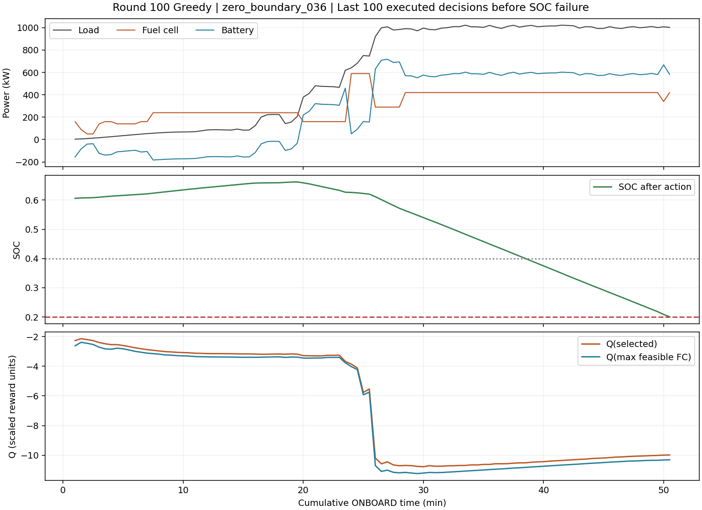
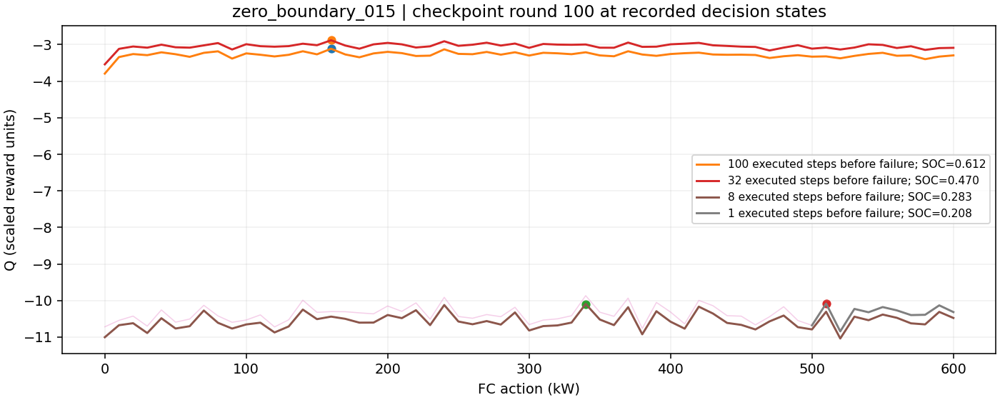

# v4最新100轮：UNKNOWN、历史对照、实际状态Q值及经济成本深入诊断

日期：2026-10-12。最新运行为`outputs/v4_socref060_beta200_100r_seed42`；历史对照为`outputs/v4_economic_ddqn_100r_seed42_20261010_123856`及`v4_100r_training_analysis.md`。本次读取已有结果、Train/Validation冻结数据及最新轮次网络权重，没有训练、策略回放或Test访问。未修改模型、奖励、超参数、标签及历史输出。

## 1. 关键结论与证据等级

1. **已证实：存在实际状态的价值传播/拟合缺口。** 第100轮三条失败轨迹的300个状态，checkpoint的合法动作argmax全部复现记录动作。网络在每个状态都有更高FC合法时仍偏好较低出力。靠近终止时Q值已接近失败惩罚尺度；部分较早状态与其8-step Double-DQN目标相差6.42～8.44个缩放奖励单位，不能用全局TD MAE约0.356掩盖这些局部缺口。
2. **已证实：高退化费用主要由变载产生，不能全部归咎启停。** 末轮Train已执行部分的FC退化61,255.65元，变载34,368.23元（含岸电停机变载），约56.11%；启停13,987.35元，约22.83%。连续ONBOARD内部超过300 kW的跳变402次。
3. **已证实：UNKNOWN与物理失败不同。** Train9个、Validation1个样本不具备完整评价资格。末轮另有Train8、Validation2个SOC受限失败，结构性功率不足和执行异常均为0。UNKNOWN不会因为不完整而自动获得成功资格。
4. **尚未证实：上述缺口具体由学习率、有效覆盖、状态信息、目标网络滞后或多步离策略偏差中哪一项主导。** 现有数据没有对应反事实动作的完整后续成本，也没有第9/74轮实际状态checkpoint。不得从末轮Q值推断早期轮次排序，不得宣布β=300/400一定有效。

末轮Greedy Train13/21，Validation5/7；Train只有第9、74轮21/21，Validation100轮均未达到7/7，没有合格best模型。Test继续封存。

## 2. 数据截断：原始时间边界、原因与可评价范围

读取正式加载器的Train30、Validation8，取第一次UNKNOWN之前的连续数据前缀。行号均从0开始，区间采用`[起行,止行)`；1 s主数据对应行号为30秒行号乘30，CSV文本行号还需加2。时间为原数据`+08:00`，未重新对时或重采样。

|集合/样本|完整30 s行数|UNKNOWN区间|UNKNOWN点数|首次截断时间(+08:00)|截断前可观测ONBOARD步数|原因|
|---|---:|---|---:|---|---:|---|
|Train _007|291|[5,10)|5|04-09 08:12:59|5|八模块FC原始同步证据不足|
|Train _017|992|[2,15)|13|05-07 08:51:01|2|同上|
|Train _029|1187|[902,1013)|111|05-27 15:43:51|891|FC7～107 kW，但净负载−64.98～−9.69 kW，能源来源未解释|
|Train _033|1194|[760,769)|9|06-05 14:28:15|760|FC出现−10.76～−2.28 kW，功率证据冲突|
|Train _034|1647|[1608,1622)|14|06-07 15:14:06|1608|FC出现−135.61～−2.48 kW，功率证据冲突|
|Train _037|3843|[3812,3828)|16|06-15 16:50:44|1880|八模块FC原始同步证据不足；此前有岸电阶段|
|Train _041|655|[1,13)|12|06-28 08:52:33|1|八模块FC原始同步证据不足|
|Train _042|624|[5,10)|5|06-30 05:22:10|5|同上|
|Train _046|3244|[2,14)、[3128,3135)|19|07-11 06:12:33|2|首段同步证据不足；第二段FC负功率。实际执行已在首段截断|
|Validation _010|1260|[726,734)|8|04-16 14:23:10|390|FC出现−11.02～−1.34 kW，功率证据冲突；此前有岸电阶段|

Train合计204个UNKNOWN点、10个连续区间；Validation8点、1区间。旧研究中D3的185点不是当前v3标签的计数，不能直接沿用。详细起止时间、原始样本起止边界、FC/电池/负载范围见[边界表](results/v4_socref200_deep_diagnostic/unknown_sample_boundaries.csv)及[全部UNKNOWN区间](results/v4_socref200_deep_diagnostic/unknown_intervals.csv)。这里的“原始边界”指已冻结主数据样本的起止时间和对应行，不是对桌面EMS文件重新清洗后的新边界。

`src/v4/mode_labels.py:28`固定的六个Train原始快照证据不足区间，与另外功率冲突/负净负载区间共同形成上述名单。原因来自已有标签及来源侧车，未再次把插值零功率证明为实际停机或岸电。

评价范围是第一次UNKNOWN之前；后续ONBOARD不能跨缺口继续拼接SOC。上述ONBOARD步数表示数据可观测上限，若策略更早物理失败，实际步数更短。第6、10轮Greedy Train各有一次UNKNOWN样本的前缀物理失败；Validation第20、21、23、38轮各有一次。不能把这些物理失败用UNKNOWN标签掩盖。末轮九个Train及一个Validation均到达数据截断，前缀物理失败为0。

`control.py`遇UNKNOWN不生成动作、补能或失败罚款；`monitored_training.py`舍弃无法闭合的经济经验。本次正式训练累计舍弃515,400条。九个Train样本第一次UNKNOWN前总计5,154个ONBOARD数据步；大量已观测长前缀因此不能用于当前经济Q的完整回报学习。这是有效覆盖限制，不能用30个原始样本数量代替有效经济训练数据规模，也不能通过虚构终止来解决。

SOC受限与功率容量不可行的区分来自`control.py:236`：若忽略SOC后仍有满足电池功率约束的FC动作，为SOC受限；否则为结构性功率不足。它不是未来全航程可行性证明。研究系统即时放电总容量为600+1248=1848 kW；三个重点失败瞬间负载1098.63、1005.65、722.25 kW，均低于该上限，但剩余SOC不足以执行下一个30秒区间。

## 3. 新旧任务身份与可比较集合

|项目|旧100轮|新SOC参考值100轮|对比较的影响|
|---|---|---|---|
|源码提交|5c670fd124a7333ac8343925889453f7cd7ab9c9|a3746c4278369669c58f59535bc8ac9860df0b22|两份元数据均标记worktree dirty，提交号不是完整运行工作树的逐文件证明|
|主数据manifest|413f2c8e…df029|相同|未换负载数据与正式划分|
|AIS manifest|e7853ea6…2829d|相同|未换航速数据|
|工况manifest|旧modes：2a44ade7…1f8f|modes_v3：003ae908…9310|控制段、补能节点及资格改变|
|完整资格集合|Train30、Validation8|Train21、Validation7；另9/1个UNKNOWN|29/30与13/21不能直接解释为算法退步幅度|
|状态|8维，含寿命累计及departure等旧特征|7维SOC、执行FC历史与负载历史|任务观测改变|
|MLP|8–128–128–61|7–128–128–61|隐藏层不变，输入不同|
|Adam学习率|0.0001|0.001|提高10倍|
|SOC辅助奖励|关闭|−200(SOC_next−0.6)²|真实费用之外增加控制偏好|
|电量奖励重分配|关闭|关闭|没有势函数反馈影响|
|Scheme A人工停机候选限制|开启|删除|策略候选约束不同，不能归因为单一SOC系数|
|辅助Outcome网络|存在，不选经济动作|删除|独立监督机制不同|
|Validation调度|Train全完成才执行|每轮执行|旧运行没有相同逐轮Validation序列|
|Torch线程数|1|16|相同seed不等于相同数值执行路径|
|共同参数|γ=1、n=8、Replay300000、batch64、replay32、τ=0.001、reward_scale=0.001、配额2、seed42|相同|仍有多个主动差异，不能把结果当单变量实验|

主数据其他划分manifest亦一致。两次提交之间`src/v2/models`、`src/v2/economics.py`、`src/v3/control.py`、`src/v3/shore.py`无提交差异；但dirty工作树限制仍需保留。

逐样本核对30秒时间轴、负载和整个工况序列，只有以下**12个完整物理任务相同**：_006、_013、_015、_020、_021、_022、_038、_048、_049、_051、_052、_053。其余18个存在工况或资格差异。旧人工门控与新控制策略不同，因此这里比较的是同一物理数据任务下的不同方法，不能声称算法设置相同。

|同12任务集合|旧末轮|新第9轮|新第74轮|新末轮|
|---|---:|---:|---:|---:|
|完整完成数|11/12|12/12|12/12|10/12|

四个轮次共同完成的固定10任务为上述集合去掉_015、_038。仅对这同10个完整任务比较成本：

|经济项目/元|旧末轮|新第9轮|新第74轮|新末轮|
|---|---:|---:|---:|---:|
|氢耗|7,020.79|7,136.85|7,177.37|4,485.47|
|FC退化|15,240.18|19,626.46|20,072.46|13,206.64|
|电池退化，含补能|392.65|419.51|465.31|1,056.79|
|购电，含模型终端补能|0.00|0.00|0.00|1,181.64|
|同10任务总计|22,653.61|27,182.83|27,715.14|19,930.53|

第9/74轮同10任务费用较旧末轮高19.99%/22.34%；新末轮低12.02%，但同12任务只完成10个，因此**不能以这10个任务的省钱证明整体策略更好**。这是双方共同成功任务的条件比较，未包含失败任务的完整航程费用。完整名单和各轮资格见[同任务比较CSV](results/v4_socref200_deep_diagnostic/same_task_cost_comparison.csv)。旧29个完成样本总费用156,189.93元与新末轮13个完成样本36,605.92元不作直接对比。

## 4. 第100轮真实决策状态的61动作Q值

### 4.1 checkpoint对应性与读取方式

`training_state_latest.pt`头部`completed_round=100`，源码提交和manifest与本次`run_metadata.json`一致；权重实际为7–128–128–61，Online/Target各自加载且不同。源代码在Greedy Train、Validation之后保存checkpoint，其间没有经济优化。因此能够诊断**第100轮已记录Greedy决策**。

checkpoint SHA256：`ca501ba949446482c5433f47bf2a77b2d70599e2e0638359738ce210e7817525`。读取只提取Online/Target张量，在遇到ReplayItem前停止反序列化，未构造300000条Replay对象，未加载优化器为训练Agent，也未执行任何优化。

实际状态按7维正式规则从归档FC动作、SOC和当前已观测负载重建；第一步历史重复初始化，岸电后FC历史从0重置。对300个状态重新计算物理掩码，均与归档一致；Online在合法集合中argmax **300/300与记录动作一致**。这比只用目录名或网络形状匹配提供了更直接的对应证据。state、61个Q、掩码、动作排名、经济成本等存于[Q值宽表](results/v4_socref200_deep_diagnostic/round100_failure_states_q61.csv)。

未保存第9/74轮诊断checkpoint，诊断轮次列表为空。本报告不以最终网络解释那些轮次的实际Q排名。Q单位始终为0.001缩放的训练奖励单位；Q差除以0.001是原奖励等价单位，包含SOC项和失败项，**不是实际人民币账本**。

### 4.2 失败前窗口

|样本|窗口/步|SOC起→止|平均负载/FC/电池，kW|更高FC仍合法|所选动作Q排名第1|平均Q所选−Q最大FC|
|---|---:|---|---|---|---|---:|
|Train _015|8|0.2831→0.2002|1098.15 / 361.25 / 736.90|8/8|8/8|0.3871|
|_015|32|0.4698→0.2002|939.89 / 340.63 / 599.26|32/32|32/32|0.3379|
|_015|100|0.6123→0.2002|510.91 / 217.80 / 293.11|100/100|100/100|0.2313|
|Validation _036|8|0.2677→0.2008|1004.93 / 410.00 / 594.93|8/8|8/8|0.3197|
|_036|32|0.4663→0.2008|1007.69 / 417.50 / 590.19|32/32|32/32|0.3223|
|_036|100|0.6040→0.2008|598.41 / 316.00 / 282.41|100/100|100/100|0.2912|
|Validation _047|8|0.2365→0.2009|732.18 / 415.00 / 317.18|8/8|8/8|0.4063|
|_047|32|0.3788→0.2009|733.02 / 337.50 / 395.52|32/32|32/32|0.4712|
|_047|100|0.6295→0.2009|584.08 / 280.10 / 303.98|100/100|100/100|0.3602|

这些窗口有持续净放电，不能解释成只有失败瞬间一个负载尖峰；也不能仅凭600 kW合法证明总航程可完成。[完整窗口统计](results/v4_socref200_deep_diagnostic/failure_windows.csv)含失败行号、负载、已执行奖励和SOC惩罚。终止失败罚款在原始轨迹中仅出现一次，最后8/32/100步累计奖励均因此包含该一次罚款。

其余对应图：[Train _015功率/SOC/Q](results/v4_socref200_deep_diagnostic/zero_boundary_015_failure_q.png)、[Validation _047功率/SOC/Q](results/v4_socref200_deep_diagnostic/zero_boundary_047_failure_q.png)、[_036逐动作Q](results/v4_socref200_deep_diagnostic/zero_boundary_036_q_action_curves.png)、[_047逐动作Q](results/v4_socref200_deep_diagnostic/zero_boundary_047_q_action_curves.png)。淡线包括非法动作；不能用非法动作Q参与实际选择。

### 4.3 同一末步状态的成本与反事实

以下“改选600”是**同一物理状态的离线单步估算**，不是重新执行整个策略，也不是实船实测。保留正式效率、FC四类退化及电池模型，未附加未发生的岸电。

|样本/最后动作源行|记录FC / 最大合法FC|Q记录 / Q最大FC|记录即时经济费/元|600即时经济费/元|记录SOC→600动作后SOC|记录SOC惩罚 / 600SOC惩罚|
|---|---|---|---:|---:|---|---|
|_015 /130|510 /600|−10.0827 /−10.3150|27.99|38.41|0.200215→0.201480|31.966 /31.764|
|_036 /101|420 /600|−9.9860 /−10.3105|16.89|37.88|0.200795→0.203325|31.873 /31.470|
|_047 /115|510 /600|−10.1942 /−10.3687|17.22|27.80|0.200866→0.202131|31.862 /31.660|

更高FC的即时费用更高，SOC单步收益只减少约0.20～0.40个原奖励单位。这解释了即时偏好方向；是否应为了未来成本选择更高功率，必须由价值估计承担。

**不能把三个末步一概认定为还能补救：** _015和_036即使末步改600，下一实际负载下仍无可行动作，说明留能必须更早发生。_047末步改600后，下一状态仍有580/590/600合法，当前选510则下一步失败，构成更直接的局部动作后果证据；但尚未证明此替代能完成整个剩余航段。

### 4.4 长期传播：局部Bellman残差比全局均值更有信息

对已记录Greedy后续经验计算只读8-step目标：最多8个真实奖励之和乘0.001；有真实终止则不bootstrap，否则用第8步后状态的Online合法argmax与Target估值。三个窗口均为连续ONBOARD，未跨UNKNOWN；不把诊断目标写回Replay。它是当前冻结网络在这些轨迹上的残差，**不是历史优化器批次的TD统计**。

|样本|最后8步残差MAE|最后32步残差MAE|最后100步残差MAE|100步最大残差|
|---|---:|---:|---:|---:|
|_015|0.3149|1.5719|0.7714|8.4413|
|_036|0.2777|0.2967|0.8976|7.9536|
|_047|0.3270|0.5071|0.8915|6.4247|

具体最大缺口：

|样本/源行|SOC /当前负载kW|动作|Q预测|只读8-step目标|绝对残差|
|---|---|---:|---:|---:|---:|
|_015 /97|0.47031 /179.65|160|−2.87945|−11.32071|8.44126|
|_036 /46|0.63745 /466.32|160|−3.25020|−11.20382|7.95362|
|_047 /58|0.52913 /547.63|160|−3.69568|−10.12043|6.42475|

这些残差来自已经执行、可复核的未来经验，不是向在线状态输入未来负载。对应第8步后Online/Target Q差约0.48、0.63、0.41，仅凭目标网络滞后不能解释6～8的全部缺口。

**可以确认：终止附近的失败价值已部分拟合，而若干更早状态的8-step目标仍未被当前网络充分满足。** 不能据此确定哪个超参数有错，也不能把实际失败轨迹的完整回报当作所有反事实动作的真实最优Q；实际后续动作和最优后续动作可能不同。特别是所有动作输出接近失败尺度时，网络未展示出可靠的“不同动作对应不同存活机会”的排序。合法集合argmax实现本身与归档一致，没有发现动作选择时绕过Q或使用非法动作的证据。[残差表](results/v4_socref200_deep_diagnostic/readonly_q_td_residuals.csv)。

## 5. FC跳变、运行边界及退化子项

所有38个样本的末轮已执行ONBOARD前缀均统计，UNKNOWN/失败后的未知部分不虚构。连续ONBOARD相邻动作才计内部跳变；样本初始/岸电后首次启动计离港边界，岸电关闭另计停机变载，不把跨岸电两个动作直接相减。

|末轮已执行集合|Train|Validation|
|---|---:|---:|
|ONBOARD步数|10,890|2,798|
|内部跳变 >100 kW|984|152|
|内部跳变 >200 kW|443|117|
|内部跳变 >300 kW|402|102|
|内部最大跳变/kW|440|550|
|0→正功率启动，总计|39|13|
|样本初始或岸电后首次启动|34|13|
|连续ONBOARD内部重新启动|5|0|
|连续ONBOARD内部正→0停机|7|0|

首次启动计“当前段第一次实际正功率”，即使前面延迟若干个0功率决策仍属该段首次；本次统计中非首决策才启动的情况为0。启停只是正式模型的功率转换代理，不是设备接触器或堆状态实测。

|代表性样本|内部平均\|ΔFC\| /最大，kW|>100/>200/>300次数|边界启动/内部启动|FC变载费用（不含岸电停机）/元|
|---|---|---|---|---:|
|_005，完成|60.29 /440|41 /40 /40|1 /0|2,058.37|
|_006，完成、长期高SOC|16.71 /150|12 /0 /0|1 /0|662.60|
|_011，完成、岸电边界|27.02 /440|56 /45 /45|2 /0|2,457.47|
|_015，失败|5.46 /170|3 /0 /0|1 /0|95.92|
|_036，失败|14.26 /430|3 /2 /1|1 /0|176.40|
|_047，失败|29.48 /430|12 /5 /5|1 /0|391.39|

_005和_011并非靠频繁启动产生高变载费用；_015相当平滑却耗尽SOC。因此“平滑”“少启动”“供电成功”不能互相替代。所有逐样本统计见[FC与经济费用表](results/v4_socref200_deep_diagnostic/round100_fc_costs_by_sample.csv)。典型完整图沿用[上一份报告](v4_socref200_100r_training_analysis.md)，未重复生成。

正式公式来自`src/v2/models/fuel_cell_degradation.py:16`、`:171`及`src/v3/control.py:142`。600 kW聚合映射到参考功率的1/6、替换费用1,050,000元、EOL损失70,000 μV，故换算因子为15元/μV：

- 低载运行：`0<P_FC<480`时，`10.17*(30/3600)*15=1.27125`元/步。
- 高载运行：`P_FC>=480`时，`11.74*(30/3600)*15=1.46750`元/步。
- 变载：`0.0441*|ΔP_FC|/6*15=0.11025*|ΔP_FC|`元/步。一次440 kW跳变约48.51元。
- 启停循环代理：0→正功率计`23.91*15=358.65`元；正→0不再收一次循环费，但保留变载损失。

这些参数是现有正式研究模型，本次没有重标定。用所有记录动作复算并与各样本原FC经济账本相核对，差异小于1e-6元；各样本未触及寿命成本饱和，不需要对四项按比例分摊削减。

|FC退化子项/元|Train已执行全部前缀|Validation已执行全部前缀|
|---|---:|---:|
|低载运行|11,392.94|3,230.25|
|高载运行|1,507.12|377.15|
|ONBOARD变载，含初始启动功率阶跃|34,331.85|6,988.75|
|岸电关闭变载|36.38|41.90|
|启停循环代理|13,987.35|4,662.45|
|总FC退化|61,255.65|15,300.49|

低载在当前模型中包括所有未达额定80%的正功率；不能把这一术语误解成只有10/40 kW工况。不存在把ONBOARD变载另加入一份人为波动罚款的情况。

## 6. 四项经济账本与SOC辅助奖励

以下为**末轮所有已执行前缀**，包括成功、物理失败及数据截断；加上成功样本实际生成的终端模型结算。仅用于费用来源诊断，不是完整Train/Validation航程的可比总费用。

|项目/元|Train|Validation|
|---|---:|---:|
|氢耗|17,654.85|5,734.25|
|FC退化，含模型岸电关闭|61,255.65|15,300.49|
|电池退化，含已生成补能|3,238.72|1,269.52|
|购电：中途固定目标模型岸电|0.00|438.92|
|购电：完整样本终端模拟补能|1,576.43|304.78|
|四项经济合计|83,725.65|23,047.95|
|SOC辅助惩罚，原奖励等价单位|67,376.83|12,797.75|
|独立失败罚款，原奖励等价单位|81,061.28（8次）|20,265.32（2次）|

购电、电池补能退化及岸电停机均已包含于相应经济项，没有再增加第五项“电量价值费用”。中途固定目标和终端补能均是模型情景，不能冒充实测岸电。上述Validation438.92元包括UNKNOWN样本观测前缀；只取5个完成样本时为360.72元，两者范围不同，不是报表矛盾。失败与UNKNOWN不触发终端模拟补能。

β=200采用固定参考值二次偏差，不是旧0.4～0.6免罚分段函数：

`r = -economic_ledger - 200*(SOC_after_onboard_action-0.6)^2`，失败末步另扣独立罚款；SHORE本身不加SOC项；最终复合奖励进入Replay时乘0.001一次。300个诊断状态及已归档奖励均按该公式，未发现本次重分配重复计费或SOC符号反向的证据。

|动作后SOC|β200单步惩罚|β300|β400|
|---:|---:|---:|---:|
|0.60|0|0|0|
|0.40|8|12|16|
|0.22|28.88|43.32|57.76|
|0.20|32|48|64|
|0.79|7.22|10.83|14.44|
|0.80|8|12|16|

末轮Train实际动作后SOC<0.4为1806/10890（16.58%），SOC<0.22为352步（3.23%），SOC≥0.79为2528步（23.21%）；Validation对应565/2798（20.19%）、8步、0步。注意Q窗口表用动作前SOC，和这些动作后统计相差一控制步是正常的。

高SOC且FC=0的901个实际决策，**901个物理掩码均仅允许0**，没有正功率合法却主动选0的例子。此前被质疑的高SOC关机，在这些末轮点上是充电空间与10 kW离散动作约束造成。不能据此把整个高SOC运行归咎DQN主动停机；网络更早持续充电到上限仍是待解释的策略现象。_006的351步有192步动作后SOC≥0.79，SOC惩罚累计1916.92个等价单位，却未阻止长期高SOC。

**提高β的可计算效果有限：** 三个最后状态改选600相对于已选动作的“经济费+SOC惩罚”额外代价，β200时为10.22、20.59、10.38；β400仍为10.02、20.18、10.17。单步SOC收益很小，升至300/400不会直接消除这些末步的即时低功率优势。完整轨迹累计收益和重新学习后的Q排序可能变化，不能用此静态算式保证训练结果。

风险包括SOC辅助目标进一步压过纯经济费用、更积极船上补能、提高氢耗及变载费用，或改变状态访问分布。当前Train已执行SOC项67,376.83与四项经济费用83,725.65已是同一数量级。应先识别价值传播缺口，不能把β加大当成无需验证的修复。

## 7. 按优先级排序的问题与最小受控实验设计

以下仅为待批准计划，本轮未执行，未选择新参数。

|优先级|已确认的问题/待验证因素|最小下一步|控制条件与判据|
|---|---|---|---|
|P0|局部8-step残差高、部分状态动作价值不能区分后续存活机会|先核对这些状态在现有经济Replay的覆盖、n-step终止标签及Target值，不必重跑100轮；本次未反序列化Replay，故覆盖频数尚未知|区分已见与未见状态；确认对应Bellman目标确实进入主Q，不以总体loss代替局部排序|
|P1|优化/泛化不足与n=8长回报/离策略偏差未分离|批准后选一组单变量比较：当前n=8与n=1，或当前Adam0.001与0.0001；优先只选一对，不同时修改|同v3任务、7维状态、β200、费用、mask、失败机制、配额和初始化种子；独立目录；至少seed42/43/44。报告真实失败事件与n-step失败终止条目自然增减；每个种子保持相同环境训练预算，另列实际优化量|
|P2|SOC辅助项是否真的改善完成性尚未隔离|在学习链条通过P0检查后，β0 vs β200；只有明确收益才研究β300或400|固定其他方法，完整21/7集合及UNKNOWN前缀失败同时评价；比较同一完整集合经济成本、FC变载和SOC分布；不使用不同失败集合的截断费用|
|P3|当前7维状态与未来高负荷/剩余航程可能存在歧义|先做不训练的状态邻近与后续结果分布检查，再决定是否要研究新增可观测特征|不引入在线未来负载；不能因_036连续失败就直接扩宽网络或声称设备不可行|

状态邻近检查是离线数据分析候选，尚未执行。长期高负荷下任务进度缺失、状态混叠、8-step中间探索动作未经离策略修正、Replay有效覆盖不足及Target滞后均为机制假设，不是已定位的程序错误。

每组实验只有一项主动变化；失败终止配额、n-step条目数的自然变化必须单列，不能把n=8的最后8条终止回放误称8次真实供电失败。成功资格仍要求无UNKNOWN完整Train/Validation全部完成且UNKNOWN前缀没有物理失败。合格后才比较固定Validation完整经济成本。β300/400讨论不构成参数修改授权。

**当前最有证据的问题是局部长期回报学习没有闭合，加上完成任务仍有高变载费用；不是已证明的容量不足或仅仅梯度爆炸。** 末轮梯度最大1.526，100轮最大约2.284，未达到max_norm10；这只能排除记录中的大梯度爆炸，不能排除学习率/价值估计不稳定。本次不进入Test。

## 8. 文件、范围与可复核性

- 第100轮checkpoint权重与300状态Q值对应；早期轮次checkpoint缺失明确保留限制。
- 7份小型CSV提供UNKNOWN边界、逐样本跳变/费用、同任务比较、窗口、完整61动作Q和只读TD残差；6张图只覆盖三个重点失败样本，完整正常/高SOC/岸电图复用此前4张图。
- 逐个样本流式读取轨迹，没有整份大型轨迹或Replay的内存展开。正式加载器Test打开计数均为0。没有更改任何数据manifest或旧归档。
- [测试清理与初步分析](v4_socref200_100r_training_analysis.md)已完成207项通过、1项历史可选机制严格xfail；本轮深入诊断没有再运行训练或新的测试套件。
