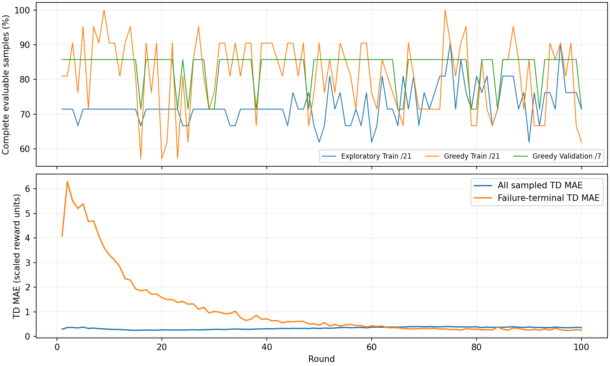
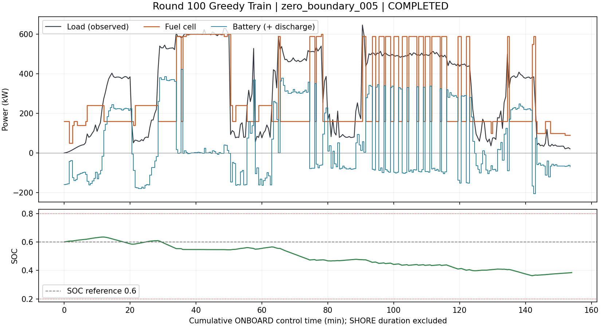
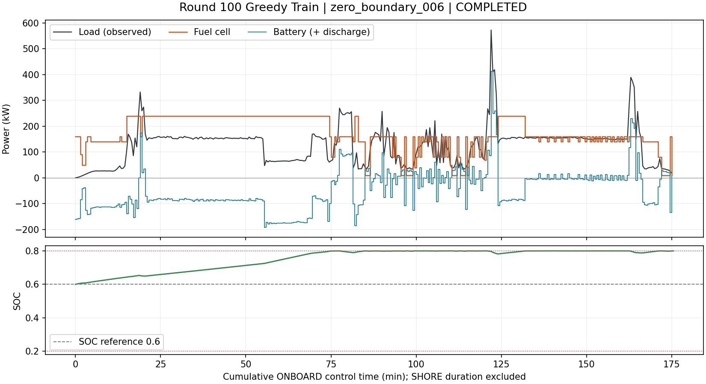
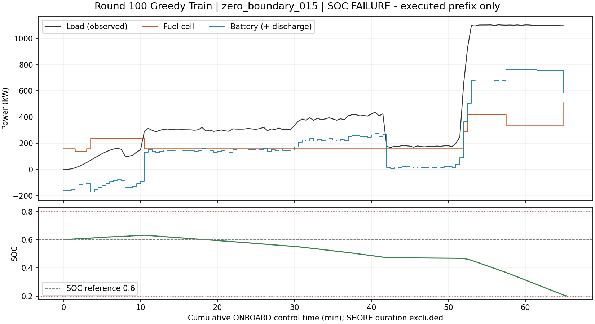
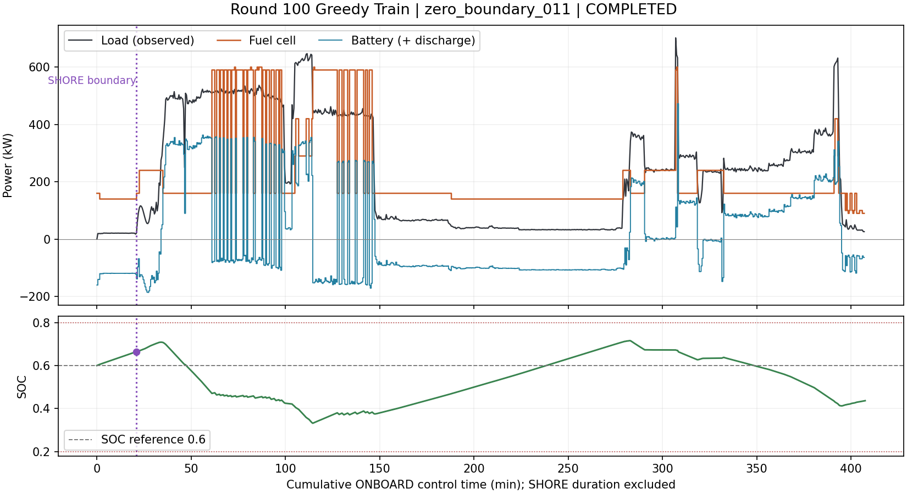

# v4 SOC参考值二次奖励：100轮训练结果分析（2026-10-11）

## 1. 数据与模型身份

- 唯一分析对象：`outputs/v4_socref060_beta200_100r_seed42/`。依据 `run_metadata.json`、`report.json` 和第100轮已归档轨迹；未重新运行策略、未读取Test。
- 训练源码：`a3746c4278369669c58f59535bc8ac9860df0b22`。100轮全部结束，末轮ε=0.05，耗时约3.18小时。`training_state_latest.pt`存在；`best_agent.pt`不存在；合格轮次为0。
- 7–128–128–61 MLP Double DQN；61个0–600 kW绝对动作；Adam 0.001，γ=1，n=8，batch64，Replay300000，replay32，软更新τ=0.001，reward_scale=0.001，失败配额2，失败惩罚倍率1，seed42。
- SOC奖励：每个实际ONBOARD动作后扣除 `200*(SOC_next-0.6)^2`；不属于真实经济费用。能量奖励重分配关闭；人工FC停机门控已删除；工况标签v3。
- 训练环境步1,176,176，预填充14,876；经济Replay插入670,498，经济优化20,953次（预填充303、正式20,650），软更新20,953次、初始硬复制1次。UNKNOWN未闭合经验舍弃515,400条。Test打开数0，manifest未改变。

## 2. 完成率：未形成稳定合格策略

评价分母为固定无UNKNOWN集合：Train21、Validation7；另有Train9、Validation1个不完整样本，不能计为正常完成或直接归为物理失败。Validation每轮均执行。

|轮次|探索Train /21|Greedy Train /21|Greedy Validation /7|Train UNKNOWN前物理失败|
|---:|---:|---:|---:|---:|
|1|15|17|6|0|
|9|15|21|6|0|
|10|15|19|6|1|
|20|15|12|6|0|
|40|15|19|6|0|
|60|13|16|6|0|
|70|16|15|6|0|
|74|17|21|6|0|
|90|13|18|6|0|
|100|15|13|5|0|

**Train仅第9、74轮完成21/21，且两轮UNKNOWN前缀无物理失败；Validation从未完成7/7，最高6/7。** 第100轮Train13/21（61.90%）、Validation5/7（71.43%），另分别有9、1个数据截断。
后10轮Greedy Train完成数：14、14、14、19、18、19、17、19、14、13，平均16.1/21。短期全完成没有持续，最后一轮也不代表最佳模型。

## 3. TD学习改善与策略改善必须分开

|指标（缩放奖励单位）|第1轮|第100轮|
|---|---:|---:|
|总体TD MAE|0.2958|0.3565|
|失败终止TD MAE|4.0828|0.2563|
|Smooth L1 loss|0.1716|0.2002|
|采样Q均值|-0.2574|-3.8890|

第100轮抽样13,824条，其中失败终止432条，正好3.125%=2/64，配额机制生效。失败终止TD MAE 0.2563换算原奖励单位约256.27，不是实际费用；总体约356.48。末轮Q范围[-11.8742,-1.2574]。
100轮最大裁剪前梯度范数2.284，裁剪次数0，未看到梯度爆炸或非有限数值的证据。总体TD误差并未持续下降。终止样本拟合变好，不能证明失败前几十至几百步的动作价值已经准确；本次没有逐轮诊断checkpoint及实际状态Q值档案，不能复原历史逐动作Q排名。

## 4. 第100轮功率与SOC

Train全部已执行ONBOARD步（含物理失败及UNKNOWN前缀）：SOC均值0.5881，范围[0.200007,0.800000]。SOC<0.4占16.58%，SOC≥0.79占23.21%。
FC均值169.37 kW，零出力8.27%，记录启动39次，平均绝对变载28.60 kW/步，最大440 kW/步。启动为现有功率转换口径，不等价于实船独立设备状态证明。
独立逐样本流式核对：动作前SOC≥0.79且FC=0共901步，**901步物理掩码都只有0，主动选择0且正功率可行的次数为0**。不能把这些停机归咎于错误Q排序。第100轮Train记录中的 `负载-FC-电池` 最大残差为0。
已执行状态没有越过硬边界，但8个Train航段耗能后无后续可行动作；这与全航段供电成功是不同指标。SOC均值接近0.6掩盖了部分区间接近0.8、另一些区间耗尽至0.2的问题。

### 四个典型Train样本

图横轴为累计ONBOARD控制时间，不包含SHORE时长；紫线表示模型岸电结算边界，不绘制虚构的岸电充电功率。失败图只保留已执行前缀，不补画未供电的后续曲线。

1. **_005：能够完成，但FC反复出现大幅跳变。** 308步，平均FC280.6 kW，相邻动作平均绝对变化60.3 kW，最大440 kW；SOC最低0.3634，终点0.3849。完成不等于平稳性达标。

2. **_006：完成但SOC贴近上界。** 351步，SOC最高0.799998，终点0.799764；二次SOC项没有把所有场景稳定维持在0.6。

3. **_015：FC长期偏低，随后SOC耗尽。** 131个有效动作后失败；整个前缀平均FC212.2 kW。最后100步负载均值510.9 kW、FC217.8 kW、电池293.1 kW，SOC从0.6123降到0.2002，100步均存在更高合法FC动作。

4. **_011：跨岸电后完成，但局部仍反复在约160与590/600 kW间切换。** 815个ONBOARD动作，SOC最低0.3323、终点0.4369。岸电边界抵港SOC高于0.6，不额外充电、出港保持该SOC，属于既定模型规则。

## 5. 失败位置及早期动作证据

末轮Train物理失败（零起算数据行）：_002[124]、_008[88]、_015[131]、_016[205]、_038[546]、_044[166]、_045[191]、_050[224]，均标记SOC受限；结构性功率失败和程序执行错误均为0。Validation为_036[102]、_047[116]，均SOC受限。_017仅在行2因UNKNOWN截断，不能继续称为本次SOC失败。

|Train样本|失败前窗口|起始→末SOC|平均负载/FC/电池 kW|存在更高合法FC的步数|
|---|---:|---|---|---:|
|_015|8|0.2831→0.2002|1098.1 / 361.3 / 736.9|8/8|
|_015|32|0.4698→0.2002|939.9 / 340.6 / 599.3|32/32|
|_015|100|0.6123→0.2002|510.9 / 217.8 / 293.1|100/100|
|_044|8|0.2388→0.2000|786.0 / 441.3 / 344.8|8/8|
|_044|32|0.3775→0.2000|779.3 / 384.7 / 394.6|32/32|
|_044|100|0.4801→0.2000|661.3 / 462.9 / 198.4|96/100|

最后有效动作：_015选510，合法集合500–600；_044选590，合法集合{590,600}。证据支持“持续电池净放电导致SOC储备下降”，而不是简单的瞬时负载超过系统功率容量。但更大动作当步合法不证明整段必然可完成，本轮未执行反事实控制或离线可行性验证。
100轮中_015失败97轮、_044失败90轮；Validation _036失败100轮、_047失败14轮。应优先单独核查_036的物理可行性和失败前决策，不能只增加轮数后假定能解决。

## 6. 经济费用：只比较相同完整集合

第9与74轮都完成同一21个可评价Train样本，可以作如下同口径比较；第100轮只完成13个，不参与该经济优劣比较。

|项目（元）|第9轮，21个完整样本|第74轮，同21个完整样本|
|---|---:|---:|
|氢耗|29,857.16|30,395.90|
|FC退化（含模型岸电边界停机）|59,767.27|72,066.15|
|电池退化（含终端模拟补能）|1,999.61|2,155.97|
|岸电购电|156.74|0.00|
|总可比经济成本|91,780.78|104,618.02|
|SOC辅助惩罚（原奖励等价单位，非费用）|44,722.21|60,210.64|

第74轮比第9轮经济成本高13.99%，主要来自FC退化；FC退化占比分别约65.12%、68.89%。两轮仍未通过Validation，不能称为合格模型。未分解FC四类退化，也未重放，因此不能将全部退化费用归因于启动。
第9轮购电156.74元全部为终端模拟补能，中途模型岸电购电为0；第74轮两类购电均为0。第100轮完成的13个Train样本仅部分集合成本36,605.92元，另有失败与UNKNOWN前缀费用，不能宣传为总费用降低。Validation末轮完成5个样本的16,924.18元同样不是完整Validation成本。其岸电购电分别为中途固定目标360.72元、终端模拟304.78元，不能冒充实测电费。
现有 `observed` 字段表示物理经济模型核算的已执行部分，不意味着实船实测交易；固定目标岸电与终端补能另列模型假设。独立失败惩罚不计入上述经济成本。

## 7. 结论与优先问题

**本次仍未达到最终Test评价条件。** 网络能产生部分可行策略，终止样本TD拟合确有改善，但没有学到跨场景稳定可行、成本与FC平稳性同时令人满意的策略。没有证据把问题简单归为梯度爆炸，也没有原奖励对照来证明此次SOC项单独造成改善或恶化。

1. 优先确认反复失败样本尤其Validation _036在当前v3任务边界下的完整可行性，再区分环境约束与策略不足；本轮仅指出需查问题，不实施新回放。
2. 定位早期功率分配与长期价值传播：_015、_044仍在更高FC合法时持续用电池，8-step直接覆盖4分钟，窗口以外依靠bootstrap传播。现有样本TD统计不能证明具体状态Q排序正确；需要今后经批准保存对应实际状态Q值。
3. 核查有效学习覆盖：515,400条UNKNOWN未闭合经验被正确舍弃，但长期靠港/低负载状态与完整航程的分布由此不同。评估边界SOC、频繁大幅变载与缺失任务进度/未来风险信息的关系，不能凭全局均值调大惩罚或扩大网络。

## 8. 分析边界

仅流式读取第100轮Train逐样本轨迹（单个样本处理后释放），读取小型汇总JSON及已有结果元数据；未整份加载大型轨迹、未加载107 MB checkpoint、未读取Test。图表为现有记录的重绘，没有新控制行为。清理工作只修订过时测试、旧入口说明及历史诊断脚本对已删除接口的引用，不修改正式算法。

## 9. 遗留接口与测试清理结果

已将相关v4测试迁移到7维状态、128–128隐藏层、Adam 0.001、61动作、已删除Outcome网络及人工停机门控的当前接口；保留真实物理失败的经济Q回放测试。补充SOC固定参考值二次惩罚、真实执行FC历史、n-step奖励只缩放一次及旧8维checkpoint拒绝加载的断言。`train.py`只更新旧入口说明，共享加载、运行与汇总函数保留。

旧`review.py`此前使用含模型岸电的历史profile字段覆盖共享汇总的`observed`分类；本次移除该冗余覆盖，保持模型岸电单列，未改变控制或费用计算。历史TD诊断脚本移除对已删除门控接口的mock。

17个v4测试文件分批复核：**207项通过、1项已知问题xfail**；Python语法解析及`git diff --check`通过。没有启动正式训练。

未解决项：仅在历史可选`redistribute_battery_energy=True`时，ONBOARD→SHORE→下一ONBOARD首步无可行动作会因末步已经完成势函数校正而触发`failure suffix is already corrected or penalized`。已添加严格xfail复现，不在本次清理中修改奖励/失败算法；本次正式运行该选项为False，因此此问题不能用于解释本次100轮失败。后续启用该选项前必须修复并验证。
