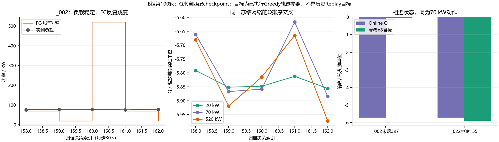

# V4 正常终止价值冲突与燃料电池跳变专项核查

## 1. 本轮结论

1. 昨天的候选确为 **Schaul 等的比例 PER：TD 误差优先抽样＋逐样本重要性权重**。保留在独立工作树 `v4-per-prep`，未删除、未改参数，尚未合并到当前训练工作树。刚完成的 B 组没有启用 PER。
2. `_002` 的大幅跳变由固定 Online 网络的动作排序产生。405个决策的复原动作与归档一致；52次超过300 kW的内部跳变中，原FC动作均仍物理可行。不存在这些跳变由动作掩码强迫的证据。
3. 已取得完整物理反事实见证：只把 `_002` 第160步的520 kW改为20 kW，后续已归档动作不变，仍完整完成405步，含终端补能的经济费用降低 **98.86元**；计入原 SOC 辅助项后，累计奖励也改善 **33.91原奖励单位**。这次孤立尖峰对已验证的原后续序列没有必要。
4. B组正常终止与中途近邻确有明显目标差。一对相近状态、相同70 kW动作的参考目标为−0.03403/−5.89193，当前Q为−5.72072/−5.71462；两者当前Huber梯度cosine约−0.9999994。这是具体的局部共享拟合干扰证据。
5. 不能把上述两项观察提升为“PER一定解决跳变”或“终止冲突是跳变的唯一原因”。保留 PER 作为采样候选；下一步分别验证共同拟合质量与实际在线可观测信息，不直接叠加平滑奖励或控制规则。

## 2. 范围、版本及证据等级

正式结果仅取 `outputs/v4_replay_ab_B_observed_seed42_100r_socmaskfix_resume30` 第100轮；旧A仅用于既有实际Replay配对证据，不混为B的Replay统计。

- 当前分支：`feat/direct-power-mlp-ddqn`，HEAD `a40afa2c8fd0a967d40d8aa30472b228232fbc0e`。
- 当前源文件SHA256：`6c39c47efac5e740d0265c1c9604b0395c4df7061c2880185ebfec53352c200f`，与B记录一致，本轮没有修改正式源文件。
- 小型诊断checkpoint：`diagnostic_checkpoints/round_100.pt`，212769字节；SHA256 `31fe324400a4d0e64bb3906fd83d4d63eade63b5e9cbedc8774ff5b3616861e9`。
- checkpoint的提交、源码hash、实验ID、超参数和数据manifest与本次元数据核对一致。Online/Target载入独立副本，未载入大型续训checkpoint或30万条Replay。
- 根据真实执行FC历史和归档当前负载复原7维状态，已有Q诊断中的状态与61个Q值最大差均为0；`_002/_006/_015`的405/351/134次实际动作及物理mask全部一致。
- 仅读取Train侧标签和归档，不读取Test。本轮未读取新的Validation轨迹，未运行正式训练、优化器或测试套件。
- 新增计算包括冻结参数前向、32对Huber梯度、两条405步固定动作序列的正式物理核算；没有将副本保存为正式策略，没有修改历史权重、Replay、日志或数据。

**单位：**Q/TD采用scale=0.001后的训练奖励单位；SOC辅助项不计入四项经济费用；反事实经济账本采用原值CNY。岸电/终端补能均为模型结算，不是实测账单。

## 3. PER保留内容与文献边界

[Schaul等，ICLR 2016，§3.3–3.4、Algorithm 1](https://arxiv.org/html/1511.05952v4)给出比例随机优先化与IS校正。候选核心为：

\[
P_i\propto (|\delta_i|+\epsilon_p)^\alpha,\qquad
w_i\propto (N P_i)^{-\beta_{IS}},\qquad
L=\frac1B\sum_iw_i\operatorname{Huber}_1(Q_i-y_i).
\]

现有候选保留原失败终止配额2：失败池沿用原均匀抽样，其余普通池才使用PER。权重按对应条件分布及共同归一化计算；这应准确称为“**比例PER＋既有失败配额**”，不是原论文不带配额的全池PER复现。默认仍为uniform；候选alpha=0.6、beta_IS=1、epsilon=1e-6均未改动。

beta_IS=1意在校正新增采样偏差。因此关键经验被抽得更多，并不意味着其期望总损失权重也同比增加；共同归一化还会改变实际梯度尺度。PER解决经验使用效率，不凭空增加缺失的状态信息或保证消除目标冲突。

候选的准备、FIFO、恢复及先前有限验证见[PER准备报告](../../v4-per-prep/docs/v4_per_sampling_preparation_2026-10-13.md)。此前探针的关键条目抽取45→186、误差8.14→8.26，不能作为控制效果已经改善的证据。本轮没有重跑该探针，也没有改变候选实现。

## 4. 正常终止：公式与局部冲突

### 4.1 未发现已核查路径的终止计算错误

- [dqn.py](../src/v4/dqn.py) 的 `masked_double_dqn_targets` 对真正done禁止bootstrap；`remember_trajectory`在真实结束处截断n8，先累计原奖励，再在`remember`中缩放一次。
- [control.py](../src/v4/control.py) 的 `replay_episode`先计区间费用和SOC辅助项，岸电费用附着前一真实动作；同样本岸电后继续ONBOARD时保持非终止，样本真正结束时才done。
- UNKNOWN前未闭合尾窗不是成功终止，不造后继或补能。真实供电失败继续独立终止并计一次失败训练惩罚。

末端目标只包括当前位置之后尚未发生的费用，而不是此前已发生的整条航程费用。正常末端目标接近0本身不是错误。

第100轮报告中，**跨399次实际更新抽到的262个正常终止采样位置**全部绝对TD>1，MAE4.54357；其跨更新时点均值Q−4.63904、目标−0.09546。它不是一个batch，也不是本轮最终全Replay快照。

### 4.2 最新B冻结模型的Greedy参考检查

流式读取第100轮Train归档，每次只处理一个样本，复原实际状态；按当前同一Online/Target快照计算已执行后续的8步参考目标。有效非终止窗口要求真实后继已观测。

**这些是Greedy轨迹参考目标，不是本轮实际存入Replay的tuple，也不是历史更新时的目标。**

| 指标 | 结果 |
|---|---:|
| 有效参考窗口 | 12780 |
| 正常终止参考窗口 | 136（17个完成样本×8） |
| 失败终止参考窗口 | 32（4个物理失败样本×8） |
| 非终止参考窗口 | 12612 |
| 正常终止Q均值 | −5.23523 |
| 正常终止目标均值 | −0.05743 |
| 正常终止参考TD MAE | 5.17781 |
| 跨样本、同动作最近配对中：SOC差≤0.01，六个功率特征差各≤10 kW | 83/136 |

最近的一对：

| 量 | `_002`决策397：末端n8窗口 | `_022`决策155：中途n8窗口 |
|---|---:|---:|
| 当前SOC | 0.5764913 | 0.5768068 |
| 执行动作 | 70 kW | 70 kW |
| 当前负载 | 35.47143 kW | 35.22378 kW |
| n8实际奖励和（缩放） | −0.0340335 | −0.0161208 |
| bootstrap | 0 | −5.8758121 |
| 当前参考目标 | −0.0340335 | −5.8919329 |
| 当前Q | −5.7207208 | −5.7146153 |
| 残差y−Q | +5.6866873 | −0.1773175 |

两个输入SOC仅差0.0003155，六个功率特征最大差1.4293 kW。当前Huber梯度范数分别12.29524、2.17877，内积−26.78847、cosine−0.9999994。改善其中一个损失的局部方向会损害另一个；梯度统计仅属单条独立诊断，不是正式batch梯度爆炸。

检查最近32对，**只有10对当前梯度为负内积**。其余22对当前更新方向同向；不能因目标不同就声称所有更新正在互相抵消。Adam实际更新还受矩估计影响，梯度内积不是Adam更新的精确效果公式。[Bengio等，ICML 2020，Eq.1、§2.1](https://proceedings.mlr.press/v119/bengio20a/bengio20a.pdf)提供这类诊断依据，没有证明本船所有误差均由干扰造成。

旧A实际Replay已有5336个末端最近配对，完全相同float32状态＋动作的混合组为0；其中131对满足SOC/功率差≤0.001/1 kW。这是相近状态的分离困难，不是相同输入对应两种确定真值的不可解证明。旧导出CSV仅30个最近例子，不能冒充全集。

### 4.3 需要区分任务终点与观测切片

当前7维没有任务时域/阶段信息；零功率边界来自数据切片，不等同于在线已知业务终点。若研究目标确为有限样本费用＋末端补能，done规则合理，但状态可能不能区分末端和中途。若研究目标是持续运营，则需要真实后继与业务终止定义，不能凭空复制末状态bootstrap。

[Pardo等，Time Limits in Reinforcement Learning，§2–3](https://arxiv.org/html/1712.00378v1)支持上述区分。论文不授权向策略提供Validation真实剩余行数或未来负载。固定已知期限下elapsed clock可以表示时间；不同且未知的样本期限下，仅elapsed time也不等价于剩余时间。

因此，“补足真实在线可观测任务信息”是有依据的待验证方向，**不是直接添加离线row/N或事后终点标志**。本轮没有修改状态、done或任务定义。

## 5. FC跳变：实际Q排序与经济费用

### 5.1 固定参数仍发生动作排序交叉

`_002`第159～161步负载约78.27、78.21、75.66 kW，执行FC为20→520→70 kW，当前mask均有61动作。整个Greedy过程网络参数固定，不能把这些跳变解释为执行期间网络持续更新。

| 决策索引 | 跳变 | Q_selected−Q_previous | 最大Q与次大Q差 | 当前费用比保持原FC高 |
|---|---|---:|---:|---:|
| 160 | 20→520 kW | +0.0329704 | 0.0109510 | 61.37645元 |
| 161 | 520→70 kW | +0.0479512 | 0.0479512 | 43.42806元 |

`Q(520)−Q(20)`从决策159的−0.0675621变成160的+0.0329704；执行520后，含真实FC历史/差分的新状态使70排到前面。固定网络对闭环历史状态形成交替动作偏好。

52个超过300 kW的跳变，最大/次大Q差中位数0.0166447，17个小于0.01，最小约0.0000429。小优势不等于置信区间，但说明较小的动作价值估计差就可以造成数百kW的变化；不能把这些排名视为已经精确拟合的长期经济优势。

### 5.2 费用已计入，当前参考Bellman排序也有偏差

第160步，520 kW的费用63.19910元（H2 5.06741、FC退化56.59250、电池1.53919）；保持20 kW为1.82266元。520带来的SOC辅助项略低，但计入辅助项后即时缩放奖励仍比20差0.0608126。

同一快照的**离线单步参考目标**，使用下一已观测负载和正式物理核算：520为−5.86249、20为−5.75730，偏好20约0.10519，而Online当前偏好520。第161步同类参考也偏好保持520约0.02649，Online偏好70。这里的单步目标不是正式n8Replay目标，也不代表最优全航程反事实。

按原实际执行的8步后续计算，第160/161步参考残差为−0.24749/−0.47705。它们同样不是历史抽样目标；不能给未执行的替代动作捏造8步奖励。

### 5.3 完整固定动作序列的反事实见证

只用Train `_002`，标签405行均ONBOARD，标签SHA256与manifest一致。通过正式 `replay_episode` 执行两条固定序列，限定810个物理区间：

- 基线：全部原归档FC动作。
- 反事实：只在第160步把520改为20，之后FC命令保持原归档值；不是重跑DDQN，也不是新的在线保持规则。

基线逐步SOC、reward、经济账本及终端账本与归档最大差均为0；两条序列每步均通过物理mask及SOC/电池功率检查。

| 指标 | 基线 | 单点反事实 | 变化 |
|---|---:|---:|---:|
| 完整执行 | 405步 | 405步 | 同一完整样本 |
| H2费用 | 1109.82 | 1105.15 | −4.67元 |
| FC退化费用 | 4287.11 | 4187.68 | −99.42元 |
| 电池退化（包括终端充电） | 141.02 | 141.61 | +0.59元 |
| 终端岸电购电 | 13.98 | 18.63 | +4.64元 |
| 可比四项经济总额 | 5551.92 | 5453.07 | **−98.86元** |
| SOC辅助项原奖励等值 | 1535.38 | 1600.32 | +64.95 |
| 总原训练奖励 | −7087.30 | −7053.39 | **+33.91** |
| 最小SOC | 0.307236 | 0.307236 | 不变 |
| 实际终端SOC | 0.580645 | 0.574222 | −0.006423 |
| 内部FC变化>300 kW | 52 | 50 | −2 |

末端补能费用17.73983→23.77908元已经包含于上述费用，没有免费消耗末端电量。辅助项单独核算，没有冒充经济费用。

这证明**存在更好且可行的同负载动作序列**，不是只有瞬时成本更低。但没有证明真实最优Q必然满足Q*(20)>Q*(520)：520可能存在另外更好的后续控制，且改变实际状态后DDQN会重新选择其他动作。不能把此反事实序列部署成动作覆盖或训练参考标签。

### 5.4 高SOC的受迫与主动行为

`_006`有53次内部动作变化时，原FC功率已因SOC上界而不合法，需要降低出力；不能把全部变化判为网络异常。3个FC=0动作均有正功率可行，但保持正功率并非一定费用更高，例如某些状态停机的即时变载成本比保持正功率高。

B的高SOC零动作Q并非始终最低，也不能沿用旧A的该结论。仅把真实Q、可行性与完整费用分开分析，本轮未设“高SOC强制停机”规则。

## 6. 有依据的最小解决路径

| 顺序 | 具体动作/候选 | 文献与本项目证据 | 验收及副作用 |
|---|---|---|---|
| 1 | 保留现有PER候选，独立验证共同拟合；不同时变更奖励、状态、Batch或更新预算 | Schaul §3.3–3.4；关键来源稀疏和局部较大残差 | 同样初始网络、数据、种子和更新预算；按类别/来源报告实际抽样、IS权重、未加权留出TD与Q排序；若只多抽样而拟合/控制不改善，不能宣称有效 |
| 2 | 明确有限任务结束与数据边界，审查能否提供真实可观测任务信息 | Pardo §2–3；本轮相近状态目标差5.86及负梯度 | 若有运营计划/已观测航行信息，单独验证其减少目标混合的作用；未知剩余长度不得输入。影响状态/checkpoint，需单独确认 |
| 3 | 只有在采样和信息明确后，单变量研究有效更新预算及稳定性 | [Fedus等，ICML 2020](https://proceedings.mlr.press/v119/fedus20a.html)区分replay ratio/容量；以前单纯增加拟合损伤其他类别 | 维持相同经验和奖励，固定优化次数对照；不能用更低TD替代完整成功率和费用，不同步改学习率/Target/网络 |
| 4 | 若已证实局部观测无法区分未来风险，研究因果历史表示 | [Hausknecht与Stone，DRQN](https://arxiv.org/abs/1507.06527)支持从已观测序列处理部分可观测性 | 本船是否受益未验证；不是本轮切换LSTM、改变状态或启用预测模块的依据 |

诊断实验方法参照[Fu等，ICML 2019](https://proceedings.mlr.press/v97/fu19a.html)分离采样、逼近与目标变化；目前不支持一次同时改多个超参数。PER的beta_IS=1及归一化权重需与有效更新强度一起记录，不能把更多采样简单等同于更多优化力度。

**下一轮受控训练（本轮未启动）：**若先验证PER，则复用已完成B为历史参照，只新增显式PER组，保持7–128–128–61、Adam0.001、gamma1、n8、batch64、replay32、tau0.001、SOC beta200/ref0.6、scale0.001和配额2，从新权重/空池开始。只能使用PER工作树中已接好的入口；主工作树尚没有PER参数，不能直接给它追加该参数。候选加载器会拒绝缺少PER配置和优先级状态的旧checkpoint；本次对照协议也不把切换采样语义后的B续训当作同条件从头训练。这是当前实现及实验边界，不是算法上永远不能迁移。

验收同时包括：固定Train21/Validation7的完成率、UNKNOWN前物理失败、同一完整集合的四项经济费用、FC平均绝对变化/大跳变/真实启停、SOC边界占比，以及正常末端、失败前缀、UNKNOWN窗口的抽样和未加权TD。以多随机种子检查后期稳定性；不使用Test，不改变原模型资格。

## 7. 本轮交付与限制

新增本报告和小型[诊断附件目录](results/v4_terminal_jump_followup_20261013/)：

- `terminal_reference_summary.json`：B冻结Greedy参考目标统计及限制。
- `terminal_reference_pairs.csv/json`：最近32对状态、目标、Q及梯度证据。
- `fc_jump_checkpoint_probe.json`：匹配网络Q、实际mask、单步/实际n8参考。
- `fc002_fixed_sequence_counterfactual.json`：正式物理环境固定序列见证及独立经济/奖励账本。
- `q_crossing_terminal_conflict.png`：一个诊断图，未重复保存所有轨迹。

本轮没有正式算法修改、合并PER、提交推送或正式重训。**核查已完成，不表示FC跳变已经修复。**已取得比“长期传播慢”更具体的动作价值偏差与局部拟合干扰证据；下一步应让价值学习质量决定改动，而不是用人工运行规则制造曲线。
