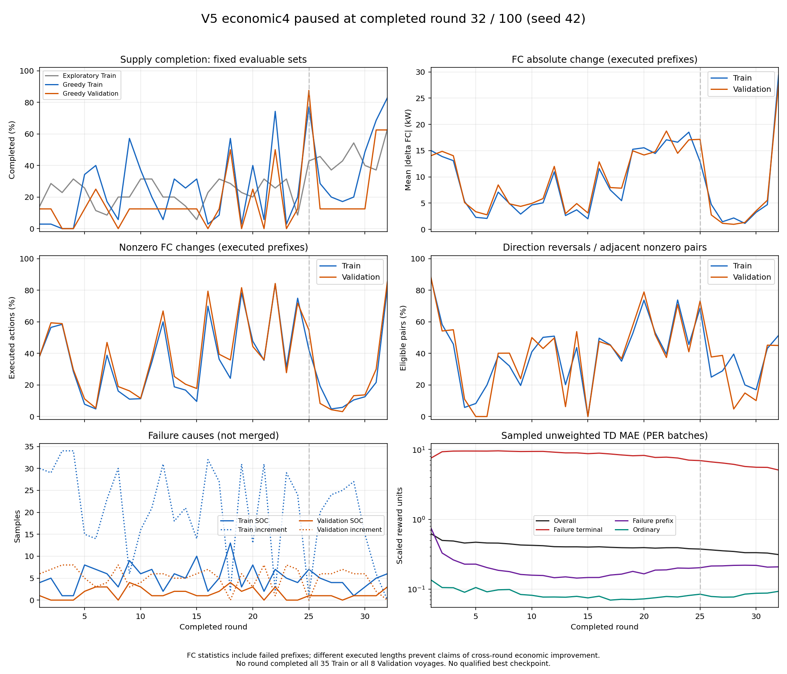
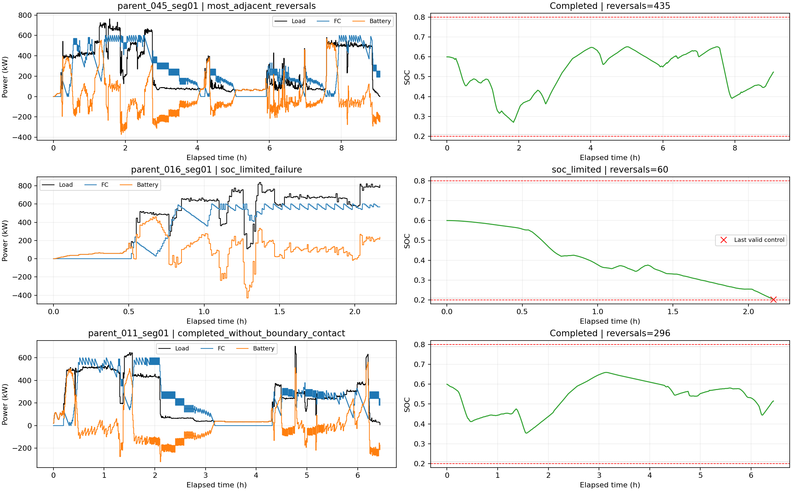

# V5第32轮暂停分析（2026-10-21）

## 结论与操作状态

**完成率曾提高，但频繁反向变载和SOC受限失败仍未解决；按用户条件暂停，不继续训练。**

- 分支：`feat/v5-economic4-ddqn`；训练源码HEAD：`34712730a4423baad09549d96e261c2f2a8de028`。
- 运行：`outputs/v5_economic4_delta7_td1_per_interleaved_seed42_100r_20261021_165354_083`；实验ID：`V5-ECON4-DELTA7-TD1-PER-INTERLEAVED-S42`。
- 已确认对应`v4.feedback_study`进程PID **28936**退出。该后台进程没有独立主窗口，无法安全向其单独发送控制台中断；先复制并验证完整checkpoint，再仅终止该PID。其他进程未处理。
- 权威完整checkpoint为**第32轮**。日志末尾已进入第33轮Greedy Train，但该轮未完成、未提交checkpoint，不混入分析。
- 本次只分析已有Train/Validation产物和冻结权重前向；没有训练、环境重放、Test访问或算法改动。

## 1. 有改善吗

|完整轮次|Greedy Train|Greedy Validation|Validation平均绝对FC变载 kW|Validation非零变载时间比例|
|---:|---:|---:|---:|---:|
|25|27/35|7/8|17.148|54.872%|
|31|24/35|5/8|5.535|29.967%|
|32|29/35|5/8|27.665|85.326%|

第32轮Train达到本次最高29/35，但Validation从第25轮7/8回落为5/8；第31轮短暂较低的变载在下一轮大幅回升。**不能据单轮完成率提高宣称收敛或控制效果改善。**

32个完整轮次中没有Train35/35、没有Validation8/8，没有合格checkpoint，`best_checkpoint=null`，未生成可用于最终评价的`best_agent.pt`。第25轮只是Validation完成数最多，并非合格最佳模型。此次只运行至32/100轮，不表述为已完成100轮实验。

## 2. 第32轮问题的量级

|Greedy指标（包含实际执行的失败前缀）|Train|Validation|
|---|---:|---:|
|完成|29/35|5/8|
|SOC受限失败|6|3|
|增量动作不可达失败|0|0|
|已执行决策步|12333|3423|
|平均绝对FC变载（按区间时长加权），kW|29.404|27.665|
|非零变载时间比例|81.442%|85.326%|
|连续方向反转/相邻非零动作组|5132/9988|1305/2900|
|反转比例|51.382%|45.000%|
|FC启动次数|94|34|
|最小SOC|0.200465|0.200830|
|最大SOC|0.663369|0.659236|

反转指同一样本内相邻两个实际增量异号，保持动作打断相邻关系，不跨航段。逐步算术平均与时长加权值略有差异：Validation为27.683与27.665 kW；末尾不足30秒区间导致差异，不能混用口径。

没有SOC长期贴近上限的证据：所有最新Greedy样本`SOC>=0.79`累计时长均为0。`SOC<=0.21`的已执行区间累计Train540秒、Validation300秒，占各自观测时长0.146%和0.292%；最长连续低SOC区间分别240秒和120秒。**占比低并不表示安全**，部分轨迹很快因下步无可行动作而终止，不能将失败后的缺失时间当作安全运行时间。

末轮失败位置（正式程序0基row）：

- Train：`parent_008_seg01` 74，`parent_010_seg02` 228，`parent_015_seg01` 136，`parent_017_seg01` 125，`parent_036_seg01` 85，`parent_050_seg01` 271。
- Validation：`parent_002_seg01` 111，`parent_016_seg01` 261，`parent_044_seg01` 181。

这些是当前控制路径的SOC受限失败，不等于完整航段物理上无解；本次没有重新求可行见证。历史其他轮次仍有增量不可达失败，已在逐轮CSV中单列，未归为SOC学习失败。

## 3. 三条典型Validation航段

- `parent_045_seg01`：完成，但1090步中950步变载，连续反向435次、启动14次；FC退化9499.41元，完整Zhou成本12632.60元。即使完成供电，也没有实现平稳基础负荷控制。
- `parent_016_seg01`：执行261步后SOC约0.20192，下步无可行动作。高负载阶段SOC持续下降，同时仍有60次连续反向。已执行前缀费用不是完整航段成本。
- `parent_011_seg01`：完成、SOC约0.354～0.659，但774步中615步变载，连续反向296次，完整Zhou成本6520.08元。SOC没有贴边也仍出现频繁变载。

上述不同航段的费用仅描述各自运行，不能跨负载、跨长度直接排名策略经济性。

## 4. 经济账本与Q证据

第32轮Validation已执行账本（含3条失败前缀）为：实际氢耗9171.55元、有符号电池等效氢耗1090.64元、FC退化26529.11元、电池退化1238.57元，合计38029.87元；FC退化占69.759%。独立失败训练惩罚30397.98原始奖励单位另列，不算真实经济支出。

该合计**不是固定8条完整Validation经济成本**。所有轮次固定完整集合的可比较成本均为空，因此不以不同完成集合的合计判断成本是否改善。最新完整航段四分项与Zhou评价最大对账差小于1e-12元；奖励与经济账本符号及一次失败惩罚对账误差小于2e-12原始单位，没有发现本次轨迹中的重复经济收费。

已保存的第30轮正式动作对诊断仍显示价值排序问题：Validation抽取20个“实际变载且保持合法”的真实状态，即时奖励20/20劣于保持；13/20状态Online偏变载而冻结一步DDQN目标偏保持，其余7/20连冻结目标也偏变载。Train对应79对有48对排序矛盾。数据见`saved_action_pairs.csv`。

该结果来自每样本最多16点的确定性有限抽样，**不是第32轮全状态比例**，也不是最优Q真值或完整反事实回报。它支持“仅改纯经济奖励并未自动消除价值排序异常”；不能据此唯一归因于PER、学习率、Target滞后或状态不足。本次不擅自改变任何一项。

第32轮冻结权重的CPU/eval前向复现了全部3423/3423个Validation实际贪心动作。在2921个“实际变载且保持合法”状态中，Online/Target最佳动作不一致2434个（83.33%）；变载相对保持的Q优势中位数0.08999，最优/次优Q间隔中位数0.01121、P95为0.05175（均为缩放后训练单位）。间隔低于0.001的仅208/2921（7.12%），因此不能把所有振荡一概解释为微小数值并列。前向证据说明策略确实主动选择这些动作，尚不能把Target当作正确Q，也没有提供第32轮逐状态真实长期反事实收益。

第32轮实际更新批次的未加权TD MAE为0.31127；其中失败终止696次抽样的MAE为5.07937、正常终止70次抽样为0.70161（缩放后训练单位，含重复抽样，不是独立留出误差）。PER加权Loss仅0.00011673，不能将小Loss误报为价值已收敛，也不能据此声称Adam没有更新。

## 5. 更新机制及保存状态

|同一运行、同一完整范围|真实环境步/Replay插入|Adam更新|Target软更新|UTD|
|---|---:|---:|---:|---:|
|Bootstrap|14995|468|468|0.0312104|
|正式32轮|232838|7276|7276|0.0312492|
|总计|247833|7744|7744|0.0312468|

Greedy评价277009步另列，不进入训练UTD。正式更新7246次来自航段内部回调、30次来自失败终止收尾，航段结束集中更新0次；初始Target复制1次，剩余credit25。交错更新确实接入，但接入不等于策略收敛。

保留全部7个`.pt`文件：原`training_state_latest.pt`、停止前备份、只读第32轮小权重，以及第1/10/20/30轮诊断权重。原续训文件约68.01 MB，备份SHA256完全一致：`a58f10d61f8af4e7193c3e86e4a7ce96b7564b3661018b4ff6f9cc49a7afaa6e`。具体路径、身份及校验见`pause_checkpoint_identity.json`和清理清单。

严格恢复校验包括源码HEAD。本次文档归档提交会改变分支HEAD；未来若恢复这份checkpoint，需使用其原源码提交`34712730...`对应的隔离工作树，不能修改checkpoint身份或将其加载到不同算法配置。本次不恢复训练。

## 6. 归档与轨迹清理范围

证据目录：[v5_economic4_paused_20261021](results/v5_economic4_paused_20261021/)。包含32轮报告/计数、43样本明细、3张典型航段数据及组合图、保存的动作对Q/TD诊断、压缩指标和日志。

最新43条Greedy轨迹另存为`round032_greedy_steps.csv.gz`，保留逐步state/next_state、动作/mask、SOC、成本/奖励及冻结Online/Target全部7动作Q值；这些Q值仅由对应第32轮真实权重CPU/eval前向获得，不经过学习。删除原JSON后仍可读取这些CSV.gz分析最新轮次。

清理仅针对上述唯一V5运行目录的97份`round_*_trajectories.json`，共1,900,303,562字节（约1.90 GB/1.77 GiB），包括未闭合第33轮探索轨迹。**提交推送归档后才删除**，其他实验、全部checkpoint/Replay、数据集、代码、原报告/指标/日志均保留。明细见`trajectory_cleanup_manifest.json`，实际执行结果见后续`trajectory_cleanup_receipt.json`。

早期逐步完整轨迹没有全部提交Git；清理后不能从Git恢复已删除的原JSON。已有逐轮汇总和诊断点保留，最新Greedy逐步数据以CSV.gz保留。本次不把Git推送描述为大型训练输出的完整云备份。

## 7. 后续判断

当前最应保留的结论是：完成率尚不稳定，FC反向振荡及SOC储备不足仍在，暂无合格最终模型。此次完成暂停、证据保全、归档及清理；没有证据支持立即继续加轮数或一次更改多个因素。下一项算法改动需要依据已保存的Q/TD动作对及同一初态反事实区分，另行确认，本次不实施。
